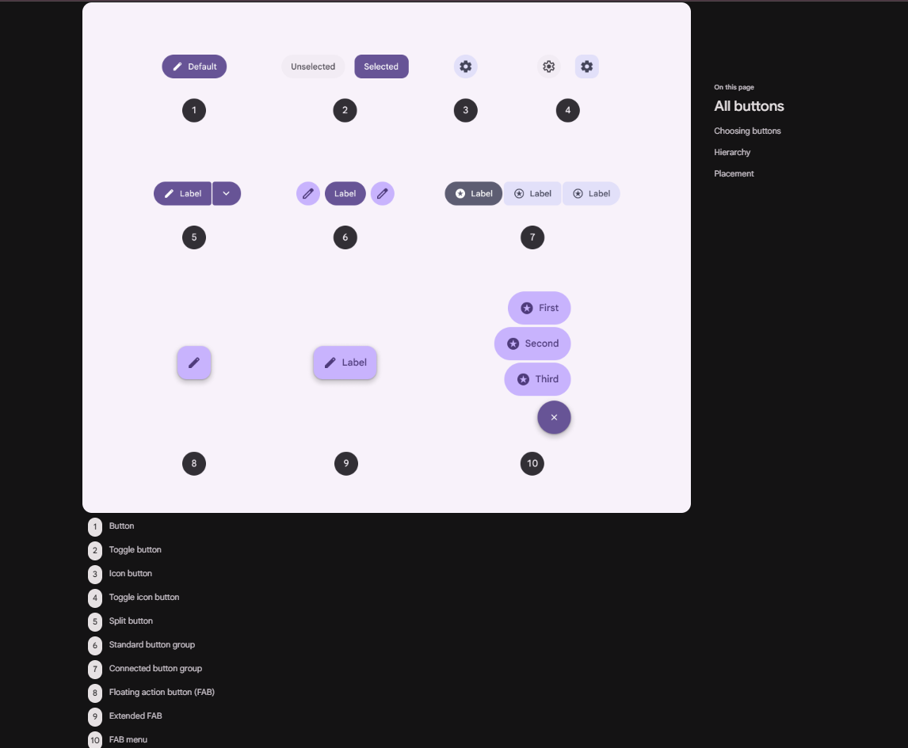
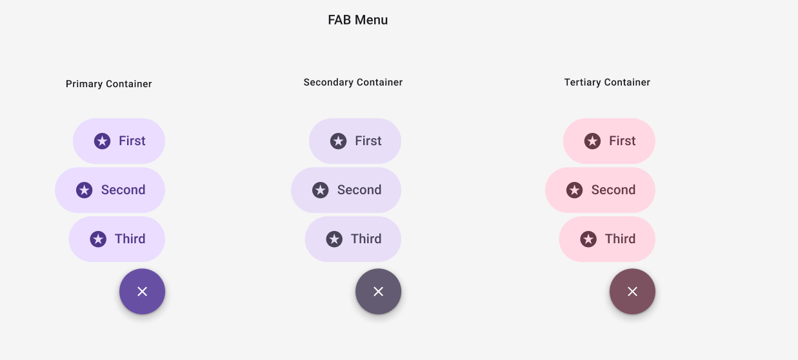
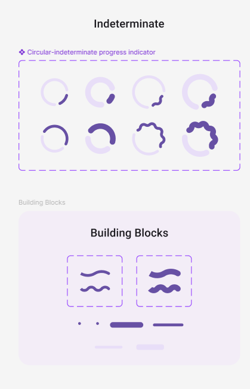
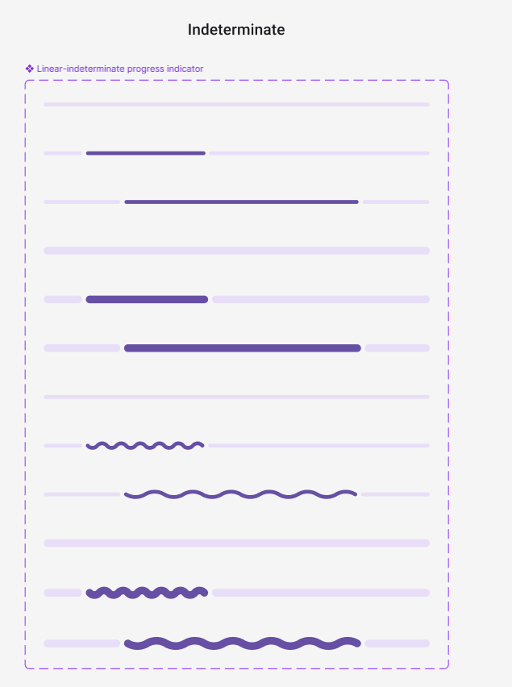

# Material 3 Expressive Skill

An AI agent skill that teaches coding assistants how to correctly implement Material Design 3 Expressive (M3E), Google's 2025 UI language, instead of defaulting to flat, generic Material UI.

Most AI systems get M3E wrong: static progress bars instead of wavy ones, plain spinners instead of the 7-shape morphing loader, sharp corners instead of squircles. This skill gives agents the specs to get it right the first time.

## What it covers

- Wavy progress bar geometry (linear and circular, determinate and indeterminate)
- 7-shape morphing loader
- Squircle icon buttons and connected button groups
- FAB menu containers and morph behavior
- Spring-based motion and easing curves
- Much, much more.

| | |
|---|---|
|  |  |
|  |  |

## Install

**macOS / Linux**
```bash
curl -fsSL https://downloads.paymind.online/install-material-3-expressive-skill.sh | sh
```

**Windows**
```powershell
irm https://downloads.paymind.online/install-material-3-expressive-skill.ps1 | iex
```

You can check the scripts before running them: [`.sh`](https://downloads.paymind.online/install-material-3-expressive-skill.sh) / [`.ps1`](https://downloads.paymind.online/install-material-3-expressive-skill.ps1)

## Usage

Just ask your agent to use it. Or use the /command: /m3e 

Works with:
- Claude code
- Codex
- Gemini CLI
- And more (must use .agents/skills as the skill directory.)

Tested with: Claude Code
