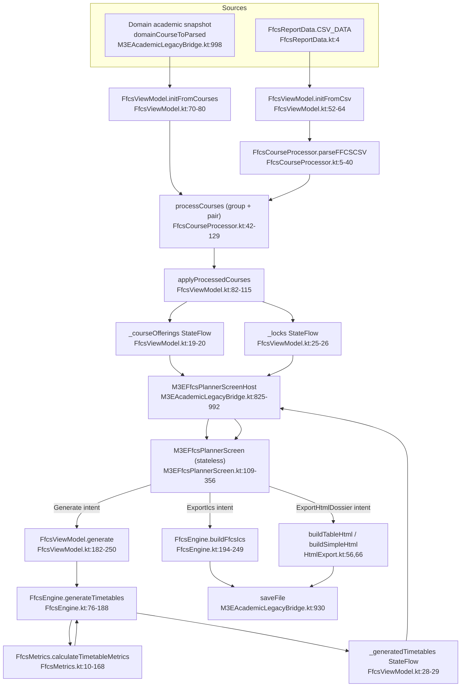

# FFCS Planner architecture

> **In one line:** a CSV row (an **ingredient card**) is parsed into a course, the view model takes the order, the engine cooks clash-free variants, and the host plates them onto the screen and hands the finished ICS or HTML to the phone.

## Plain English before technical

Picture a restaurant.

- The **source** is the pantry: a fixed CSV string in the app, or (when synced) the student's real academic snapshot.
- The **processor** reads the ingredient cards and groups them into menu items (offerings).
- The **view model** is the head chef: it holds the current order (selected courses, locks, blocked slots) and decides when to start cooking.
- The **engine** is the kitchen: it tries combinations of offerings, throws away any where two classes land on the **same day with overlapping time windows** (a **clash** — the student cannot attend both, even in different rooms), then ranks the survivors.
- The **screen** is the menu card the customer sees. It is deliberately dumb: it shows state and sends intents.
- The **host** is the waiter: it owns real-world effects like saving a file.

Two words used below: an **offering** is one concrete choice for a course (teacher + slot + room); a **variant** is one complete clash-free week. A **lock** is the student's "only this offering" note.

## What → why → how

**What.** One singleton view model sits between a stateless Compose screen and a pure generation function. No network call happens in the generation loop; the whole planner is local.

**Why.** Keeping the screen stateless makes it previewable and testable, and keeping the engine free of Compose makes ranking deterministic. The running app still throws plain exceptions instead of returning typed failure codes; wave 1 ported the typed codes and drop policy as a library (D-175), and wave 3 must wire them in.

**How.** Follow the diagram, then the stage table, then the sequence.

---

## The whole data flow



## Stage by stage, with real code

| Stage | Component | What it does | Real source file:line |
|---|---|---|---|
| 1. Source | `FfcsReportData` | Holds the embedded CSV; header at line 4. | `FfcsReportData.kt:3-4` |
| 2. Load | `FfcsViewModel.initFromCsv` | Reads `CSV_DATA`, parses, re-processes, publishes. | `FfcsViewModel.kt:52-64` |
| 2b. Load (real data) | `initFromCourses` + `domainCourseToParsed` | Prefers the synced snapshot; CSV is the fallback. | `FfcsViewModel.kt:70-80`, `M3EAcademicLegacyBridge.kt:846-855,998-1009` |
| 3. Parse | `parseFFCSCSV` | Quote-aware split; needs at least 7 columns. | `FfcsCourseProcessor.kt:5-40` |
| 4. Group | `processCourses` | Merges L/P codes and theory+lab halves by faculty. | `FfcsCourseProcessor.kt:42-129` |
| 5. Publish | `applyProcessedCourses` | Builds offerings and one `CourseLock` per code. | `FfcsViewModel.kt:82-115` |
| 6. Project | Legacy bridge host | Maps offerings/view-model state into `M3EFfcsPlannerState`. | `M3EAcademicLegacyBridge.kt:857-909` |
| 7. Render | `M3EFfcsPlannerScreen` | Three tabs; emits `M3EFfcsPlannerAction` intents. | `M3EFfcsPlannerScreen.kt:45-102,109-356` |
| 8. Generate | `FfcsViewModel.generate` | Snapshots inputs, builds `optionsPerCourse`, calls engine. | `FfcsViewModel.kt:182-250` |
| 9. Search | `FfcsEngine.generateTimetables` | Filters, backtracks, scores, sorts. | `FfcsEngine.kt:76-188` |
| 10. Metrics | `FfcsMetrics` | Half-days, gaps, dashes, long-weekend flag. | `FfcsMetrics.kt:10-168` |
| 11. Export | Host + `buildFfcsIcs` + `HtmlExport` | Writes `.ics` and `.html` through the platform file saver. | `M3EAcademicLegacyBridge.kt:924-979`, `FfcsEngine.kt:194-249`, `HtmlExport.kt:56,66` |

### Stage 2 — the head chef takes the order

```kotlin
// FfcsViewModel.kt:52-64 — annotated line by line
fun initFromCsv() {                                       // Entry point used when no domain data is synced.
    scope.launch {                                         // Work moves off the UI thread (Dispatchers.Default, line 15).
        _isLoading.value = true                            // Screen shows "Loading course catalog...".
        try {
            val csvText = FfcsReportData.CSV_DATA          // The pantry: one embedded string.
            val parsed = FfcsCourseProcessor.parseFFCSCSV(csvText) // Ingredient cards → ParsedCourse rows.
            applyProcessedCourses(FfcsCourseProcessor.processCourses(parsed)) // Group, then publish.
        } catch (e: Exception) {
            _errorMsg.value = "Failed to load courses: ${e.message}" // Honest failure text, no fake data.
        }
        _isLoading.value = false
    }
}
```

<Note>
`processCourses` is called twice on the CSV path: once inside `parseFFCSCSV` (`FfcsCourseProcessor.kt:39`) and once directly in the view model (`FfcsViewModel.kt:58`). The second pass is effectively idempotent but unnecessary work.
</Note>

### Stage 8–9 — generation and the clash rule

```kotlin
// FfcsEngine.kt:139-144 — the backtracking heart, annotated
if (!periodsOverlap(periods, currentPeriods)) {   // Reject the offering if any period clashes with what is already placed.
    currentCombo.add(opt)                         // Otherwise keep this dish on the plate.
    val newPeriods = currentPeriods.toMutableList().apply { addAll(periods) } // Grow the occupied-time list.
    backtrack(courseIndex + 1, currentCombo, newPeriods) // Move to the next course.
    currentCombo.removeLast()                     // Undo the choice so the next candidate starts clean.
}
```

The private `periodsOverlap` (`FfcsEngine.kt:55-64`) applies the "same day and `max(start) < min(end)`" rule — the room is irrelevant. An equivalent version lives in `domain/Slots.kt:243-255`, and wave 1 ported the canonical campus schema and clash algebra as `FfcsSlotSchema` (`FfcsSlotSchema.kt:65-88`, D-172). The running engine still uses its private copy until wave 3 integration.

### Stage 11 — the waiter saves the file

| Export | Screen action | Host handler | Producer | Saved file |
|---|---|---|---|---|
| Calendar | `ExportIcs` (`M3EFfcsPlannerScreen.kt:98,261`) | `M3EAcademicLegacyBridge.kt:924-937` | `FfcsViewModel.exportIcs` → `FfcsEngine.buildFfcsIcs` (`FfcsViewModel.kt:252-254`, `FfcsEngine.kt:194-249`) | `amazecc-ffcs.ics` |
| HTML dossier | `ExportHtmlDossier` (`M3EFfcsPlannerScreen.kt:99,287`) | `M3EAcademicLegacyBridge.kt:938-979` | `buildTableHtml` / `buildSimpleHtml` (`HtmlExport.kt:66,56`) | `amazecc-ffcs-dossier.html` |

The host never invents data: the dossier is built from the selected generated variant's courses, or falls back to the real selected-course strings when nothing has been generated yet (`M3EAcademicLegacyBridge.kt:941-968`).

---

## Generation as a sequence

```mermaid
sequenceDiagram
    participant U as Student
    participant S as M3EFfcsPlannerScreen
    participant H as M3E bridge host
    participant VM as FfcsViewModel
    participant E as FfcsEngine
    participant M as FfcsMetrics

    U->>S: tap Generate (RESULTS tab)
    S->>H: onAction(Generate)
    H->>VM: generate()
    VM->>VM: snapshot selected codes, locks, blocks, options
    VM->>VM: build optionsPerCourse; throw if any course has none
    VM->>E: generateTimetables(...)
    E->>E: apply locks and blocked slots (FfcsEngine.kt:91-110)
    E->>E: backtrack; reject clashes (FfcsEngine.kt:116-148)
    E->>M: calculateTimetableMetrics (FfcsEngine.kt:170)
    M-->>E: TimetableMetrics
    E-->>VM: sorted List<TimetableState> (FfcsEngine.kt:182-187)
    VM-->>H: _generatedTimetables StateFlow (FfcsViewModel.kt:243)
    H-->>S: results mapped to M3EFfcsResult (M3EAcademicLegacyBridge.kt:874-889)
    S-->>U: ranked variant cards
```

---

## Where the wave-1 library ports sit — and what wave 3 must wire

The drift register now marks D-171…D-176 as **"PORTED - not integrated"** (`docs/WEB_PARITY_DRIFT_REGISTER.md:355-360`). The library files below exist; the running app still uses the legacy path shown in the flowchart above. Wave 3 is the integration step.

| D-ID | Wave-1 library file (exists now) | Legacy code the app still uses | What was ported | Status |
|---|---|---|---|---|
| D-171 | `ffcs/planner/FfcsPlannerModels.kt:7-29` | `FfcsModels.kt:5-98` | Canonical UPPERCASE models with `CLASS_ID`, `ERP_ID`, and "absent ≠ zero" scores. | Not integrated. |
| D-172 | `ffcs/FfcsSlotSchema.kt:65-88`; `utils/TimeMath.kt` strict entry point | `FfcsEngine.kt:39-64` and the heuristic `TimeMath.toMinutes` (`TimeMath.kt:32-51`) | Strict clock parse, both spellings, exact-interval clash. | Not integrated. |
| D-173 | `ffcs/FfcsRanking.kt:11-40` | The three-boolean comparator at `FfcsEngine.kt:182-187` | Both ranking combiners, raw factor accumulation, golden values 60/55/70/0 and 52.1. | Not integrated. |
| D-174 | `ffcs/FfcsFacultyPriority.kt:5-25`, `ffcs/FfcsFacultyRanking.kt` | No faculty preference in the running app | Per-course, order-sensitive faculty preference with sanitize/dedupe. | Not integrated. |
| D-175 | `ffcs/FfcsDropPolicy.kt:11-49`, `ffcs/FfcsGenerationRun.kt:10-18` | Thrown exceptions at `FfcsEngine.kt:85,108-110,151-153` and `FfcsViewModel.kt:223-247` | Cumulative drop ladder, protected codes, eight typed failure codes. | Not integrated. |
| D-176 | `ffcs/FfcsCsv.kt:19-40`, `ffcs/FfcsCourseProcessor.kt:134-226` | `FfcsCourseProcessor.kt:5-40,92-116` | Exact header, four-tier pairing score, user-import seam. | Not integrated. |

The intended placement rule is: **clash (D-172) and ranking (D-173/D-174) inside the engine**; **drop and failure codes (D-175) between the view model and the engine** so a failed generation becomes a result the screen can show; **CSV and pairing (D-176) in the processor** before the view model sees a course. Wave 1 delivered these as libraries at those boundaries; wave 3 must actually call them from `FfcsEngine`, `FfcsViewModel` and the host.

---

## Honest gotchas

- The M3E **Timetable tab is a placeholder**, not a grid: it renders a hint card telling the user to generate first (`M3EFfcsPlannerScreen.kt:214-227`). The real grid, `FfcsTimetableGrid` (`FfcsTimetableGrid.kt:51-58`), is only used by the older `FfcsPlannerScreen` (`FfcsPlannerScreen.kt:423,519`).
- Generation runs on `Dispatchers.Default` (`FfcsViewModel.kt:15`), not in a Web Worker. Wave 1 ported typed results and ladder plumbing (`FfcsGenerationRun.kt:10-18,59`), but the worker + inline-fallback/streaming protocol is not wired into the app.
- The running app still shows an exception string in `_errorMsg` (`FfcsViewModel.kt:244-247`); the typed failure codes that exist in `FfcsGenerationRun.kt:10-18` are not used by it yet.
- The running app has no drop ladder: a course with no options aborts the whole run (`FfcsViewModel.kt:215-228`). The ladder library lives in `FfcsDropPolicy.kt:24-49` and is not called by `generate()`.
- The engine hard-codes its own colour list (`FfcsEngine.kt:32-37`) instead of using `FfcsConstants.COLORS`.
- On iOS the platform file saver has historically been a no-op; verify any export on a real device before claiming parity (see `eval/00-summary.md:44`).

## Where to next

- [data-model.md](./data-model.md) lists every field these stages pass along and the exact canonical strings D-171 already ported as a library.
- The vocabulary page (`vocabulary.md`, owned by DOC-001) will define "variant", "lock", "ranking factor", "drop ladder" and "worker" before they appear in prose.
- The authoritative plan for the port is `docs/WEB_PARITY_DRIFT_REGISTER.md:355-360` and the `ffcs-planner` skill references `02-priority-order.md` and `04-generation-engine.md`.
