# FFCS Planner data model

> **In one line:** the planner turns one CSV row (an **ingredient card**) into a course offering (a dish on the menu), then into an `AddedCourse` (a plate on a timetable), and finally into a `TimetableState` (the whole meal plan).

## Plain English before technical

Think of building a weekly class timetable like cooking a meal.

- A **CSV row** is an **ingredient card**: it tells you one fact about one thing — "this course, this teacher, this room, this time".
- A **slot token** (like `A1`, `L31`, `TAA`) is a **time address**: it names a specific day-and-clock window. `A1+TA1` is just two time addresses written on one card, joined by a `+`.
- An **offering** is a dish you can actually order: one concrete choice for a course (a given faculty member at a given time in a given room).
- A **clash** is two classes on the **same day** whose time windows overlap — the student cannot attend both, even if they are in different rooms. The room plays no part in the rule.
- A **lock** is a note on your order: "for this course, I will only accept these offerings."
- A **variant** is one complete, clash-free meal plan. The app generates up to 50 of them and sorts them.

Part 1 below describes the legacy code the running app still uses. Where the web app's canonical contract differs, Part 2 describes it — and that contract **is** in Kotlin now, ported in wave 1 (D-171) as a standalone library. The app is not wired to it yet; wave 3 does that integration.

## What → why → how

**What.** Six immutable data classes in one file describe the entire feature's memory: `ParsedCourse`, `AddedCourse`, `TimetableState`, `TimetableMetrics`, `CourseLock`, and `CourseOffering` (`FfcsModels.kt:5-98`). Two helper files describe the time vocabulary (`config/SlotMap.kt`) and the ported web slot algorithms (`domain/Slots.kt`).

**Why.** The shape is deliberately tiny: seven lowercase strings for a course, a list of slot tokens for a placed course, and a metrics blob for ranking. That makes generation fast and the UI easy to render — but it is *not* the web contract, so anything that crosses to the web (share links, exact CSV headers, ranking scores) needs the port described in Part 2.

**How.** Read the tables below left to right: field, its Kotlin type, plain-English meaning, and the exact file and line where it is declared.

---

## Part 1 — The legacy Kotlin models (still what the app ships today)

All model declarations are in `shared/src/commonMain/kotlin/com/amazecc/app/shared/ffcs/FfcsModels.kt`.

### `ParsedCourse` — the ingredient card

| Field | Type | Meaning | Real source file:line |
|---|---|---|---|
| `code` | `String` | Course code, e.g. `BAMAT101`. The grouping key. | `FfcsModels.kt:7` |
| `title` | `String` | Human-readable title. | `FfcsModels.kt:8` |
| `type` | `String` | Theory/lab label, e.g. `TH`, `ETH`, `ELA`, `LO`. | `FfcsModels.kt:9` |
| `credits` | `String` | Credit value kept as text (e.g. `"3"`, `"1.5"`), never a number. | `FfcsModels.kt:10` |
| `room` | `String` | Venue, e.g. `AB3-509`; `NIL` when there is none. | `FfcsModels.kt:11` |
| `slot` | `String` | One `+`-joined string of slot tokens, e.g. `A1+TA1`. | `FfcsModels.kt:12` |
| `faculty` | `String` | Teacher name. | `FfcsModels.kt:13` |

The one behaviour attached to it is the offering key — the "dish name" used to match a lock to an offering:

```kotlin
// FfcsModels.kt:5-16 — annotated line by line
@Immutable                                          // Compose may skip recomposition; the object never changes.
data class ParsedCourse(                            // The raw course row, before it is placed on a timetable.
    val code: String, val title: String, ...        // Seven plain String fields (lines 7-13).
) {
    fun offeringKey(): String = "$faculty|$slot|$room" // Identity = faculty + vertical-bar + slot + vertical-bar + room.
}
```

<Warning>
The Kotlin `offeringKey()` has **no employee-id part**. The canonical web identity adds `ERP_ID` when the report carries one. See Part 2.
</Warning>

### `AddedCourse` — a course placed on a timetable

| Field | Type | Meaning | Real source file:line |
|---|---|---|---|
| `id` | `String` | Unique key for this placed course, e.g. `tt0_BAMAT101_2`. | `FfcsModels.kt:20` |
| `code` | `String` | Course code copied from `ParsedCourse.code`. | `FfcsModels.kt:21` |
| `title` | `String` | Title copied from the parsed course. | `FfcsModels.kt:22` |
| `slots` | `List<String>` | **Expanded** slot tokens — the `+` string has been split into a list. | `FfcsModels.kt:23` |
| `faculty` | `String` | Teacher name. | `FfcsModels.kt:24` |
| `venue` | `String` | Room (renamed from `room` when parsed → placed). | `FfcsModels.kt:25` |
| `credits` | `String` | Credit text. | `FfcsModels.kt:26` |
| `type` | `String` | Course type. | `FfcsModels.kt:27` |
| `color` | `String` | Hex colour for the grid, e.g. `#2563EB`. | `FfcsModels.kt:28` |

The conversion between the two shapes is a one-liner in the engine: `c.slot.split("+").map { it.trim() }` (`FfcsEngine.kt:161`). Think of it as unfolding one ingredient card into its list of time addresses.

### `TimetableState`, `TimetableMetrics`, `GapDetail`, `DashDetail` — the finished meal plan

| Field | Type | Meaning | Real source file:line |
|---|---|---|---|
| `id` | `String` | Variant id, e.g. `tt_0`. | `FfcsModels.kt:68` |
| `name` | `String` | Display name, e.g. `TT 1`. | `FfcsModels.kt:69` |
| `courses` | `List<AddedCourse>` | The plates on this plan. | `FfcsModels.kt:70` |
| `metrics` | `TimetableMetrics` | Quality numbers used for sorting. | `FfcsModels.kt:71` |
| `firstStartMin` | `Int` | Earliest class start, minutes since midnight; feeds Late Start. | `FfcsModels.kt:73` |
| `lastEndMin` | `Int` | Latest class end, minutes since midnight; feeds Early Finish. | `FfcsModels.kt:75` |

| Field | Type | Meaning | Real source file:line |
|---|---|---|---|
| `halfDays` | `Int` | Days with no classes or only a morning/afternoon block. | `FfcsModels.kt:56` |
| `gaps` | `Int` | Free hours between classes. | `FfcsModels.kt:57` |
| `gapsPerDay` | `Map<String, Int>` | Gap count per weekday. | `FfcsModels.kt:58` |
| `gapDetails` | `List<GapDetail>` | Each individual gap with from/to class and time. | `FfcsModels.kt:59` |
| `buildingDashes` | `Int` | Times the student must move between different campus blocks. | `FfcsModels.kt:60` |
| `dashDetails` | `List<DashDetail>` | Detail for each inter-block move. | `FfcsModels.kt:61` |
| `socialScore` | `Int` | Reserved for friend/classmate scoring; currently hard-coded to `0`. | `FfcsModels.kt:62` |
| `isLongWeekend` | `Boolean` | True when Monday or Friday has no classes. | `FfcsModels.kt:63` |

`GapDetail` (`FfcsModels.kt:32-41`) carries `day`, `startMin`, `endMin`, `durationMins` and optional `fromClass` / `toClass` / `fromTime` / `toTime`. `DashDetail` (`FfcsModels.kt:44-52`) carries `fromClass`, `toClass`, `fromTime`, `toTime`, `day`, `fromBlock`, `toBlock`. Both are filled by `FfcsMetrics.calculateTimetableMetrics` (`FfcsMetrics.kt:10-168`), which is why the M3E results list can show a summary line like "2 half-days · 3 gaps · 6 courses" (`M3EAcademicLegacyBridge.kt:880`).

### `CourseLock` — the "only this offering" note

| Field | Type | Meaning | Real source file:line |
|---|---|---|---|
| `code` | `String` | Course the lock applies to. | `FfcsModels.kt:80` |
| `title` | `String` | Title copied for display. | `FfcsModels.kt:81` |
| `allowedOfferings` | `List<String>` | Offering keys that are permitted; empty means "no restriction". | `FfcsModels.kt:82` |
| `hasLock` | `Boolean` | Computed getter: true when `allowedOfferings` is not empty. | `FfcsModels.kt:84` |

### `CourseOffering` — the menu item shown in the UI

| Field | Type | Meaning | Real source file:line |
|---|---|---|---|
| `faculty` | `String` | Teacher name. | `FfcsModels.kt:89` |
| `slot` | `String` | The `+`-joined slot string. | `FfcsModels.kt:90` |
| `room` | `String` | Venue. | `FfcsModels.kt:91` |
| `code` | `String` | Course code. | `FfcsModels.kt:92` |
| `title` | `String` | Course title. | `FfcsModels.kt:93` |
| `type` | `String` | Course type. | `FfcsModels.kt:94` |
| `credits` | `String` | Credit text. | `FfcsModels.kt:95` |

`toKey()` (`FfcsModels.kt:97`) returns the same faculty/slot/room identity string as `ParsedCourse.offeringKey()` — that is how `selectOffering` adds or removes a lock (`FfcsViewModel.kt:134-148`).

`FfcsConstants.COLORS` (`FfcsModels.kt:100-107`) is the 18-colour palette the engine cycles through when assigning `AddedCourse.color` (`FfcsEngine.kt:166`).

---

## Slot tokens — the time addresses

Two layers describe time:

1. `config/SlotMap.kt` is the **lookup table**: for every day, which token means which clock range.
2. `domain/Slots.kt` is a **port of the web's `slots.ts`**: split, spell, expand and compare those tokens.

| Concept | Function / value | Meaning | Real source file:line |
|---|---|---|---|
| Day list | `days` | `MON`…`SUN` (seven days). | `SlotMap.kt:4` |
| Weekday list | `weekdays` | `MON`…`FRI` — what metrics and the grid use. | `SlotMap.kt:5` |
| Token → clock | `map` | e.g. `MON:A1` is `8:00-8:50`. | `SlotMap.kt:11-190` |
| Token count | `TOTAL_SLOTS = 164` | Sum across all seven days. | `SlotMap.kt:193` |
| Key format | `slotKey(day, id)` | Produces `DAY:SLOTID`, e.g. `MON:A1`. | `SlotMap.kt:199-200` |
| Compound range | `resolveRange(day, slotStr)` | Turns `A1+TA1` into one earliest-start/latest-end pair. | `SlotMap.kt:301-315` |
| Alias resolution | `getTime(day, slotId)` | Resolves Law School spellings (`A` → `A1`, `TEE` → `S11`) as well as direct ones. | `SlotMap.kt:282-296` |
| Split | `splitSlots(slot)` | Uppercases, trims, splits on `+`, drops empties. | `domain/Slots.kt:235-240` |
| Expand | `slotSpellings(slot)` | Every id that names the same period (e.g. `A1`, `A`). | `domain/Slots.kt:139-146` |
| Expand to periods | `periodsForSlot(slot)` | One token → every (day, start, end) it occurs at. | `domain/Slots.kt:205-232` |
| Clash | `periodsOverlap` / `periodListsClash` | Same day and `max(start) < min(end)`. | `domain/Slots.kt:243-255` |
| Clash (two strings) | `slotsOverlap(theory, lab)` | Splits both strings, then calls `periodListsClash`. | `domain/Slots.kt:271-279` |

```kotlin
// domain/Slots.kt:242-245 — the clash rule, annotated
fun periodsOverlap(a: SlotPeriod, b: SlotPeriod): Boolean {   // One period from course A, one from course B.
    return a.day == b.day &&                                  // Same weekday, AND
        maxOf(a.startMin, b.startMin) < minOf(a.endMin, b.endMin) // open-interval overlap: touching ends are legal.
}
```

That is the "two classes on the same day with overlapping time windows" rule, in code — no room comparison anywhere. Boundary touching (`[480,530)` vs `[530,580)`) is allowed; real overlap is not.

<Note>
The engine also has its own parallel implementation — `FfcsEngine.getPeriodsForSlot` (`FfcsEngine.kt:39-53`) and a private `periodsOverlap` (`FfcsEngine.kt:55-64`) — using `SlotMap` directly. Wave 1 ported the strict version as a library (`FfcsSlotSchema`, `FfcsSlotSchema.kt:65-88`); the running engine still uses its own copy until wave 3 integrates it.
</Note>

---

## Where the data enters (the CSV today)

`FfcsReportData.CSV_DATA` is a multi-line string whose header is at `FfcsReportData.kt:4`:

```csv
CODE,TITLE,TYPE,CREDITS,SLOT,FACULTY,VENUE
```

`FfcsCourseProcessor.parseFFCSCSV` (`FfcsCourseProcessor.kt:5-40`) does a quote-aware comma split, skips the header row (`cols[0] == "CODE"`), and requires at least seven columns (`:25`). It maps those seven columns onto the seven `ParsedCourse` fields in order (`:27-35`). `processCourses` (`:42-129`) then merges L/P codes and theory+lab halves.

```kotlin
// FfcsCourseProcessor.kt:91-96 — the current pairing rule, annotated
if (theorySlots.isNotEmpty() && labSlots.isNotEmpty()) {         // Only when both halves exist for this faculty.
    // For simplicity in this port, we pair the first available theory with the first available lab
    // from the same faculty (VIT guarantees 1:1 if faculty is same)                 // Honest comment in the source.
    while (theorySlots.isNotEmpty() && labSlots.isNotEmpty()) {
        val t = theorySlots.removeAt(0)                           // First theory.
        val l = labSlots.removeAt(0)                              // First lab — no scoring, no backtracking.
```

Wave 1 added the web's four-tier pairing score (`FfcsCourseProcessor.computePairScore`, `FfcsCourseProcessor.kt:164`) and the exact CSV header (`FfcsCsv.CANONICAL_HEADER`, `FfcsCsv.kt:22-23`) as library APIs. The running app still calls the legacy `parseFFCSCSV` / `processCourses` path shown above until wave 3 integration.

---

## Part 2 — The canonical web contract (ported in wave 1, D-171; not yet integrated)

<Warning>
**This section is the canonical contract, not the running app's model.** The types exist in Kotlin as a wave-1 library in the `ffcs.planner` package (`FfcsPlannerModels.kt:7-29`), but the app's generation path still uses the legacy `FfcsModels.kt` types in Part 1. Sources: `ffcs-planner` skill reference `03-data-model-and-schema.md` and `docs/WEB_PARITY_DRIFT_REGISTER.md:355-360` (now marked "PORTED - not integrated").
</Warning>

The web contract uses **UPPERCASE field names** and extra identity fields that the legacy models do not have; the wave-1 library port does.

| Canonical field | Type | Meaning | Contract source |
|---|---|---|---|
| `CODE` | `string` | 7–8 uppercase alphanumerics; `L`/`P` suffixes may be merged. | skill ref 03:44 |
| `TITLE` | `string` | Human title; may contain commas (quoted in CSV). | skill ref 03:45 |
| `TYPE` | `string` | `TH`, `ETH`, `ELA`, `LO`, `SS`, `PJT`, … | skill ref 03:46 |
| `CREDITS` | `string` | Text, e.g. `"1"`, `"10"`. | skill ref 03:47 |
| `ROOM` | `string` | `AB3-103`, `NIL`; merged rows join with `" / "`. | skill ref 03:48 |
| `SLOT` | `string` | One `+`-joined string, e.g. `A1+TA1`. | skill ref 03:49 |
| `FACULTY` | `string` | One name per raw row; merged rows may be `"A / B"`. | skill ref 03:50 |
| `ORIGINAL_CODE?` | `string` | Set during grouping when an `L`/`P` code maps back to its base. | skill ref 03:51 |
| `LINK_ID?` | `string` | Manual cross-faculty pairing key. | skill ref 03:52 |
| `BATCH?` | `string` | Batch/section from imports. | skill ref 03:53 |
| `CLASS_ID?` | `string` | Registration-list class id, e.g. `CH2026270502108`; stable identity for share links. | skill ref 03:54 |
| `CLASS_IDS?` | `string[]` | Both halves' ids after a theory+lab merge; never serialised to CSV. | skill ref 03:55 |
| `ERP_ID?` | `string` | Employee id, e.g. `"50191"` — authoritative identity for a person. | skill ref 03:56 |
| `EMPLOYEE_SCHOOL?` | `string` | `SCOPE`, `SAS`, `ACAD`, … | skill ref 03:57 |

### The six differences that matter most

| # | Legacy path still wired in the app | Canonical web contract (ported as a library in wave 1) | Why it matters |
|---|---|---|---|
| 1 | Lowercase fields (`code`, `slot`) | UPPERCASE fields (`CODE`, `SLOT`) | Parsers, share codecs and tests depend on the exact strings. |
| 2 | `ParsedCourse.slot` is one string; `AddedCourse.slots` is a `List` | `ParsedCourse.SLOT` is one `+` string; `AddedCourse.slots` is a `string[]` | Both shapes exist in the web too, with `splitSlots` / `join("+")` between them. |
| 3 | No ranking field at all | Ranking score is `0..100` and **absent is not zero** | A missing factor must not silently take weight (skill main note, invariant #2). |
| 4 | No `classId` / `ERP_ID` | `CLASS_ID` and `ERP_ID` present on report rows | Share links and offering identity rely on them. |
| 5 | `offeringKey()` = faculty + bar + slot + bar + room | Offering identity adds `+ ERP_ID` when present | Two people with the same name stay separate in the web. |
| 6 | Header `CODE,TITLE,TYPE,CREDITS,SLOT,FACULTY,VENUE` | Final header `COURSE CODE,COURSE TITLE,TYPE,CREDITS,CLASS ID,ROOM,SLOT,ERP ID,EMPLOYEE NAME,EMPLOYEE SCHOOL` | Header aliasing and exact export bytes. |

### How the pieces relate

```mermaid
flowchart LR
    A["CSV row<br/>FfcsReportData.CSV_DATA:4"] --> B["ParsedCourse<br/>FfcsModels.kt:5-16"]
    B -->|"processCourses()<br/>FfcsCourseProcessor.kt:42"| C["CourseOffering list<br/>FfcsModels.kt:87-98"]
    C --> D["CourseLock list<br/>FfcsModels.kt:78-85"]
    B --> E["FfcsEngine.generateTimetables<br/>FfcsEngine.kt:76"]
    D --> E
    E -->|"split '+' into tokens<br/>FfcsEngine.kt:161"| F["AddedCourse<br/>FfcsModels.kt:18-29"]
    F --> G["FfcsMetrics.calculateTimetableMetrics<br/>FfcsMetrics.kt:10"]
    G --> H["TimetableState<br/>FfcsModels.kt:66-76"]
```



### What wave 1 ported — and what wave 3 still has to wire

| D-ID | Wave-1 library file (exists now) | What was ported | Integration status |
|---|---|---|---|
| D-171 | `ffcs/planner/FfcsPlannerModels.kt:7-29` | Canonical `ParsedCourse` / `AddedCourse` / `CourseLock` / `TimetableState` with exact strings and "absent ≠ zero". | Library only; app still uses `FfcsModels.kt`. |
| D-172 | `ffcs/FfcsSlotSchema.kt:65-88` | Strict clock parse, both slot spellings, exact-interval clash. | Library only; engine still uses its private copy. |
| D-173 | `ffcs/FfcsRanking.kt:11-40` | Ranking score math (both combiners, golden values 60/55/70/0 and 52.1). | Library only; app still uses the 3-boolean comparator. |
| D-174 | `ffcs/FfcsFacultyPriority.kt:5-25`, `ffcs/FfcsFacultyRanking.kt` | Per-course, order-sensitive faculty preference. | Library only; not wired into option ordering. |
| D-175 | `ffcs/FfcsDropPolicy.kt:11-49`, `ffcs/FfcsGenerationRun.kt:10-18` | Drop ladder and typed failure codes. | Library only; app still throws plain exceptions. |
| D-176 | `ffcs/FfcsCsv.kt:19-40`, `ffcs/FfcsCourseProcessor.kt:134-226` | Exact header, four-tier pair score, user-import seam. | Library only; app still calls the legacy CSV path. |

Every row above is **ported in wave 1 as a library, not integrated**: `FfcsEngine` and `FfcsViewModel` still use the legacy path until wave 3.

---

## Honest gotchas

- `shared/src/commonMain/composeResources/files/ffcsReport.csv` is **never read** — the hard-coded `FfcsReportData.CSV_DATA` is used instead (`eval/05-dead-code.md:92`).
- `AddedCourse.slots` is split with a plain `split("+")` in the engine (`FfcsEngine.kt:161`), not the normalising `splitSlots` helper in `domain/Slots.kt:235-240`. Existing whitespace survives.
- `TimetableMetrics.socialScore` is always `0` (`FfcsMetrics.kt:165`); it is a placeholder, not a computed social ranking.
- The palette in `FfcsEngine.kt:32-37` duplicates `FfcsConstants.COLORS` in `FfcsModels.kt:100-107` instead of reusing it.

## Where to next

- Read [architecture.md](./architecture.md) for how these values move through the app, which parts are wave-1 libraries, and what wave 3 must integrate.
- The vocabulary page (`vocabulary.md`, owned by DOC-001) will define "variant", "lock", "ranking factor" and "drop ladder" before those terms are used in prose.
- The canonical source of truth for the web contract is the `ffcs-planner` skill reference `03-data-model-and-schema.md`; this page is the Kotlin-side mirror, not a replacement.
