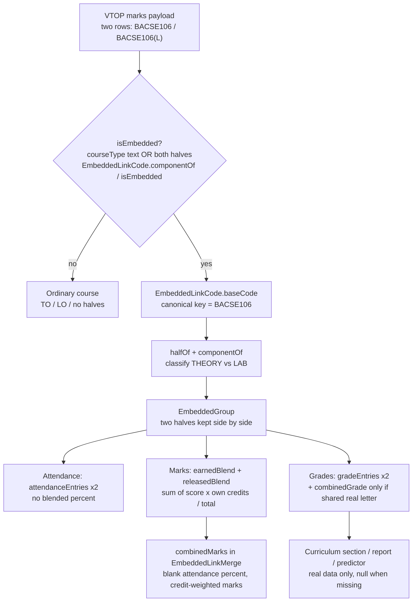

# Embedded courses — one course, two honest halves

> **In one line:** an embedded course is *one* subject that VTOP publishes as *two* rows (theory + lab), and this app keeps those two halves separate for attendance and grades, blends marks by whatever credits each half really carries, and never invents a single percentage or a grade letter that the college did not publish.

## Why this page exists

If you open a synced semester and see `BACSE106` and `BACSE106(L)` listed as two rows, it is tempting to "clean them up" into one average: one attendance percentage, one 50/50 marks blend, one letter computed from the average. That is exactly what this system refuses to do, and it is the source of several subtle bugs.

This page explains the whole embedded-course story end to end. It starts with the single most common misconception — that "ACE" is a different curriculum — then gives you the words, the three rules, a map of every real file involved, the web rules this port had to match, and the honest list of things it still does not do. Everything is grounded in the code in this repo and the sibling web app (`../AmazeCC`).

<Note>
This is the one-stop page. For the broader FFCS timetable generator, start at the [FFCS Planner handbook](./index.md); embedded courses are about how a *synced course* is interpreted, not about building a timetable.
</Note>

## Words you'll meet

| Word | Plain meaning |
|---|---|
| Embedded course | One subject taught as a class (theory) half and a practical (lab) half, published as two rows. |
| Half / component | One of those two rows — the theory side or the lab side. Written `ETH` / `ELA` in VTOP types. |
| Base code | The shared code after the half marker is stripped, e.g. `BACSE106(L)` → `BACSE106`. The key the two halves are joined on. |
| `courseSystem` | A label VTOP publishes, e.g. `"CBCS"` or `"ACE"`. **Only a label** — it does not change how a course is graded. |
| `courseType` | The text that says what the row *is*: `Embedded Theory`, `Embedded Lab`, `Embedded Theory and Lab`, `Theory Only`, `Lab Only`. This drives the rules. |
| Attendance entry | One half's own present/absent figure. An embedded pair has **two**, never one blended one. |
| Blend | A credit-weighted *number* for marks: each half's score × that half's own credits, divided by the total credits. |
| Earned vs released | "Earned" = scored so far; "released" = the recorded outcome. Both are blended the same way and released together. |
| Combined grade | The single letter VTOP publishes for the pair. It is real only when both halves independently show the same graded letter. |
| Curved (relative) grading | A grade assigned against the class average. Embedded theory is curved; a plain lab is absolute. |
| TO / LO | `Theory Only` / `Lab Only` — ordinary standalone courses, **not** embedded. |

## The idea, in plain words

Think of an embedded course as a **two-disc set**, not one disc with a hole in the middle. The theory disc and the lab disc are recorded separately: you attended 92% of theory classes and 74% of lab classes, and those are two honest facts. Saying "you attended 83%" throws information away and cannot be read back.

Marks are the one place where the two discs are combined — but like mixing two ingredients in the *exact quantities on their labels*. A 3-credit theory half and a 1-credit lab half are mixed 3:1, not 1:1; a 2+2 pair is mixed 2:2; a 2+1 pair is mixed 2:1; a 1+1 pair is mixed 1:1. If a label is missing (no credit figure), you do not guess "probably equal" — you say the mixture is unknown.

The grade is a different matter entirely. The college grades the whole course **once**, on a curve, and publishes one letter. A number computed from a blend is not that letter, so this system only shows a combined letter when the two halves actually published the same real one.

**Analogy:** the two halves are like two examiners who each sign a mark sheet. You report both signatures; you compute a weighted total from their written weightings; but you do not invent a third signature for the total.

## What this system does, and why

### 1. "ACE" is a string, not a curriculum

The most important fact: **ACE does not change any behaviour.** In the web app, `isRelativeGrading` takes the grading system as `_courseSystem` — an intentionally *unused* parameter — and decides purely from `courseType`:

File: `../AmazeCC/src/lib/gradeBoundaries.ts:166-198` (abridged)

```ts
export function isRelativeGrading(
  _courseSystem?: string | null,   // ignored on purpose
  courseType?: string | null
): boolean {
  const type = String(courseType ?? "").trim().toLowerCase().replace(/\s+/g, " ");
  if (!type) return false;
  if (type.includes("theory")) return true;
  return type === "embedded" || type === "embedded lab";
}
```

| Line | What it actually does |
|---|---|
| `_courseSystem?` (`:191`) | The leading underscore says "kept so callers still compile, never read" (`gradeBoundaries.ts:185`). |
| `type.includes("theory")` (`:196`) | Any theory-bearing type is curved — including embedded theory. |
| `type === "embedded lab"` (`:197`) | An embedded lab reads the same curve as its theory half, because the course gets **one** letter on the credit-weighted total. |

The comment at `gradeBoundaries.ts:170-175` states the rule explicitly: FFCS Academic Regulations §9.5 — "the rule did not change between CBCS and ACE". So the *only* thing ACE changes is the text in a field; whether a course is curved, and how its halves blend, comes from `courseType` and the presence of two halves. The Kotlin predictor mirrors this — `courseSystem` merely *enables* a curve lookup, it does not decide the answer:

File: `shared/src/commonMain/kotlin/com/amazecc/app/shared/domain/MarksPredictor.kt:667-680`

```kotlin
courseSystem: String? = null,
classStats: ClassStats? = null,
): CoursePredictionResult {
    val relativeEligible = courseSystem != null && isRelativeGrading(courseSystem, courseType)
    val boundaries = buildGradeBoundaries(classStats, relative = relativeEligible)
```

### 2. The three user rules now encoded in Kotlin (D-187)

`EmbeddedCourseSemantics` is the canonical, pure API for a two-half course. It deliberately does **not** merge the halves the way other screens do — it keeps them side by side so no caller can fabricate a number. Its KDoc records the contract in plain terms (`EmbeddedCourseSemantics.kt:4-30`): attendance is not combined, the credit split is never assumed, and a half with no credit leaves the blend `null`.

The three rules:

| # | Rule | Where it is enforced |
|---|---|---|
| 1 | **Two attendance entries**, never one blended percentage. | `EmbeddedGroup.attendanceEntries` holds both halves (`EmbeddedCourseSemantics.kt:57-59, 81`); the merged row's printed percentage is blank (`EmbeddedLinkMerge.kt:164-179`). |
| 2 | **Marks earned AND released are weighted by each half's own credits**, for any real pair (3+1, 2+2, 2+1, 1+1), released together. | `creditWeighted` (`:173-191`) × `blendPair` (`:242-253`), called twice in `buildGroup` (`:206-207`). |
| 3 | **Two grade halves; a combined letter only from a real shared published letter** — never inferred from an absolute-ladder blend. | `gradeEntries` + `publishedSharedGrade` (`:260-265`), wired at `:225-232`. |

**Rule 1 — two attendance entries.** The group has no aggregate attendance field on purpose:

File: `shared/src/commonMain/kotlin/com/amazecc/app/shared/domain/EmbeddedCourseSemantics.kt:54-88` (abridged)

```kotlin
data class EmbeddedGroup(
    val baseCode: String,
    val label: String,
    val theory: EmbeddedEntry?,
    val lab: EmbeddedEntry?,
    val totalCredits: Double,
    /** BOTH halves with their own percentages. No aggregate, no mean. */
    val attendanceEntries: List<EmbeddedEntry>,
    val earnedBlend: Double?,
    val releasedBlend: Double?,
    /** BOTH halves' grades — no half dropped, no merged letter fabricated here. */
    val gradeEntries: List<EmbeddedEntry>,
    /** Both halves publishing the same real letter; never inferred from a blend. */
    val combinedGrade: String?,
)
```

The test proves the intent — 92.5% theory and 74% lab stay two figures (`EmbeddedCourseSemanticsTest.kt:226-234`).

**Rule 2 — credit-weighted earned and released marks.** This is the web's `creditWeightedTotal` (`../AmazeCC/src/lib/gradeHistory.ts:415-429`) ported with the same weighting rule (the Kotlin util omits the web's single-entry weight-1 shortcut and keeps the result unrounded):

File: `shared/src/commonMain/kotlin/com/amazecc/app/shared/domain/EmbeddedCourseSemantics.kt:173-191` (abridged)

```kotlin
fun creditWeighted(
    entries: List<EmbeddedEntry>,
    selector: (EmbeddedEntry) -> Double?,
): Double? {
    val scored = entries.mapNotNull { entry ->
        selector(entry)?.takeIf { it.isFinite() }?.let { score -> entry to score }
    }
    if (scored.isEmpty()) return null
    val weights = scored.map { (entry, _) -> entry.credits }
    if (weights.any { !it.isFinite() || it <= 0.0 }) return null
    val totalCredits = weights.sum()
    if (totalCredits <= 0.0) return null
    val weighted = scored.sumOf { (entry, score) -> score * entry.credits }
    return weighted / totalCredits
}
```

`blendPair` (`:242-253`) only calls it when **both** halves published a finite score, so a half with marks can never be silently dropped and reported as a "blend". The number is intentionally left unrounded (`:188-190`) — 3+1 over 87.5/93 is exactly `88.875`, and only a display string may round it. The tests pin every pair (`EmbeddedCourseSemanticsTest.kt:70-112`):

| Pair (theory + lab credits) | Theory 87.5 / lab 93 → blend | Test |
|---|---|---|
| 3 + 1 | `(87.5×3 + 93×1)/4 = 88.875` (not 88.88) | `:72-77` |
| 2 + 2 | `90.25` | `:82-86` |
| 2 + 1 | `268/3` | `:91-94` |
| 1 + 1 | `90.25` | `:96-98` |
| 3 + 0 (no lab credit) | `null` — never a 1:1 guess | `:103-107` |

**Rule 3 — a real combined grade only.** A blend is a *number*, not a letter. The web grades an embedded course once on a curved ladder we do not hold here, so no letter is inferred from the blend. `publishedSharedGrade` accepts a combined letter only if both halves independently published the same token and it is a real graded letter:

File: `shared/src/commonMain/kotlin/com/amazecc/app/shared/domain/EmbeddedCourseSemantics.kt:255-265`

```kotlin
private fun publishedSharedGrade(theory: EmbeddedEntry, lab: EmbeddedEntry): String? {
    val t = theory.grade?.trim()?.uppercase()
    val l = lab.grade?.trim()?.uppercase()
    if (t.isNullOrEmpty() || l.isNullOrEmpty() || t != l) return null
    return t.takeIf { it in GradeHistory.GRADE_ORDER }
}
```

`GRADE_ORDER` is `S, A, B, C, D, E, F` (`GradeHistory.kt:46`), so `N` (not graded) and unknown tokens never become a letter. Tests cover both cases: different letters and missing letters give `null` (`:240-265`), while two published `A`s give `combinedGrade = "A"` (`:269-278`).

### 3. How the halves are recognised and linked

Before any of the three rules can apply, two VTOP rows must be recognised as halves of one course. `EmbeddedLinkCode` is the single normalizer for that — the port of five web spellings (`EmbeddedLinkCode.kt:3-30`). It provides:

- `baseCode` (`:75-94`) — folds `BCSE101`, `BCSE101(T)`, `bcse101 - lab`, `BCSE101L`, `BCSE101(L)` onto one key.
- `componentOf` (`:108-139`) — classifies a row as `ETH`, `ELA`, `TO`, `LO` or `UNKNOWN`. Signal order is identity-critical: explicit type text first, then a code marker, then a bare `BCSE101L`-style code, and only last the slot (weakest, because a lab sharing a slot with its theory would otherwise steal its marks).
- `halfOf` (`:148-168`) — the theory/lab side, preferring embedded wording over generic "Lab" wording because "Embedded Lab" contains "Lab".

`componentOf` feeds `labelFor` in the semantics API, which also keeps TO/LO non-embedded (`EmbeddedCourseSemantics.kt:116-136`):

```kotlin
fun labelFor(type: String?): String {
    val raw = type?.trim().orEmpty()
    if (raw.isEmpty()) return ""
    val upper = raw.uppercase()
    if (upper == "ETL" || upper.contains("ETH+ELA") || upper.contains("ELA+ETH") ||
        upper.contains("EMBEDDED THEORY AND LAB") || upper.contains("EMBEDDED THEORY & LAB")
    ) return LABEL_COMBINED
    return when (EmbeddedLinkCode.componentOf(rawCode = null, typeHint = raw)) {
        EmbeddedLinkCode.Component.ELA -> LABEL_LAB
        EmbeddedLinkCode.Component.ETH -> LABEL_THEORY
        EmbeddedLinkCode.Component.TO -> LABEL_THEORY_ONLY   // "Theory Only", not embedded
        EmbeddedLinkCode.Component.LO -> LABEL_LAB_ONLY      // "Lab Only", not embedded
        EmbeddedLinkCode.Component.UNKNOWN -> ""
    }
}
```

And `isEmbedded` is the one definition the predictor uses — the web's rule "label says embedded, **or** both payloads exist" (`useCoursePredictionScope.ts:216-230`; `EmbeddedCourseSemantics.kt:138-145`):

```kotlin
fun isEmbedded(type: String?, hasTheory: Boolean, hasLab: Boolean): Boolean =
    type?.contains("embedded", ignoreCase = true) == true || (hasTheory && hasLab)
```

### 4. Where the two shapes live: merge vs semantics

There are **two** representations, and mixing them up is the classic mistake:

| Shape | File | Keeps halves? | Used for |
|---|---|---|---|
| `Course` (merged) | `EmbeddedLinkMerge.kt` | Yes, in `Course.halves`, but the default view is one row | Ordinary screens, ingest, reports |
| `EmbeddedGroup` (semantics) | `EmbeddedCourseSemantics.kt` | Yes, side by side as the primary view | Raw per-half numbers, no blended percentages or invented letters |

`EmbeddedLinkMerge.mergeGroup` folds the pair into one `Course` for the normal UI, but keeps the raw halves as an escape hatch (`EmbeddedLinkMerge.kt:87-124`). Its two arithmetic helpers are where rules 1 and 2 land for those ordinary screens:

- `combinedAttendance` (`:164-179`) adds the two halves' attended/total **counts** for callers that need counts, but leaves `percentage = ""` — the printed single percentage is deliberately blank.
- `combinedMarks` (`:181-229`) delegates the earned-total blend to `EmbeddedCourseSemantics.creditWeighted`, so an embedded pair is never mixed 50/50.

```kotlin
return Attendance(
    attended = theory.attended + lab.attended,
    total = theory.total + lab.total,
    percentage = "",   // two halves, no single printed percentage
    ...
)
```

### 5. End-to-end flow



## The Kotlin implementation map

This is the "where do I stand?" table. D-187 is the pure semantics; D-188 is the curriculum display; D-189 closed four proven gaps in the consuming paths.

| Change | File(s) | What it contributes |
|---|---|---|
| **D-187** canonical semantics | `domain/EmbeddedCourseSemantics.kt` (new); `commonTest/.../EmbeddedCourseSemanticsTest.kt` | The three rules above as one pure API. |
| **D-187** linking | `domain/EmbeddedLinkCode.kt`, `domain/EmbeddedLinkMerge.kt` | One base-code rule, one classifier, one merge; raw halves retained in `Course.halves`. |
| **D-188** curriculum | `domain/Curriculum.kt:245-295`, `domain/overhaul/M3EStateModels.kt:464-478`, `ui/screens/m3e/M3ECurriculumScreen.kt:371-437, 539-566, 622-714` | Group halves under one section header, web-exact labels, summed credits once, no fabricated combined grade. |
| **D-189** attendance | `domain/EmbeddedLinkMerge.kt:164-179`, `domain/overhaul/M3EStateModels.kt:140-155` | Blank merged percentage; a merged pair is never "at risk" (no single figure to compare). |
| **D-189** marks / predictor | `domain/ReportDataAssembler.kt:638-646, 683-694, 790-847`, `domain/MarksPredictor.kt:683-720` | Capture each half's *own* credits from `Course.halves`; skip prediction when either is missing. |
| **D-189** grade history | `domain/GradeHistory.kt:307-314`, `domain/EmbeddedCourseSemantics.kt:22-23` | `isEmbeddedCourse` matches on `courseType` alone; reconciliation needs both halves' credits. |

The drift register records these as `D-187 (FIXED)`, `D-188 (FIXED)`, `D-189 (FIXED)` at `docs/WEB_PARITY_DRIFT_REGISTER.md:367-369`.

### Curriculum grouping (D-188)

A basket item only earns an embedded label when `labelFor` returns a genuine embedded one — the screen requires the `"Embedded"` prefix so `Theory Only` / `Lab Only` stay standalone (`M3ECurriculumScreen.kt:539-566`). The section builder groups by base code and prints the pair's summed credits **once** (`:622-714`):

```kotlin
val group = EmbeddedCourseSemantics.group(classified.map { it.second }).firstOrNull()
sections += CurriculumCourseSection(
    key = "embedded_${course.baseCode}",
    label = label,
    baseCode = course.baseCode,
    courses = canonicalHalves,
    totalCredits = group?.totalCredits?.toInt() ?: 0,
    combinedGrade = group?.combinedGrade,
)
```

The header then shows the label, the credits-once and the combined grade — but every half still keeps its own card and its own grade badge (`M3ECurriculumScreen.kt:404-444`). Credits are also counted once for progress: `passingCourses` groups halves by `baseCode` and sums their credits into a single entry (`Curriculum.kt:245-274`).

### Report predictions (D-189)

The merged `Course.credits` is the pair's **total** (3 + 1 = 4). The predictor needs each half's own figure, so before the pair is reduced the assembler reads them off `Course.halves` (`ReportDataAssembler.kt:683-694`):

```kotlin
course.halves.forEach { half ->
    val credit = half.credits?.let(::num)?.takeIf { it > 0.0 } ?: return@forEach
    if (halfIsLab(half)) {
        if (acc.labCredits == null) acc.labCredits = credit
    } else if (acc.theoryCredits == null) {
        acc.theoryCredits = credit
    }
}
```

Then, for an embedded pair, a missing credit is unknown — not `1.0` and not the merged total — so the prediction is skipped rather than fabricated (`ReportDataAssembler.kt:819-833`):

```kotlin
if (isEmbedded) {
    theoryCredits = acc.theoryCredits?.takeIf { it > 0.0 } ?: return null
    labCredits = acc.labCredits?.takeIf { it > 0.0 } ?: return null
}
```

## The web rules this port had to match

| Web rule | Source | Kotlin counterpart |
|---|---|---|
| `isEmbedded` is decided by `courseType` **text**, not by the code. | `useCoursePredictionScope.ts:216-230`; `gradeHistory.ts:506-508` | `isEmbedded(type, hasTheory, hasLab)` and `GradeHistory.isEmbeddedCourse` match the label only. |
| An embedded row whose halves never paired is **dropped from generation** — a lone "Embedded Theory and Lab" row with no lab slot is not a valid pair. | `../AmazeCC/src/__tests__/ffcs-generate.test.ts:318-330` | A lone half stays a lone `EmbeddedGroup` with honest nulls (`:152-154, 366-380`); it is not presented as a merged pair. |
| Curriculum *variants* like `BCSE101E` are **not** in the curriculum (they only share a prefix with the listed `BCSE101`). | `../AmazeCC/src/__tests__/ffcsCatalogFilters.test.ts:178-188` | Status matching uses the exact canonical base code (`M3ECurriculumScreen.kt:544-553`), not a prefix. |
| Embedded **theory is curved**; a plain lab is absolute — the system name does not change this. | `gradeBoundaries.ts:166-198` | `courseSystem` only enables `buildGradeBoundaries`; `isRelativeGrading(courseSystem, courseType)` reads the type. |
| `3 + 1` is a **fallback default** when credits are missing, not a fixed ratio. | `../AmazeCC/src/__tests__/coursePredictorScope.test.ts:147-157` | The blend uses whatever credits the halves publish; missing credits yield `null`, never an assumed split. |

## Honest edge cases and caveats

<Warning>
Read this before you "simplify" anything. Every item here is a real limitation or a deliberate refusal, not an oversight.
</Warning>

| Case | What actually happens | Why |
|---|---|---|
| **G5 — two faculty cards** | Deferred. A merged pair shows one type label and one header; two separate faculty cards are a UI-only change still planned. | Research flagged it, but D-189 fixed only proven arithmetic/data gaps; G5 was explicitly deferred (`docs/SWARM_BOARD.md:293`). |
| **A lone embedded half** | It is **not** a merged pair. It keeps its own real percentage, has one `attendanceEntry` / `gradeEntry`, and `earnedBlend`, `releasedBlend` and `combinedGrade` are all `null`. | There is no pair to blend or reconcile (`EmbeddedCourseSemantics.kt:152-154`; test `:366-380`). |
| **Theory Only / Lab Only** | Classified as `LABEL_THEORY_ONLY` / `LABEL_LAB_ONLY` and rejected by the embedded rules — they are ordinary standalone courses. | `labelFor` routes TO/LO away from embedded labels (`EmbeddedCourseSemantics.kt:131-133`); the curriculum screen requires an `"Embedded"` prefix (`M3ECurriculumScreen.kt:542-543`). |
| **A half with no credit** | No blend, no prediction. `creditWeighted` returns `null`; the report assembler returns no prediction. | Never assume 1:1 (`EmbeddedCourseSemantics.kt:182-185`; `ReportDataAssembler.kt:825-826`). |
| **Split / unknown grade letters** | `combinedGrade` is `null` unless both halves published the same real graded letter (`S..F`). `N` and unknown tokens never count. | A combined letter must be a published fact, not a guess (`EmbeddedCourseSemantics.kt:260-265`). |
| **No grade letter derived from a blend** | `releasedBlend = 85.0` still yields `combinedGrade = null` when no real letters exist. | Embedded theory is curved on a ladder this module does not hold; the number cannot be looked up as a letter (`EmbeddedCourseSemanticsTest.kt:280-317`). |
| **`courseSystem` / ACE** | Present in signatures but ignored for grading decisions. Changing `"CBCS"` to `"ACE"` changes nothing. | The regulation is unchanged across both (`gradeBoundaries.ts:170-175`). |

## Where to next

- **[FFCS Planner — start here](./index.md)** — the timetable generator this handbook is about; embedded courses are one input to it, not the whole story.
- **[Vocabulary](./vocabulary.md)** — where *theory/lab pair*, *offering*, *slot* and *clash* are first defined.
- **[Data model](./data-model.md)** — `ParsedCourse` and how `ETH+ELA` types arrive in the FFCS catalog.
- **[Docs drift register](./DOCS_DRIFT_REGISTER.md)** — DOC-001..DOC-012 and the wave/porting trail.
- **[Web parity drift register](../WEB_PARITY_DRIFT_REGISTER.md)** — the D-187/D-188/D-189 entries (`lines 367-369`) this page summarises.
