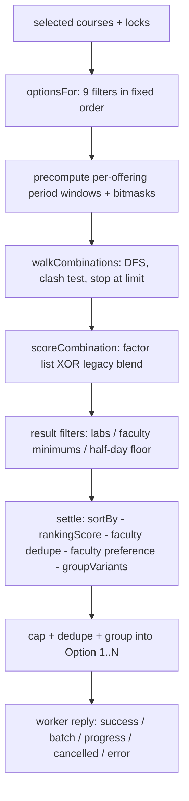
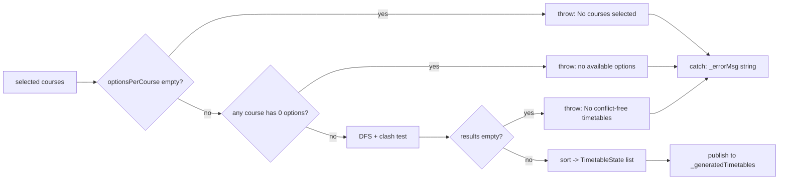

# FFCS generation engine

> **In one line:** generation picks one offering per course, throws away any combination whose classes overlap, then sorts the survivors — the Kotlin app does all of that in one function, while the web app does the same job in a worker with filters, bitmasks and streaming.

## Why this page exists

You open the planner, tap Generate, and a list of "Option 1, Option 2…" appears. It is easy to assume the app simply asked a server. It did not. A local search built every candidate week from the raw course list. If you are about to port, debug or rank those results, you need to know exactly where candidates are created, where they are rejected, and where their final order is decided — because the running app's Kotlin code and the web reference implement **the same idea at very different depths**.

## The idea, in plain words

Think of the course catalogue as a **menu** and each selected course as a **course on your order**:

- An **offering** is one menu item: a specific faculty, slot and room. In this repo it is a `ParsedCourse` with `offeringKey() = "$faculty|$slot|$room"` (`shared/.../ffcs/FfcsModels.kt:15`).
- A **candidate timetable** is a plate with exactly one item per ordered course.
- A **clash** is two classes that need the student on the **same day at overlapping times** — the student cannot be in both, even in different rooms. Any plate containing both is thrown away.
- **DFS + backtrack** is walking the menu aisles with a breadcrumb trail: take an item, walk on; if you hit a clash, step back to the last choice and try the next item. The Kotlin engine's `backtrack()` does exactly that (`FfcsEngine.kt:116-148`).
- A **result cap** is a bucket with a fixed size. Once it is full the search stops. The Kotlin bucket holds 50 by default (`FfcsEngine.kt:80`, `:121`).
- A **worker** is a kitchen helper in another room: it chops the vegetables so the Dining Room (the UI) stays responsive. **Streaming** is that helper handing you plates as they are ready instead of waiting for the whole meal. The running Kotlin app has no helper — it cooks in a single coroutine; no worker/stream protocol has been integrated.

| Term | Plain meaning | Pointer |
|---|---|---|
| offering | one teachable instance of a course (faculty + slot + room) | `FfcsModels.kt:6-16` |
| slot | a code like `A1` or `L31` that maps to a day and a time range | `FfcsEngine.kt:39-53` |
| period | one concrete day + start/end minutes extracted from a slot | `FfcsEngine.kt:18`, `:39-53` |
| clash / overlap | two periods on the same day whose time ranges intersect | `FfcsEngine.kt:55-64` |
| backtrack | depth-first search that undoes a choice when it fails | `FfcsEngine.kt:116-148` |
| cap | stop after N accepted candidates | `FfcsEngine.kt:80`, `:121` |
| settle | the final ordering steps applied *after* scoring | skill ref `04-generation-engine.md` §5.2 |
| bitmask | a row of on/off switches (one per day or half-day) used to cut bad search branches early | skill ref `04-generation-engine.md` §3 |
| worker / stream | off-thread generation that can report batches as they are found | skill ref `04-generation-engine.md` §7 |

## What → why → how

### 1. What the running Kotlin engine actually does

`shared/src/commonMain/kotlin/com/amazecc/app/shared/ffcs/FfcsEngine.kt:76-188` is the whole generator. It is a `suspend` function pinned to `Dispatchers.Default` (`:84`).

**Abridged — signature and the two filters the Kotlin port currently implements:**

```kotlin
// FfcsEngine.kt:76-110 (abridged)
suspend fun generateTimetables(
    optionsPerCourse: List<List<ParsedCourse>>,
    locks: List<CourseLock> = emptyList(),
    blockedSlots: Set<String> = emptySet(),
    maxResults: Int = 50,                       // the cap
    uniqueFaculty: Boolean = false,
    morningPreference: Boolean = false,
    options: GenerateOptions = GenerateOptions()
): List<TimetableState> = withContext(Dispatchers.Default) {
    if (optionsPerCourse.isEmpty()) throw Exception("No courses selected for generation.") // :85

    val results = mutableListOf<List<ParsedCourse>>()
    val resultsPeriods = mutableListOf<List<Period>>()
    val lockMap = locks.associateBy { it.code.uppercase() }

    val filteredOptions = optionsPerCourse.map { courseOptions ->
        if (courseOptions.isEmpty()) return@map emptyList()
        val code = courseOptions.first().code.uppercase()
        val lock = lockMap[code]
        var opts = courseOptions

        if (lock != null && lock.allowedOfferings.isNotEmpty()) {          // :97-99
            opts = opts.filter { it.offeringKey() in lock.allowedOfferings }
        }
        if (blockedSlots.isNotEmpty()) {                                   // :101-103
            opts = opts.filter { !slotInBlockedList(it.slot, blockedSlots) }
        }
        opts
    }
    if (filteredOptions.any { it.isEmpty() }) {                            // :108-110
        throw Exception("One or more courses have no available options after applying constraints.")
    }
```

| Line | What it actually does |
|---|---|
| `:76-84` | Public entry point. Everything runs on `Dispatchers.Default`; there is no worker object and no cancel handle. |
| `:80` | Default cap is 50. There is no 30,000 hard limit in Kotlin. |
| `:85` | Empty input throws a plain `Exception` — not a typed code. |
| `:89` | Locks are indexed by uppercased course code. |
| `:97-99` | Only exact offerings named in a `CourseLock` are kept. |
| `:101-103` | Blocked slots are removed. This is 1 of the web's 9 filters (see §3). |
| `:108-110` | A course left with zero offerings fails the **whole** run by throwing. |

**The search itself — `FfcsEngine.kt:112-148` (abridged):**

```kotlin
val optionsWithPeriods = filteredOptions.map { options ->
    options.map { opt -> opt to getPeriodsForSlot(opt.slot) }      // :112-114
}

fun backtrack(courseIndex: Int, currentCombo: MutableList<ParsedCourse>,
              currentPeriods: MutableList<Period>) {
    if (results.size >= maxResults) return                         // :121 cap
    if (courseIndex == optionsWithPeriods.size) {                  // :122 full week
        if (uniqueFaculty) {
            val faculties = currentCombo.map { it.faculty.uppercase() }
            if (faculties.toSet().size != faculties.size) return   // :123-126
        }
        results.add(currentCombo.toList())                         // :127-128
        resultsPeriods.add(currentPeriods.toList())
        return
    }
    val options = optionsWithPeriods[courseIndex]
    for ((opt, periods) in options) {
        if (morningPreference) {
            if (periods.any { it.startMin >= 840 }) continue        // :134-137
        }
        if (!periodsOverlap(periods, currentPeriods)) {             // :139 the gate
            currentCombo.add(opt)
            val newPeriods = currentPeriods.toMutableList().apply { addAll(periods) }
            backtrack(courseIndex + 1, currentCombo, newPeriods)    // :142 descend
            currentCombo.removeLast()                               // :143 undo
        }
    }
}
backtrack(0, mutableListOf(), mutableListOf())                      // :148
yield()                                                             // :149
if (results.isEmpty()) throw Exception("No conflict-free timetables found. ...") // :151-153
```

| Line | What it actually does |
|---|---|
| `:112-114` | Periods are resolved once per offering, before the walk — the same "precompute, don't re-walk" idea as the web port. |
| `:121` | Cap checked at every node. Once `results` has 50 weeks, every branch returns immediately. |
| `:122-130` | Base case: a full week is copied into `results`. `uniqueFaculty` also rejects a repeated professor here. |
| `:134-137` | `morningPreference` is a hard filter: any period starting at or after 14:00 kills the option. |
| `:139` | The **only** compatibility rule: open-interval overlap on the same day. |
| `:142-143` | Recurse, then pop the scratch lists — the breadcrumb trail. |
| `:149` | One `yield()` after the whole search. It is a single cooperation point, **not** a cancellation/streaming protocol. |

**The clash predicate — `FfcsEngine.kt:55-64`:**

```kotlin
private fun periodsOverlap(a: List<Period>, b: List<Period>): Boolean {
    for (pa in a) {
        for (pb in b) {
            if (pa.day == pb.day &&
                max(pa.startMin, pb.startMin) < min(pa.endMin, pb.endMin)) {  // :58
                return true
            }
        }
    }
    return false
}
```

The formula `max(startA, startB) < min(endA, endB)` is the **open-interval** rule the web reference pins as a port requirement (`04-generation-engine.md` §10, "Uses open-interval overlap `max(start) < min(end)` on the same day"). A class ending at 09:50 and one starting at 09:50 do **not** clash. This part of the Kotlin port is already correct.

### 2. How the results get their order today

After the search, each accepted combination is mapped to a `TimetableState` (`:155-180`) and sorted (`:182-187`):

```kotlin
// FfcsEngine.kt:182-187
timetableStates.sortedWith(
    compareByDescending<TimetableState> { if (options.closeGaps) it.metrics.gaps == 0 else false }
        .thenByDescending { (it.metrics.halfDays * 10) + ((20 - it.metrics.gaps) * 5) }
        .thenByDescending { if (options.lateStart) it.firstStartMin else 0 }
        .thenBy { if (options.earlyFinish) it.lastEndMin else Int.MAX_VALUE }
)
```

| Sort key | Meaning | Important detail |
|---|---|---|
| `closeGaps` | gap-free weeks first | Only active when the boolean is set. |
| `halfDays * 10 + (20 - gaps) * 5` | an always-on "compact week" score | In `FfcsMetrics.kt:104`, `gaps` is accumulated with integer hours (`gapMins / 60`), and `halfDays` counts **free** half-days (`:68`, `:124`). This is a heuristic, not the web's eight-factor score. |
| `lateStart` | later first class first | Uses the single earliest start `firstStartMin` (`:177`), not an average across class days. |
| `earlyFinish` | earlier last class first | Uses the single latest end `lastEndMin` (`:178`). |

The three toggles come from `GenerateOptions(closeGaps, lateStart, earlyFinish)` (`FfcsEngine.kt:26-30`) with setters at `FfcsViewModel.kt:170-180`. **That is the entire ranking implementation in Kotlin today: three booleans and one fixed comparator.** See [ranking-and-priority.md](./ranking-and-priority.md).

### 3. How the driver calls it today

`shared/src/commonMain/kotlin/com/amazecc/app/shared/state/FfcsViewModel.kt:182-250` is the only caller.

```kotlin
// FfcsViewModel.kt:182-200, 223-248 (abridged)
fun generate() {
    val selected = _selectedCodes.value
    if (selected.isEmpty()) {
        _errorMsg.value = "Select at least one course to generate."    // :185
        return
    }
    // ... snapshots of locks, blocked slots, maxResults, flags ...      :189-194
    _isGenerating.value = true
    _errorMsg.value = null
    _generatedTimetables.value = emptyList()

    scope.launch {
        try {
            // ... build optionsPerCourse; empty offerings are collected :204-221
            if (droppedCodes.isNotEmpty()) {
                throw Exception("No available offerings for: ...")      // :224-227
            }
            val results = FfcsEngine.generateTimetables(                // :233-241
                optionsPerCourse = optionsPerCourse, /* ... */
            )
            _generatedTimetables.value = results                        // :243
        } catch (e: Exception) {
            _errorMsg.value = e.message ?: "Generation failed."         // :245
            _generatedTimetables.value = emptyList()
        }
        _isGenerating.value = false                                     // :248
    }
}
```

What this means for a port:

- **One shot, no worker.** `scope.launch` (`:200`) plus the engine's `withContext(Dispatchers.Default)` is the whole execution model. There is no `postMessage`, no `runId`, no cancel, no batch/progress stream.
- **Errors are strings in the running app.** Every failure collapses into `_errorMsg` (`:34-35`, `:245`). The typed error codes and drop ladder ported in wave 1 (`FfcsGenerationRun.kt:10-18`, `FfcsDropPolicy.kt:24-49`) are library code the app does not call yet — see [drop-ladder-and-errors.md](./drop-ladder-and-errors.md).
- **Cap is user-set but bounded differently.** `_maxResults` starts at 50 (`:47`) and `setMaxResults` coerces to `1..500` (`:166-168`). The web reference caps at 50 by default but allows up to 30,000 (or infinity) with its unlimited flags.

### 4. The full web pipeline (skill reference `04-generation-engine.md`; wave-1 libraries, wave-3 integration)

> **Library ported in wave 1; not yet in the running app.** The reference describes the behaviour a faithful port must reach. Wave 1 delivered ranking (D-173, `FfcsRanking.kt`), faculty priority (D-174) and typed failures/drop ladder (D-175, `FfcsGenerationRun.kt` / `FfcsDropPolicy.kt`) as standalone libraries. None of it is called by `FfcsEngine.kt` / `FfcsViewModel.kt` yet; wave 3 does that integration.



#### 4.1 `optionsFor` — nine filters in a fixed order

From `04-generation-engine.md` §2 (`src/lib/ffcsGenerate.ts:486-599`):

| # | Filter | Running app (legacy path) |
|---|---|---|
| 1 | named `allowedSlots` | none |
| 2 | named `allowedFaculty` | none |
| 3 | exact offerings (`FACULTY\|SLOT\|ROOM` + ERP id) | partial — `FfcsEngine.kt:97-99` / `FfcsViewModel.kt:209-213` via `offeringKey()` |
| 4 | embedded rows complete | none |
| 5 | morning / evening preference | partial — `morningPreference` is applied *inside the walk* at `FfcsEngine.kt:134-137`, not as an option filter |
| 6 | blocked slots, checked through both spellings | partial — `FfcsEngine.kt:101-103` (one spelling) |
| 7 | min start / max end / per-day end bounds | none |
| 8 | sync a friend's exact classes | none |
| 9 | **sort options by faculty priority — last** | ported in wave 1 (D-174, `FfcsFacultyPriority.sortOptionsByFacultyPriority`) but not called by the running app |

The order matters: "an offering rejected early is never reconsidered later." Filter 9 is a **sort**, not a removal, and it runs last so preference orders survivors without resurrecting rejected ones.

#### 4.2 Bitmask DFS, scoring and the settle order

| Stage | Web reference (ref 04) | Running app (legacy path) |
|---|---|---|
| Search | `walkCombinations` with precomputed windows, `labDayMasks` (5 bits/day), `labSites`, `halfDayMasks` (10 cells), `minHalfDays`; monotone rules prune at first break; `TICK_INTERVAL = 4096` drives cooperative ticks; visitor-style `hooks.visit` (§3, `:359-498`) | Pairwise `periodsOverlap` only, no rule bitmasks, no visitor, one `yield()` after the entire search |
| Score | `scoreCombination`: factor list **XOR** legacy blend, one path per call; data-less factors omitted, never zeroed (§4, `:1045-1161`) | Fixed comparator over three booleans (`FfcsEngine.kt:182-187`) |
| Settle | 10 steps: `sortTimetables` → rankingScore sort → `dedupeByFaculty` → faculty-preference sort → `groupVariants`, then `capped = finite limit && found >= limit` (§5.2, `:1373-1405`) | A single `sortedWith` call; no dedupe, no variant grouping, no `capped` flag |
| Caps | `DEFAULT_RESULT_LIMIT = 50`, `HARD_RESULT_LIMIT = 30_000`, `DEFAULT_BATCH_SIZE = 50`; `limit = noLimit ? (removeHardResultLimit ? ∞ : 30_000) : resultCap ?? 50` (§1.2) | `maxResults = 50`, coerced to `1..500` (`FfcsViewModel.kt:47`, `:166-168`) |

#### 4.3 Worker, cancellation and streaming protocol

From ref 04 §7:

- Replies are a tagged union: `success {timetables, capped?}`, `batch {timetables}`, `progress {nodes, found, accepted}`, `cancelled {timetables}`, `error {code, subjectCode?}`.
- `GenerationHandle.result` **never rejects**; failures arrive as `error`, cancellation as `cancelled`. `cancel()` is idempotent.
- There is **no `cancel` message** — the walk is synchronous, so the page cancels with `worker.terminate()`; the inline fallback uses cooperative `shouldStop` with `setTimeout(..., 0)` so a same-tick cancel is observable.
- Streaming is opt-in (`onBatch` / `onProgress` present). A retry reuses one `runId` and one catalog snapshot so it only posts `droppedCodes`.
- `GenerateParams` must stay plain data across the structured-clone boundary: "no `Set`, no class instances, no functions."

The running app has none of this; its cancellation story is the single `yield()` at `FfcsEngine.kt:149`. Wave 1 added typed results and ladder plumbing (`FfcsGenerationRun.kt`) as a library, but the worker/cancel/stream protocol is not wired in until wave 3.

#### 4.4 Determinism — there is no seed

Ref 04 §6: reproducibility comes from (a) `masterCourses` order → `byCode` bucket insertion order → `optionsPerCourse` order, (b) DFS in that order, and (c) stable sorts at every stage. The only randomness in the web engine is `newId()` (used for ids); the purity test compares **slot layouts**, not ids. There is no RNG seed to configure or port.

The Kotlin engine is deterministic for the same reason and even avoids id randomness: generated ids are derived strings (`tt_$idx`, `tt${idx}_${code}_$i` — `FfcsEngine.kt:158`, `:173`), so **no seed parameter should be invented for a port**.

## What can go wrong

> **Warning — running-app failures are unstructured.** `FfcsEngine.kt:85`, `:108-110` and `:151-153` throw plain `Exception`s; `FfcsViewModel.kt:223-231` throws two more. All of them land in the same `catch` at `:244-246` and become free text in `_errorMsg`. There is no way for a caller to branch on the reason in the app. Wave 1 ported the eight typed codes and the ladder (`FfcsGenerationRun.kt:10-18`, `FfcsDropPolicy.kt`) as a library; wave 3 must route the app through them (see [drop-ladder-and-errors.md](./drop-ladder-and-errors.md)).

> **Warning — cap × search order interaction.** Because the DFS stops at the cap, the order in which each course's options are walked decides *which* weeks survive. This is why faculty-priority sorting must happen **before** the walk, not after it. See mechanism B in [ranking-and-priority.md](./ranking-and-priority.md).

> **Warning — do not mistake the Kotlin sort for web ranking.** `(halfDays * 10) + ((20 - gaps) * 5)` with `gaps` measured in whole hours is the local heuristic the app still uses. The web reference has six legacy profiles, eight ordered factors and a four-component blend, with per-factor rounding rules — ported in wave 1 as `FfcsRanking.kt` (D-173) but not used by the app yet. The two are not interchangeable.



## Where to next

- **[Ranking and priority](./ranking-and-priority.md)** — the three separate "priority" mechanisms, why the three Kotlin booleans are not the web ranking system, and the wave-1 library ports (D-173/D-174).
- **[Drop ladder and errors](./drop-ladder-and-errors.md)** — retryable vs crash, protected codes and the eight typed error codes ported in wave 1 (D-175), not yet wired into the app.
- **[Vocabulary](./vocabulary.md)** — every term used here, defined once in plain English.
- **Source of truth:** `FfcsEngine.kt:76-188`, `FfcsViewModel.kt:182-250`, and ffcs-planner skill `reference/04-generation-engine.md` §§1-7, §10.
