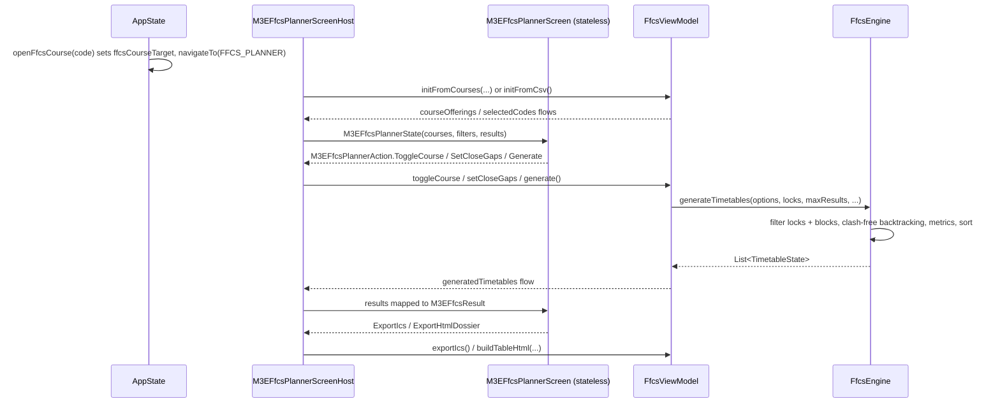

# FFCS Planner — how the Android app builds your timetable

> **In one line:** you tick the subjects you want, the planner tries every combination of professors and times that doesn't double-book you, sorts the survivors from best to worst, and hands you the top few to choose from.

## Why this page exists

The planner looks like one screen with a few chips and buttons, but under it sits a catalog parser, a clash-aware search, a metrics scorer and a state bridge. If you only read the UI, you cannot tell what "Generate" actually did or why one option is listed before another. This page follows one click all the way down and back up, using the real Kotlin source.

## Words you'll meet

Each word below is defined once here; the full explanations with code are on the [vocabulary page](./vocabulary.md).

| Word | Plain meaning |
|---|---|
| Course | The subject you want, identified by a code such as `CSE3002`. |
| Offering | One actual instance of that course: a professor, a time and a room. |
| Slot | The short "when" label on an offering, e.g. `A1+A2`. |
| Period | The real day-and-minutes block a slot expands into. |
| Clash | Two periods that overlap on the same day — impossible to attend. |
| Theory/lab pair | Two report rows (classroom + practical) merged into one offering. |
| Ranked timetable | One clash-free option, with quality numbers, placed in a best-first order. |
| Ranking factor | A switch that changes that order (today: Close Gaps, Late Start, Early Finish). |
| Faculty priority | A per-course ordered preference for professors — ported in wave 1 (D-174) as a library, not yet wired into the running app (wave 3). |
| Generator target | A course pinned so it cannot be removed — canonical model ported in wave 1 (D-171); the running app still uses `CourseLock` (wave 3 wiring pending). |
| Result cap | The maximum number of options kept (default 50). |
| Drop ladder | Retry-by-removing-courses policy — ported in wave 1 (D-175) as a library, not yet wired into the running app (wave 3). |
| Share code | A string that encodes a plan for a friend — not wired into the running app; it is outside the wave-1 library set (D-171..D-176) and belongs to later waves. |

## The idea, in plain words

Imagine your week as an empty pegboard. Every offering is a peg shaped like "this professor, this time, this room". You cannot put two pegs in the same hole — that is a clash. The planner starts with your list of courses, reads all the pegs available for each one, then walks through the options: take one peg for course one, one for course two, and so on, refusing any peg that would collide with what is already placed. Every complete board it manages to build is a **ranked timetable** candidate.

Once it has enough boards (the **result cap**), it measures each one — how many free half-days, how many empty gaps, how late the first class starts, how early the last one ends — and sorts them so the nicest board is on top. The screen just draws that sorted list.

**Analogy:** it is a jigsaw puzzle where every piece is a class, two pieces cannot overlap, and the box photo on the lid is your three filter chips.

## What → why → how

**What.** Turn a set of chosen course codes into a short, ordered list of clash-free weekly timetables.

**Why.** Choosing an FFCS timetable by hand means cross-checking dozens of timetable rows for overlaps and then eyeballing which one has the fewest gaps. That is exactly the kind of tedious, rule-based work a computer should do.

**How.** Four layers cooperate:

1. **Entry/route** — `AppState` owns the `FFCS_PLANNER` destination and can open it with a preselected course.
2. **State** — `FfcsViewModel` holds the catalog, selection, locks, filters and results in `StateFlow`s.
3. **Engine** — `FfcsEngine` filters offerings, walks combinations without clashes, measures and sorts them.
4. **UI** — `M3EFfcsPlannerScreen` is a 100% stateless composable: it renders state and emits actions. A host maps those actions to the view model.

## The code, line by line

### 1. The host connects the stateless screen to real state

File: `shared/src/commonMain/kotlin/com/amazecc/app/shared/ui/screens/m3e/M3EAcademicLegacyBridge.kt:824-855, 910-923` (abridged)

```kotlin
fun M3EFfcsPlannerScreenHost(modifier: Modifier = Modifier) {
    val offerings by FfcsViewModel.courseOfferings.collectAsState()
    val selectedCodes by FfcsViewModel.selectedCodes.collectAsState()
    val generated by FfcsViewModel.generatedTimetables.collectAsState()
    val generateOptions by FfcsViewModel.generateOptions.collectAsState()
    ...
    LaunchedEffect(Unit) {
        if (offerings.isEmpty()) {
            val domainCourses = domain.academics.semesters[selectedSemId]?.courses?.values
                ?.mapNotNull(::domainCourseToParsed)?.takeIf { it.isNotEmpty() }
            if (domainCourses != null) FfcsViewModel.initFromCourses(domainCourses)
            else FfcsViewModel.initFromCsv()
        }
    }
    ...
    is M3EFfcsPlannerAction.Generate -> {
        activeTab = M3EFfcsTab.RESULTS
        FfcsViewModel.generate()
    }
    is M3EFfcsPlannerAction.SetCloseGaps -> FfcsViewModel.setCloseGaps(action.enabled)
```

| Line | What it actually does |
|---|---|
| `collectAsState()` on five flows | The host reads state; the screen never owns it (M3EAcademicLegacyBridge.kt:827-833). |
| `domainCourses ... ?: initFromCsv()` | Prefer the real synced academic snapshot; fall back to the bundled CSV only when nothing is synced (`:846-854`). |
| `Generate -> activeTab = RESULTS; FfcsViewModel.generate()` | The tap becomes a real generation call and moves to the Results tab (`:915-918`). |

The screen itself receives its data as an immutable value and only emits intents:

File: `shared/src/commonMain/kotlin/com/amazecc/app/shared/ui/screens/m3e/M3EFfcsPlannerScreen.kt:64-102` (abridged)

```kotlin
@Immutable
data class M3EFfcsPlannerState(
    val activeTab: M3EFfcsTab = M3EFfcsTab.COURSES,
    val courses: List<M3EFfcsCourse> = emptyList(),
    val filteredCourses: List<M3EFfcsCourse> = emptyList(),
    val results: List<M3EFfcsResult> = emptyList(),
    val isGenerating: Boolean = false,
    val closeGaps: Boolean = false,
    val lateStart: Boolean = false,
    val earlyFinish: Boolean = false,
    ...
)

sealed interface M3EFfcsPlannerAction {
    data object Generate : M3EFfcsPlannerAction
    data class ToggleCourse(val code: String) : M3EFfcsPlannerAction
    data class SetCloseGaps(val enabled: Boolean) : M3EFfcsPlannerAction
    data object ExportIcs : M3EFfcsPlannerAction
    ...
}
```

<Note>
`mockFfcsState()` at `M3EFfcsPlannerScreen.kt:396-407` exists only for the two `@Preview` functions at `:409-419`. It is preview data, not what a user sees at runtime.
</Note>

### 2. The view model takes a snapshot and calls the engine

File: `shared/src/commonMain/kotlin/com/amazecc/app/shared/state/FfcsViewModel.kt:182-250` (abridged)

```kotlin
fun generate() {
    val selected = _selectedCodes.value
    if (selected.isEmpty()) {
        _errorMsg.value = "Select at least one course to generate."
        return
    }
    val locksSnapshot = _locks.value
    val blockedSnapshot = _blockedSlots.value
    val maxResultsSnapshot = _maxResults.value
    ...
    scope.launch {
        try {
            ...
            val results = FfcsEngine.generateTimetables(
                optionsPerCourse = optionsPerCourse,
                locks = locksSnapshot,
                blockedSlots = blockedSnapshot,
                maxResults = maxResultsSnapshot,
                uniqueFaculty = uniqueFacultySnapshot,
                morningPreference = morningPrefSnapshot,
                options = _generateOptions.value
            )
            _generatedTimetables.value = results
        } catch (e: Exception) {
            _errorMsg.value = e.message ?: "Generation failed."
            _generatedTimetables.value = emptyList()
        }
    }
}
```

| Line | What it actually does |
|---|---|
| `selected.isEmpty()` guard | No course chosen → a friendly error, no engine call (FfcsViewModel.kt:183-187). |
| `...Snapshot` values | Reads every flow once before launching so the background job uses one consistent configuration (`:189-194`). |
| `scope.launch` | The work runs on `Dispatchers.Default + SupervisorJob()` (`:15`, `:200`). |
| `FfcsEngine.generateTimetables(...)` | The one and only call into the engine (`:233-241`). |
| `catch (e: Exception)` | Engine failures become a visible error message, not a crash (`:244-247`). |

### 3. The engine filters, walks, measures and sorts

File: `shared/src/commonMain/kotlin/com/amazecc/app/shared/ffcs/FfcsEngine.kt:116-148, 182-187` (abridged)

```kotlin
fun backtrack(
    courseIndex: Int,
    currentCombo: MutableList<ParsedCourse>,
    currentPeriods: MutableList<Period>
) {
    if (results.size >= maxResults) return
    if (courseIndex == optionsWithPeriods.size) {
        ...
        results.add(currentCombo.toList())
        resultsPeriods.add(currentPeriods.toList())
        return
    }
    val options = optionsWithPeriods[courseIndex]
    for ((opt, periods) in options) {
        if (!periodsOverlap(periods, currentPeriods)) {
            currentCombo.add(opt)
            val newPeriods = currentPeriods.toMutableList().apply { addAll(periods) }
            backtrack(courseIndex + 1, currentCombo, newPeriods)
            currentCombo.removeLast()
        }
    }
}
...
timetableStates.sortedWith(
    compareByDescending<TimetableState> { if (options.closeGaps) it.metrics.gaps == 0 else false }
        .thenByDescending { (it.metrics.halfDays * 10) + ((20 - it.metrics.gaps) * 5) }
        .thenByDescending { if (options.lateStart) it.firstStartMin else 0 }
        .thenBy { if (options.earlyFinish) it.lastEndMin else Int.MAX_VALUE }
)
```

| Line | What it actually does |
|---|---|
| `results.size >= maxResults` | The result cap stops the walk (FfcsEngine.kt:121). |
| `!periodsOverlap(...)` | The clash rule: only non-overlapping offerings are added (`:139`). |
| `backtrack(courseIndex + 1, ...)` then `removeLast()` | Try the next course, then undo the choice so siblings can be tried (`:142-143`). |
| `compareByDescending...` | The ranking: gap-free first when requested, then a half-day/gaps score, then late start, then early finish (`:182-187`). |

## One click, end to end



The navigation entry point is real: `AppState.openFfcsCourse` stores a course code in `ffcsCourseTarget` and navigates to `Screen.FFCS_PLANNER` (`AppState.kt:794-796, 849-853`), and `FFCS_PLANNER` is one of the local-search screens (`AppState.kt:403-409`).

## What the system gives back

Each item in `generatedTimetables` is a `TimetableState` (`FfcsModels.kt:66-76`):

| Field | Type | Meaning (from the code) |
|---|---|---|
| `id` | String | Stable key, `"tt_$idx"` (`FfcsEngine.kt:173`). |
| `name` | String | Display label, `"TT ${idx + 1}"` (`:174`). |
| `courses` | `List<AddedCourse>` | The chosen offerings with slot, faculty, venue and colour (`:156-168`). |
| `metrics.halfDays` | Int | Free half-days; feeds the score at `:184`. |
| `metrics.gaps` | Int | Empty stretches; gap-free is promoted when Close Gaps is on (`:183`). |
| `firstStartMin` | Int | Earliest start in minutes; Late Start preference (`:177`, `:185`). |
| `lastEndMin` | Int | Latest end in minutes; Early Finish preference (`:178`, `:186`). |

The host flattens this into the UI's `M3EFfcsResult` with a summary such as `"3 half-days · 2 gaps · 4 courses"` (`M3EAcademicLegacyBridge.kt:874-889`).

## What can go wrong

<Warning>
"No courses selected for generation." — thrown when the engine receives an empty course list (`FfcsEngine.kt:85`).
</Warning>

<Warning>
"One or more courses have no available options after applying constraints." — thrown when locks or blocked slots leave a course with nothing to choose from (`FfcsEngine.kt:108-110`).
</Warning>

<Warning>
"No conflict-free timetables found. Try removing some constraints." — thrown when every combination clashes (`FfcsEngine.kt:151-153`).
</Warning>

<Warning>
"No available offerings for: … Deselect them or clear their locks/blocks." — thrown by the view model before the engine call when a selected course has zero options (`FfcsViewModel.kt:223-228`).
</Warning>

All of these are caught and shown in the Results tab's error card (`M3EFfcsPlannerScreen.kt:319-325`) via the view model's `catch` block (`FfcsViewModel.kt:244-247`).

## Scope today, honestly

The Android port is **not** a full copy of the web planner, and the port has two distinct stages. Wave 1 (D-171..D-176) ported the canonical planner models, slot schema and clash rules, ranking math, faculty priority, drop ladder, and CSV/pairing as **libraries** — `ffcs/planner/FfcsPlannerModels.kt`, `FfcsSlotSchema.kt`, `FfcsRanking.kt`, `FfcsFacultyPriority.kt`/`FfcsFacultyRanking.kt`, `FfcsDropPolicy.kt`/`FfcsGenerationRun.kt` and `FfcsCsv.kt`. The drift register records these as `PORTED - not integrated` at `docs/WEB_PARITY_DRIFT_REGISTER.md:355-360`. They are **not yet wired into the running app**: `FfcsEngine`, `FfcsViewModel` and the M3E planner screen still use the legacy path described on this page. That wiring is wave 3.

- **No guided wizard in the runtime UI.** The UI has three tabs — Courses, Timetable, Results (`M3EFfcsPlannerScreen.kt:45-48`) — not the web's step-by-step wizard. The wizard is not part of the wave-1 library set.
- **No plan share codec wired into the runtime UI.** The planner does not call a plan-to-code encoder or decoder. The exports that *do* exist are a real RFC 5545 `.ics` (`FfcsEngine.kt:190-249`) and a simple HTML table dossier (`M3EAcademicLegacyBridge.kt:938-978`); the latter is not the web's multi-page dossier. Share-code support is outside D-171..D-176 and belongs to later waves.
- **Ranking math, faculty priority and the drop ladder are ported as libraries, not wired in (wave 3).** The running app still has three ranking booleans (`FfcsEngine.kt:20-30`), `uniqueFaculty` plus exact `CourseLock` keys (`FfcsModels.kt:78-85`), and plain error messages instead of a retry ladder. The wave-1 libraries are `FfcsRanking.kt`, `FfcsFacultyPriority.kt`/`FfcsFacultyRanking.kt` and `FfcsDropPolicy.kt`/`FfcsGenerationRun.kt` (`WEB_PARITY_DRIFT_REGISTER.md:357-359`).

## Where to next

- **[FFCS planner words, explained once](./vocabulary.md)** — all fourteen terms, with a code excerpt for each.
- **[Docs drift register](./DOCS_DRIFT_REGISTER.md)** — DOC-001..DOC-007 units and the wave-1-port / wave-3-wiring trail.
