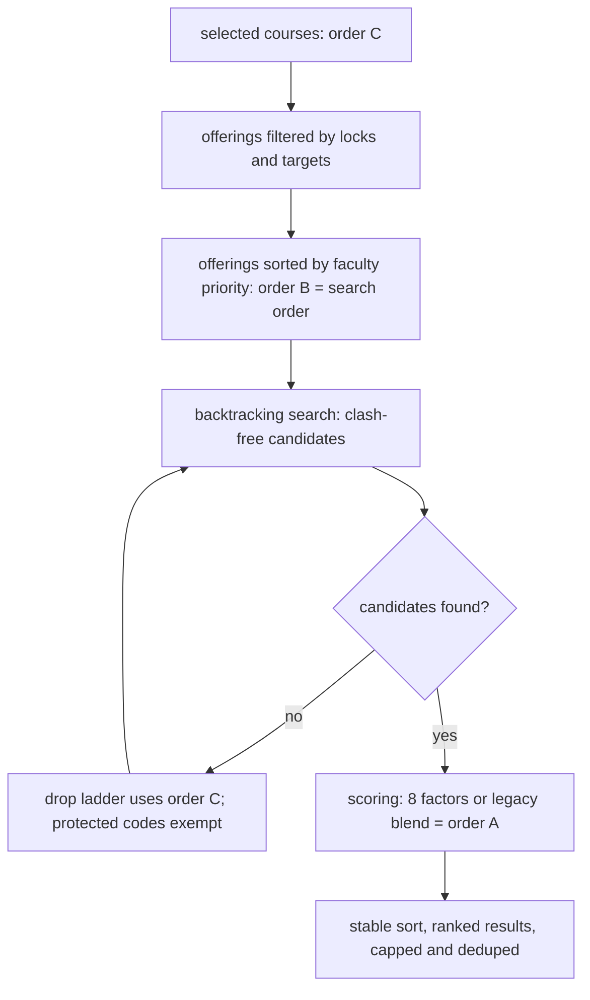
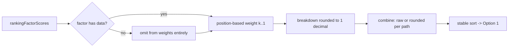

# Ranking and priority

> **In one line:** "priority order" means three different things in FFCS — which timetable is Option 1, which professor you want for one course, and which course gets sacrificed when nothing fits — and a port that merges them will look plausible while ranking everything wrong.

## Why this page exists

The word "priority" appears in three separate features of the web planner, backed by three different data shapes, three different storage keys and three different stages of the pipeline. The ffcs-planner skill calls this "the most important file in the skill" (`reference/02-priority-order.md:1-3`). The running Kotlin app implements **none** of the three systems in its generation path — it has three booleans and one fixed comparator (`FfcsEngine.kt:26-30`, `:182-187`). Wave 1 ported A, B and the policy for C into standalone libraries (D-173/D-174/D-175); wave 3 must wire them in. If you are integrating D-173 (ranking math), this is the map you need before you touch a single number.

## The idea, in plain words

Picture three different remote controls that all happen to have a button labelled "priority":

1. **Which timetable wins** is the *channel list* — it decides what appears at the top of your results. This is a **scorecard**: each row (gaps, half-days, faculty…) contributes points, and moving a row up makes it louder.
2. **Which professor you want** is a *per-dish preference* — "for this course, I want Dr. Rao first." It is written as a name list, not a number.
3. **Which course gets dropped** is the *packing order* — "if the week will not fit, leave out whatever I added last." It is derived from the order you selected courses.

Other words you will meet:

- **Profile** = a pre-tuned preset of weights, like a "sports mode" on the scorecard. There are **six**.
- **Factor** = one switchable scorecard row. There are **eight**.
- **Weight** = how many points a row is worth, decided by its position in the list.
- **`null` vs `0`** = "no opinion, do not count me" versus "explicitly last place." Confusing them is a classic bug.
- **Raw vs rounded** = whether you add up the unrounded points and round once at the end, or round each row first and then add. The shipped code does **both**, in different functions.

| Term | Plain meaning | Pointer |
|---|---|---|
| ranking-factor order (A) | which generated timetable is Option 1 | ref `02-priority-order.md` §A |
| faculty-priority order (B) | which professor for *this* course | ref `02-priority-order.md` §B |
| course / drop order (C) | what to sacrifice when nothing fits | ref `02-priority-order.md` §C |
| `RankingFactor` | one of 8 scorecard rows | ref `02` §A.5, `:345-356` |
| `RankingMode` / profile | one of 6 presets with fixed weights | ref `02` §A.2, `:94-133` |
| `RankingPriority` | one of 4 legacy blend components | ref `02` §A.6, `:330`, `:471` |

## The disambiguation table — read this before anything else

From `reference/02-priority-order.md:7-29`:

| # | Name | Question it answers | Data shape | Persisted as | Port D-ID (wave-1 status) |
|---|---|---|---|---|---|
| A | **Ranking-factor order** | "Which generated timetable is Option 1?" | `RankingFactor[]` (8 values) + `RankingPriority[]` (4 values) | `ffcs_settings.rankingPriorityOrder` + generator prefs | D-173 — ported, not integrated |
| B | **Faculty-priority order** | "Which professor do I want for *this* course?" | `FacultyPriorityMap = Record<string, string[]>` | `ffcs_facultyPriority` | D-174 — ported, not integrated |
| C | **Course / drop order** | "If not everything fits, what do I sacrifice?" | `courseOrder: readonly string[]` | selection order / session prefs | D-175 — ported, not integrated |

They are applied at **different stages** (ref `02` `:15-29`):



> **Critical exclusivity rule:** mechanism B appears **twice** — it reorders options before the search (changing which weeks exist at a cap) *and* contributes a comparison score after the search (changing their order). A port that implements only one of these is subtly wrong (ref `02` `:1205`).

## Mechanism A — ranking-factor order (ported in wave 1, D-173; not integrated)

> **Wave-1 library (D-173), not the running app.** The register marks D-173 "PORTED - not integrated" (`docs/WEB_PARITY_DRIFT_REGISTER.md:357`); the port is `ffcs/FfcsRanking.kt:11-40` with the expectation "both combiners, raw accumulation, golden 60/55/70/0 and 52.1". The app still uses the three-boolean comparator until wave 3.

### A.1 Six legacy profiles vs eight factors vs four components

There are **three** scoring shapes in the reference, not one:

| Shape | How many | Where | How it combines |
|---|---|---|---|
| Legacy **profiles** | 6 modes | `RANKING_MODES` / `PROFILES`, ref `02` §A.2 `:94-133` | Fixed weight table per profile; default `Balanced` |
| New **factor list** | 8 factors | `RANKING_FACTORS`, ref `02` §A.5 `:345-356` | Positional weights from the student's order; per-row switch disables a factor |
| Legacy **four-component blend** | 4 components | `RankingPriority = "profile" \| "faculty" \| "sort" \| "time"`, ref `02` §A.6 `:449-505` | Positional weights from `rankingPriorityOrder` |

The six profiles are `Best Faculty`, `Balanced`, `Half Days`, `Minimize Gaps`, `Early Finish`, `Late Start` (ref `02` `:94-101`). Their weights are *preferences*, not measurements — that is why they live in a separate module from `timetableMetrics` (ref `02` §A.1 `:42-85`).

Verbatim weights from ref `02` §A.2 `:127-134` (`PROFILES` in `src/lib/ffcsRanking.ts`); a number is that factor's share of the score:

| Profile | compactDays | lowGaps | earlyFinish | lateStart | balancedLoad | facultyQuality |
|---|---|---|---|---|---|---|
| Best Faculty | 2 | 2 | 1 | 1 | 1 | 45 |
| Balanced (default) | 10 | 14 | 10 | 8 | 8 | — |
| Half Days | 30 | 10 | 8 | 4 | 3 | — |
| Minimize Gaps | 6 | 32 | 6 | 3 | 8 | — |
| Early Finish | 8 | 10 | 30 | 2 | 4 | — |
| Late Start | 8 | 8 | 4 | 30 | 4 | — |

Faculty only participates in `Best Faculty`, and only when review data exists. `profileFor(unknown)` falls back to `Balanced` rather than throwing (ref `02` `:136-142`).

The eight factors, with the UI labels from ref `02` §A.8 `:536-545`:

| Factor | Label | Score expression (ref `02` §A.4 / §A.5) |
|---|---|---|
| `gaps` | Fewer gaps | `inverted(gapsPerDay, 6) * 100` |
| `halfdays` | Free half-days | `(halfDays / 12) * 100` |
| `balancedLoad` | Balanced days | `inverted(dailyLoadVariance, 4) * 100` |
| `faculty` | Faculty quality | Vitfac aggregate, omitted when unrated |
| `social` | Time with friends | `socialScore` 0-100 |
| `earlyFinish` | Early finishes | `inverted(avgEnd - 12:00, 7h) * 100` |
| `lateStart` | Late starts | `normalize(avgStart - 08:00, 6h) * 100` |
| `time` | Time preference fit | omitted when no preference is set |

> **Naming trap:** `metrics.halfDays` means *free* half-days (bigger = more free time), while the profile's `compactDays` means *class days that fit in a four-hour window* (bigger = tighter week). They sound identical and mean opposite things; a port must never read one for the other (ref `02` §A.1 `:61-73`).

> **Ordering discrepancy:** `RANKING_FACTORS` lists `social` before `faculty`; the UI default order puts `balancedLoad` and `faculty` before `social`. Both are valid because the combiner uses whatever order the caller passes — a port must **choose one and document it** (ref `02` §A.8 `:560`).

### A.2 Positional weights and the two combiners

With `k` present factors, weights are `k, k-1, …, 1` and the total is `k(k+1)/2`; the top factor gets `2/(k+1)` of the score (ref `02` §A.5 `:445`). For `k=8`: 8,7,6,5,4,3,2,1 → total 36 → top ≈22.2%. For `k=4`: 4,3,2,1 → total 10 → top 40%.

**Abridged from ref `02` §A.5 `:410-442` (framework-free port shape from §A.10 `:684-705`):**

```ts
export function combineFactors(scores, order) {
  const seen = new Set();
  const active = order.filter(f => RANKING_FACTORS.includes(f) && !seen.has(f) && !!seen.add(f));
  const present = active.filter(f => {
    const v = scores[f];
    return v !== null && v !== undefined && Number.isFinite(v);
  });
  const total = present.reduce((sum, _, i) => sum + (present.length - i), 0);
  if (!total) return { score: 0, breakdown: {} };
  const breakdown = {};
  let score = 0;
  present.forEach((f, i) => {
    const w = present.length - i;
    const p = clamp100(scores[f]) * w / total;
    breakdown[f] = r1(p);   // rounded to 1 decimal
    score += p;             // RAW points accumulated
  });
  return { score: r1(Math.max(0, Math.min(100, score))), breakdown };
}
```

| Behaviour | Why it matters |
|---|---|
| Duplicates removed, first occurrence kept | a bad persisted order cannot double-count a factor |
| Data-less / disabled factors removed **before** weights are assigned | disabling the top factor promotes the next one instead of leaving a hole |
| Every factor rounded to 1 decimal in `breakdown`; final score rounded once | "why is this Option 1?" must be auditable |

**The two combiners are not identical.** `combineFactorScores` **drops** factors not in the supplied order; `combineRankingScores` **appends** missing components from the canonical `["profile","faculty","sort","time"]` (ref `02` §A.6 `:502-504`). Preserve this asymmetry — a partial legacy order is completed, not truncated.

Also: only **one** ranking path runs per generation call. When `rankingFactors` is present it supersedes `rankingMode` / `rankingPriorityOrder` entirely — "one kind of ranking runs per call, never both stacked" (ref `02` §A.8 `:562-580`; ref `04-generation-engine.md` §4 `:422-438`).

### A.3 The raw-vs-rounded asymmetry — a real, documented trap

This is the detail most likely to make a port fail its golden test:

- **`scoreRanking` (legacy profile scoring)** accumulates the **rounded** per-factor points: `const rounded = Number(points.toFixed(1)); breakdown[key] = rounded; raw += rounded;` (ref `02` §A.4 `:302-311`).
- **`combineRankingScores` and `combineFactorScores`** accumulate **raw** points and round only each breakdown entry and the final score (vendored `ffcsRanking.ts:409-411`, reported in ffcs-planner `docs/SWARM_BOARD.md:63-65`; see also `scripts/go/README.md:75-79`). The three runnable reference stacks were corrected from scoring **52.0 to 52.1** once they matched the vendored source.

Documented golden vectors from the reference ports: breakdowns `60/40/16.7/3.3` and `70/50/16.7/3.3`, final sample-report score `52.1` (`scripts/go/README.md:70-79`). The Kotlin drift register records the D-173 expectation as "golden 60/55/70/0 and 52.1" (`WEB_PARITY_DRIFT_REGISTER.md:357`) — treat the register as the Kotlin acceptance target, and do not invent a derivation for a tuple the references do not spell out.

> **Warning:** rounding the final composite only, or rounding per-factor in the wrong path, silently changes `52.1` to `52.0`. Ref `02` §F item 8: "Rounding the final composite only. The shipped code rounds each factor to 1 decimal first." Preserve each path's exact rule and pin both with golden tests.

### A.4 What the running app uses today — and what the wave-1 library adds

`GenerateOptions(closeGaps, lateStart, earlyFinish)` (`FfcsEngine.kt:26-30`) exposed through three setters (`FfcsViewModel.kt:170-180`) and one comparator (`:182-187`). The running app has no numeric score, breakdown, combiners or golden-vector checks. Wave 1 supplies them as libraries — the enums in `ffcs/planner/FfcsPlannerModels.kt`, the scoring in `ffcs/FfcsRanking.kt` — but `FfcsEngine` does not call them yet. Current JVM tests for the running path only assert the three booleans' ordering effects (`shared/src/jvmTest/.../FfcsParityTest.kt:30-78`).

## Mechanism B — faculty-priority order (ported in wave 1, D-174; not integrated)

> **Wave-1 library (D-174), not the running app.** Register: `docs/WEB_PARITY_DRIFT_REGISTER.md:358` now says "PORTED - not integrated" (it used to say "Missing entirely"). The running app's `CourseLock` only carries `allowedOfferings` (`FfcsModels.kt:78-85`), so "which professor I prefer" cannot be expressed there; the wave-1 `FacultyPriorityMap` (`FfcsFacultyPriority.kt:24-25`) supplies the shape as a library.

- Data shape: `FacultyPriorityMap = Record<string, string[]>` — course code → faculty **names** in best-first order (ref `02` §B.1 `:741-742`).
- Names come from the report's `FACULTY` cell split on `/`, compared case-insensitively (`:751-756`, `:866-871`).
- `null` means "no preference expressed" and is **excluded** from scoring; a listed course whose faculty is absent scores `0` — a real negative answer (`:789-830`).
- Score for rank `i` in a list of length `n` is `(n - i) / n`; with 3 names: `1.0, 0.667, 0.333`, unlisted `0` (`:799-806`, `:871`).
- `sortOptionsByFacultyPriority` runs **inside `optionsFor`, before the DFS** (ref `04-generation-engine.md` §2 filter 9, §10), so at a result cap the preferred offerings are the ones that survive.

Worked example (ref `02` §B.4 `:934-943`):

```ts
const map = { CSE1001: ["Dr. Rao", "Dr. Menon", "Prof. Iyer"] };
facultyPreferenceScore(map.CSE1001, "Dr. Rao / Dr. Smith") === 1.0; // first name matches index 0
facultyPreferenceScore(map.CSE1001, "Prof. Iyer") === 1 / 3;        // index 2
facultyPreferenceScore(map.CSE1001, "Dr. Unknown") === 0;           // listed course, name absent
facultyPreferenceScore(undefined, "Dr. Rao") === null;              // no preference
```

## Mechanism C — course / drop order (ported in wave 1, D-175; not integrated)

> **Wave-1 library (D-175), not the running app.** Register: `docs/WEB_PARITY_DRIFT_REGISTER.md:359` marks it "PORTED - not integrated"; the policy lives in `FfcsDropPolicy.kt:24-49` and the typed codes in `FfcsGenerationRun.kt:10-18`.

This one is only a *priority* in the sense of "added last, needed least": `courseOrder` is the order the student selected courses, and the **tail** is dropped first. Codes the student explicitly targeted (a non-empty lock) are `protectedCodes` and are never dropped. The full ladder, protected-code rules and typed failure codes are in [drop-ladder-and-errors.md](./drop-ladder-and-errors.md). Do not wire mechanism C into the app as "drop the first-selected course" — that is mistake #4 in ref `02` §F `:1226`.

## What can go wrong

The reference's own review checklist (ref `02` §F `:1221-1231`) — each is a real failure mode, not a hypothetical:

| # | Mistake | Consequence |
|---|---|---|
| 1 | Coercing `null` faculty/preference score to `0` | unranked courses outrank or drag down plans |
| 2 | Applying faculty priority only after generation | result caps discard preferred offerings |
| 3 | Using `metrics.halfDays` where `compactDays` is wanted | ranks backwards |
| 4 | Dropping the first-selected course instead of the last | violates "added last, needed least" |
| 5 | Dropping a targeted / locked course | breaks a stated student intent |
| 6 | Retrying on a solver crash | infinite or misleading retry loop |
| 7 | Reusing a mutated order array in `combineRankingScores` | partial order gets the canonical tail appended |
| 8 | Rounding the final composite only | golden score drifts `52.1` → `52.0` |
| 9 | Treating the UI default factor order as canonical | `RANKING_FACTORS` differs from the UI; caller order is authoritative |



## Where to next

- **[Generation engine](./generation-engine.md)** — where scoring sits in the pipeline and why the Kotlin cap makes search order matter (D-173/D-175 boundary).
- **[Drop ladder and errors](./drop-ladder-and-errors.md)** — mechanism C in full: retryable vs crash, protected codes, eight typed error codes (D-175).
- **[Vocabulary](./vocabulary.md)** — definitions of every term used here.
- **Source of truth:** ffcs-planner skill `reference/02-priority-order.md` §§0, A–F and `reference/04-generation-engine.md` §4; `FfcsEngine.kt:26-30`, `:182-187`; `FfcsViewModel.kt:170-180`; `docs/WEB_PARITY_DRIFT_REGISTER.md:357-359`.
