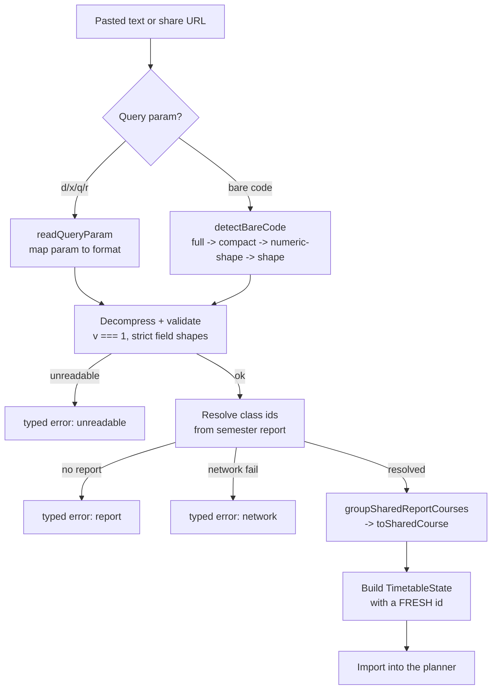
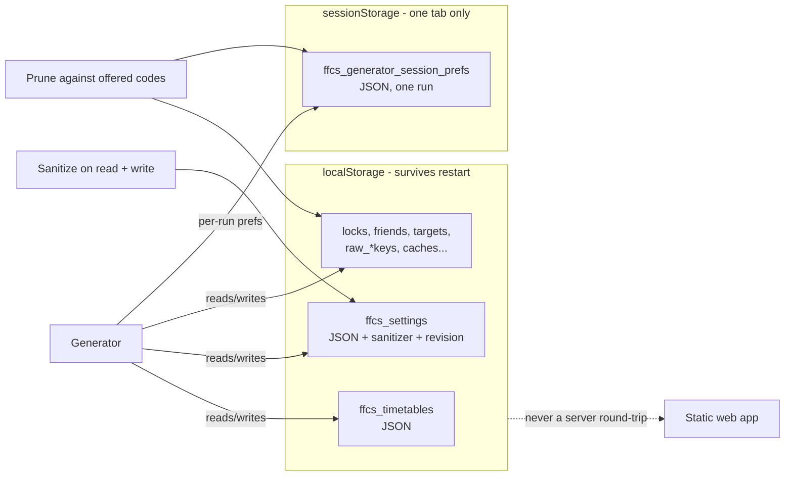

# Share links and storage

> **In one line:** the web planner packs a whole week into a URL code (`?d`, `?x`, `?q` or `?r`) and keeps its state in namespaced browser storage, while the Kotlin app currently shares only attendance-schedule codes and stores just two FFCS cache values — the canonical layers exist as wave-2 ported libraries (D-178 storage, D-179 share codecs) with golden tests, but are **not yet wired** into the running app.

## Why this page exists

The other pages on this site describe the planner that *runs* in this repository. This one is different: it records a **contract from the web original** that the Kotlin port has implemented as libraries but has not yet wired into the app, side by side with **what the Kotlin code actually does today**. Mixing the two is the easiest way to document a feature that is not running.

Three sources are in play, and they must never be blended:

| Source | What it is | Status in the running app |
|---|---|---|
| ffcs-planner skill `reference/06-import-export-share.md` and `reference/07-storage-and-settings.md` | Verbatim record of the shipped AmazeCC web implementation | **Specification only** — the contract the ported libraries follow |
| AmazeCC-Kotlin source (`SocialUtils.kt`, `SettingsManager.kt`, `FfcsViewModel.kt`) | The code that actually runs | Attendance sharing + two FFCS cache keys only |
| Wave-2 work items D-178 (storage) / D-179 (share codecs) | Canonical layers ported into Kotlin libraries with golden tests | **Ported libraries — not yet wired into the running app** |

<Warning>
Nothing in the "canonical contract" sections below is a claim about the current Kotlin app. Those sections are the specification a port must satisfy. The section **"What Kotlin actually has today"** is the honest description of the shipped code.
</Warning>

## Words you'll meet

Each term is defined here before it is used later on the page.

| Word | Plain meaning | Where it comes from |
|---|---|---|
| Wire format | One agreed way of packing a plan into text for a URL | ref `06` §1 (`:9-47`) |
| Payload | The actual text after `?d=`, `?x=`, `?q=` or `?r=` | ref `06` §1 (`:34-39`) |
| Codec | A pair of functions: encode (plan → text) and decode (text → plan) | ref `06` §§1.1–1.3 |
| lz-string | A JavaScript compression library whose output is URL-safe text | ref `06` §1.1 (`:71-93`) |
| base64url | The URL-safe alphabet `-` and `_` instead of `+` and `/`, with `=` padding stripped | `compressScheduleCode`, `SocialUtils.kt:144-175` |
| LEB128 / varint | A way to write an integer as a run of 7-bit chunks with a "more follows" flag | ref `06` §1.3 (`:162-183`) |
| Class ID prefix / suffix | A shared class id split into a common head and the short tails that differ per course | ref `06` §1.2 (`:114-136`) |
| Receiver priority | If a link contains several params, the order in which the reader tries them | `FFCSShareView.tsx:40-64`, ref `06` §1 (`:41`) |
| Bare code | A pasted payload with no `?d=` / `?x=` wrapper at all | ref `06` §1.5 (`:203-221`) |
| Fresh id | A new identity assigned on decode, so importing twice creates two plans | ref `06` §1.1 (`:83-109`) |
| localStorage / sessionStorage | Browser notebooks: one survives a restart, the other dies with the tab | ref `07` §2 (`:157-175`), §4 (`:233-268`) |
| Raw-string key | A value written verbatim instead of as quoted JSON | ref `07` §2 (`:175`) |
| Sanitizer | Code that repairs each bad field individually instead of discarding the whole record | ref `07` §1.3 (`:82-128`) |
| Revision stamp | A version number on a settings record that tells a migration whether `50` was an old default or a real choice | ref `07` §1.3 (`:114-128`) |
| Target pruning | Removing saved generator targets whose course codes are no longer offered | ref `07` §4 (`:270-294`) |
| Ported library | A canonical layer reimplemented in Kotlin with golden tests, but not yet wired into the running app. **D-185 wired the FFCS *export builders*** into the host (`M3EAcademicLegacyBridge.kt:1000-1121`) — a different work item that did **not** wire the share codecs or the storage keys. | D-178 / D-179 (this page); D-185 export wiring in `M3EAcademicLegacyBridge.kt:1000-1121` |

## The idea, in plain words

**Sharing is packing for a trip.** The web planner offers four sizes of suitcase label:

- `?d=` is the **full packing list** — every course, with its slots and faculty, written out.
- `?x=` is the **hotel address** — semester plus class-id prefixes and suffixes; the reader looks the courses up in its own current report.
- `?q=` is just the **shape of the list** — prefix and suffixes, no name.
- `?r=` is the **shorthand list** — one letter for the semester/report and a string of tiny compressed numbers.

All four fit in a URL, so no server is involved. The reader follows a fixed pecking order (`q` before `r` before `x` before `d`) and, when someone pastes a naked code rather than a link, tries the strictest decoders first.

**A codec is a lock and a key.** `lz-string` turns JSON into URL-safe text and back; a version stamp (`1`) makes sure the two ends speak the same language. A tampered or truncated payload simply fails to decode — it never half-imports.

**Identifiers are luggage tags, not cargo.** When a shared week is decoded, the plan's courses and name survive but its id does **not**: a fresh tag is printed, so importing the same plan twice gives you two plans instead of silently overwriting one.

**Storage is two kinds of paperwork.** `localStorage` is the filing cabinet that survives closing the browser; `sessionStorage` is the sticky note on the desk that disappears when you leave. The web planner keeps timetables, settings and locks in the cabinet, and one-run generator preferences on the sticky note.

**A sanitizer is a careful editor.** If one field in the saved settings is corrupt, the editor fixes *that field* from a default and leaves the other five alone. A revision stamp lets it tell an old default from a deliberate choice — `50` on an old record means "upgrade to 30 000", while `50` on a current record means "the student really picked 50".

**Target pruning is removing old reservations.** A pinned course that is no longer offered would fail the whole generation run, so stale targets are dropped from both storage and session preferences before the next run.

## What → why → how

**What.** Define (a) how a plan is encoded into a share URL and decoded back, and (b) which keys hold planner state, how their values are encoded, and how saved settings are repaired and migrated.

**Why.** A link is the only way a student can hand a week to a friend without a backend, and browser storage is the only place a client-side planner can remember anything. Both formats are easy to get subtly wrong: wrong compression, wrong reader priority, wrong JSON-vs-raw encoding, or a settings wipe that throws away a student's choices.

**How.** Read the contract from the web source of truth, then check it against the Kotlin source and mark the gap. This page follows exactly that order.

---

## The canonical share contract (web source of truth — not running Kotlin)

Source: ffcs-planner skill `reference/06-import-export-share.md`, quoting `src/lib/ffcsShare.ts`, `src/lib/ffcsShareInput.ts` and `src/app/share/ffcs/FFCSShareView.tsx` in the AmazeCC repository.

### 1. Four wire formats

`FFCS_SHARE_VERSION = 1` and `FFCS_SHARE_WARN_LENGTH = 8000`; the version is checked **exactly**, and a mismatch returns `null` (ref `06` `:11-32`, `:97`). Over-long links are flagged, not rejected:

```ts
// src/lib/ffcsShare.ts:14-15, 196-198 (via ref 06 :14-15, :196-198)
export const FFCS_SHARE_VERSION = 1;
export const FFCS_SHARE_WARN_LENGTH = 8000;

export function isOversizedShareLink(url: string): boolean {
  return url.length > FFCS_SHARE_WARN_LENGTH;
}
```

| URL param | Format name | Payload | Name travels? | Size |
|---|---|---|---|---|
| `?d=` | full | lz-string JSON `{v, c, n, k}` — whole plan, courses included | yes | largest |
| `?x=` | compact | lz-string JSON `{v, s, p, i, n}` — semester + prefix + suffixes + name | yes | medium |
| `?q=` | shape | lz-string JSON `{p, i}` — prefix + suffixes only; semester inferred from prefix | no | small |
| `?r=` | numeric-shape | `"<code>.<base64url LEB128 deltas>"` | no | smallest |

```ts
// src/lib/ffcsShare.ts:11-31 (via ref 06 :13-32)
export const FFCS_SHARE_VERSION = 1;
export const FFCS_SHARE_WARN_LENGTH = 8000;

interface ShareWire {
  v: number;
  /** Campus whose schema the plan was built against. */
  c: string;
  n: string;
  k: AddedCourse[];
}

export interface CompactShareWire {
  v: number;
  s: FFCSSemesterId;
  p: string;
  i: string[];
  n: string;
}
```

Only the **shared week** travels: its name and placed courses. Other timetables, friends, locks and metrics are deliberately absent (ref `06` `:11`).

### 2. Receiver priority and bare-code order

The reader tries `q` > `r` > `x` > `d` (`FFCSShareView.tsx:40-64`, ref `06` `:41`). A pasted naked code takes a different order: **full → compact → numeric-shape → shape**. Compact is tried before shape because a compact payload also satisfies the shape decoder; trying shape first would misread it (ref `06` `:221`).

```ts
// src/lib/ffcsShareInput.ts (via ref 06 :205-219), abridged
export type ShareInputFormat = "full" | "compact" | "shape" | "numeric-shape";
const PARAM_FORMATS = { d: "full", x: "compact", q: "shape", r: "numeric-shape" } as const;

function readQueryParam(value: string): ParsedShareInput | null {
  const match = /(?:^|[?\s&])([dxqr])=([^\s&#]+)/.exec(value);
  if (!match) return null;
  const key = match[1] as keyof typeof PARAM_FORMATS;
  let encoded = match[2];
  if (encoded.includes("%")) { try { encoded = decodeURIComponent(encoded); } catch { return null; } }
  return { format: PARAM_FORMATS[key], encoded };
}
```

`resolveShareInput` then loads the semester report and maps class ids → `ParsedCourse` rows → `groupSharedReportCourses` → `toSharedCourse`, with typed errors `unreadable` / `report` / `network` (ref `06` `:203-221`). A URL with a base path honours `NEXT_PUBLIC_BASE_PATH`, so the same static build works at a root or under `/<repo>/` (ref `06` `:185-201`).

### 3. Fresh id on decode

The full decoder validates every field, then gives the result a **new** id. This is an explicit invariant, not an implementation detail:

```ts
// src/lib/ffcsShare.ts:486-534 (via ref 06 :80-109), abridged
export function decodeTimetableShare(encoded: string): { timetable: TimetableState; campus: string } | null {
  if (!encoded) return null;
  let wire: unknown;
  try {
    const json = decompressFromEncodedURIComponent(encoded);
    if (!json) return null;
    wire = JSON.parse(json);
  } catch { return null; }
  if (!wire || typeof wire !== "object") return null;
  const w = wire as Record<string, unknown>;
  if (w.v !== FFCS_SHARE_VERSION) return null;
  if (typeof w.n !== "string" || !Array.isArray(w.k)) return null;
  const courses = w.k.map(asCourse).filter((c): c is AddedCourse => c !== null);
  if (courses.length === 0) return null;
  return {
    timetable: {
      id: `share-${Date.now().toString(36)}-${Math.random().toString(36).slice(2, 8)}`,
      name: w.n,
      courses,
    },
    campus: typeof w.c === "string" && w.c ? w.c : GLOBAL_CAMPUS,
  };
}
```

| Decode result | Why |
|---|---|
| name, courses, campus preserved | that is the shared content |
| **fresh `share-…` id** | importing twice yields two plans, not a silent overwrite (ref `06` `:83-85`, `:225`) |
| `null` for truncated, version-bumped or empty-course payloads | never half-import (ref `06` `:227`) |

### 4. Numeric-shape LEB128 limits

`?r=` sorts the four-digit class-id suffixes, writes the **deltas** between them as LEB128 varints, then base64url-encodes those bytes (ref `06` `:162-181`):

```ts
// src/lib/ffcsShare.ts:345-444 (via ref 06 :162-181), abridged
  const sorted = (suffixes as number[]).sort((a, b) => a - b);
  const bytes: number[] = [];
  let previous = 0;
  for (const suffix of sorted) {
    let delta = suffix - previous;
    do {
      const data = delta & 0x7f;
      delta = Math.floor(delta / 128);
      bytes.push(data | (delta > 0 ? 0x80 : 0));
    } while (delta > 0);
    previous = suffix;
  }
  let binary = "";
  for (const byte of bytes) binary += String.fromCharCode(byte);
  const encodedBytes = btoa(binary).replace(/\+/g, "-").replace(/\//g, "_").replace(/=+$/g, "");
  return `${report.classIdPrefixCode}.${encodedBytes}`;
```

Decode rejects:

| Rejection | Source |
|---|---|
| non-canonical varints | `ffcsShare.ts:429` (ref `06` `:183`) |
| zero deltas | `ffcsShare.ts:430` |
| **suffix value** > 9999, checked both on a single decoded varint and on the running `currentSuffix` | `ffcsShare.ts:423`, `:432` |
| more than 100 ids | `ffcsShare.ts:434` |

<Warning>
The `9999` cap is on each numeric **suffix value**, not on the number of suffixes — a documented drift that was corrected during the reference audit (skill §7, "numeric-share decode limit"). Do not implement it as a count limit. Report codes are winter final `"2"`, winter mock `"1"`, fall `"0"` (`ffcsReports.ts:45-84`).
</Warning>

### 5. How a shared link is read



---

## The canonical storage contract (web source of truth — not running Kotlin)

Source: ffcs-planner skill `reference/07-storage-and-settings.md`, quoting `src/lib/storage.ts`, `src/lib/ffcsSettings.ts`, `src/lib/ffcsGeneratorSessionPrefs.ts` and `src/lib/ffcsGeneratorTargets.ts` in the AmazeCC repository.

### 1. Storage primitives

Every operation swallows errors — a full quota or blocked storage degrades to defaults, never a crash (ref `07` `:157-175`):

```ts
// src/lib/storage.ts:89-129 (via ref 07 :159-173)
function getItem<T>(key: string): T | null {
  try {
    const raw = localStorage.getItem(key);
    if (raw === null) return null;
    return JSON.parse(raw) as T;
  } catch { return null; }
}
function setItem<T>(key: string, value: T): void {
  try { localStorage.setItem(key, JSON.stringify(value)); } catch { /* quota exceeded, silently fail */ }
}
function removeItem(key: string): void { try { localStorage.removeItem(key); } catch {} }
function getString(key: string): string | null { try { return localStorage.getItem(key); } catch { return null; } }
function setString(key: string, value: string): void { try { localStorage.setItem(key, value); } catch {} }
```

Namespacing is a literal `ffcs_` prefix. The portable helper treats **three keys as raw strings** (`RAW_STRING_KEYS`, `storage.ts:556-558`): `ffcs_activeTimetableId`, `ffcs_dismiss_faculty_guide`, `ffcs_layout_mode`.

### 2. Complete key inventory

| Key | Encoding | Shape |
|---|---|---|
| `ffcs_timetables` | JSON | `TimetableState[]` — saved weeks; unbounded growth possible |
| `ffcs_activeTimetableId` | **raw string** | id string |
| `ffcs_blockedSlots` | JSON | array of blocked slot tokens |
| `ffcs_friends` | JSON | `Friend[] = {id,name,timetables:TimetableState[]}[]` |
| `ffcs_friendGroups` | JSON | `FriendGroup[] = {id,name,friendIds:string[]}[]` |
| `ffcs_socialScoreGroupMethod` | raw string | group-method name |
| `ffcs_courseLocks` | JSON | `CourseLock[]` |
| `ffcs_facultyPriority` | JSON | `FacultyPriorityMap = Record<code, string[]>` — **camelCase P** |
| `ffcs_manual_links` | JSON | `ManualLink[]` |
| `ffcs_raw_courses` | JSON | `ParsedCourse[]` shared cache with Free Classrooms |
| `ffcs_raw_courses_${semesterId}` | JSON | per-semester variant |
| `ffcs_settings` | JSON | `FFCSSettings`, sanitized on every read/write |
| `ffcs_tour_seen` | **raw string** | `String(TOUR_VERSION)` — do not hand-edit to replay |
| `ffcs_tips_dismissed` | JSON | `string[]` |
| `ffcs_layout_mode` | **raw string** | `"guided"|"modern"|"classic"` |
| `ffcs_layout_mode_prompt_seen` | JSON | `"true"` via `safeStorage.setItem`; **not** in `RAW_STRING_KEYS`, so JSON-encoded (ref `07` `:216`) |
| `ffcs_generator_targets` | JSON | `CourseLock[]` — the generator's own target picks |
| `ffcs_generator_session_prefs` | **sessionStorage** JSON | `GeneratorSessionPreferences` |
| `ffcs_generator_view_mode` | raw string | `"modern"|"classic"` |
| `ffcs_final_list_notice_seen` | raw string | `"true"` |
| `ffcs_dismiss_faculty_guide` | **raw string** | `"true"` |
| `ffcs_dashboard_widgets` | JSON | `string[]` |
| `ffcs_semester` | raw string | `FFCSSemesterId`; the resolver deliberately never reads it |
| `ffcs_analytics_enabled` | raw string | `"true"/"false"`; absent = enabled; never touched by a settings reset |
| `ffcs_analytics_queue` | JSON | `QueuedEvent[]`; capped at 100, oldest dropped |
| `ffcs_vitfac_enabled` | raw string | mirrors `settings.vitfacIntegration` |
| `cache_ffcs_feedback`, `cache_ffcs_feedback_status` | JSON | feedback status caches |

> **Discrepancies preserved from the reference (ref `07` `:229`):** older docs spell the priority key `ffcs_faculty_priority` (code: `ffcs_facultyPriority`), call the session store `ffcs_generator_session` (code: `ffcs_generator_session_prefs`), and list `ffcs_results_filter` even though no writer exists — result filters are component state only. Follow the code spellings in the table above.

### 3. JSON vs raw string

| Question | JSON key | Raw-string key |
|---|---|---|
| What is stored? | `JSON.stringify(value)` — strings carry surrounding quotes | the characters verbatim |
| Who reads it? | `getItem<T>` / `storage.get` | `getString` / `getRaw` |
| Example keys | `ffcs_timetables`, `ffcs_settings` | `ffcs_activeTimetableId`, `ffcs_layout_mode`, `ffcs_tour_seen` |
| Why it matters | JSON can hold objects, arrays, booleans | a raw read of a JSON-encoded value returns extra quotes and never matches `true` |

Keep the three portable-helper raw keys raw, keep analytics consent in its own key so a settings reset cannot silently re-enable tracking, and store derived scores as UI state rather than canonical persisted state (ref `07` `:315-322`).

### 4. Session preferences

Per-run generator settings live in `sessionStorage`, so a new tab starts clean (ref `07` `:233-268`):

```ts
// src/lib/ffcsGeneratorSessionPrefs.ts:11-42 (via ref 07 :235-267), abridged
export interface GeneratorSessionPreferences {
  preference?: "compact" | "spread" | "morning" | "evening";
  strictTheoryPreference?: boolean;
  separateLabDays?: boolean;
  uniqueFaculties?: boolean;
  noLimit?: boolean;
  resultCap?: number;
  rankingMode?: RankingMode | null;
  /** The generator's ranked factor list: priority order + per-factor off switch. */
  rankingFactorOrder?: RankingFactor[];
  rankingFactorDisabled?: RankingFactor[];
  targets?: CourseLock[];
  isReviewing?: boolean;
  // ...more fields in the reference
}
```

### 5. Settings defaults, sanitizer and one-shot migration

The settings record carries a `revision` stamp; defaults are frozen, and the sanitizer repairs **each field independently** (ref `07` `:43-80`, `:82-128`):

```ts
// src/lib/ffcsSettings.ts:196-282 (via ref 07 :94-125), abridged
export function sanitizeFFCSSettings(raw: unknown): FFCSSettings {
  const r = (raw && typeof raw === "object" ? raw : {}) as Record<string, unknown>;
  const revision = asInt(r.revision, PRE_REVISION, SETTINGS_REVISION, PRE_REVISION);
  return {
    revision: SETTINGS_REVISION,
    rankingMode: r.rankingMode === "none" ? "none" : (asRankingMode(r.rankingMode) ?? FFCSSettingsDefaults.rankingMode),
    defaultSortBy: SORT_BY.includes(r.defaultSortBy as SortBy)
      ? (r.defaultSortBy as SortBy) : FFCSSettingsDefaults.defaultSortBy,
    exportFormat: EXPORT_FORMATS.includes(r.exportFormat as ExportFormat)
      ? (r.exportFormat as ExportFormat) : FFCSSettingsDefaults.exportFormat,
    rankingPriorityOrder: (() => {
      const allowed: readonly RankingPriority[] = ["profile", "faculty", "sort", "time"];
      const supplied = Array.isArray(r.rankingPriorityOrder) ? r.rankingPriorityOrder : [];
      const unique = supplied.filter(
        (value, index): value is RankingPriority =>
          allowed.includes(value as RankingPriority) && supplied.indexOf(value) === index,
      );
      return [...unique, ...allowed.filter((value) => !unique.includes(value))];
    })(),
    minHalfDays: asInt(r.minHalfDays, 0, MAX_HALF_DAYS, FFCSSettingsDefaults.minHalfDays),
    resultCap: (() => {
      const stored = asInt(r.resultCap, MIN_RESULT_CAP, MAX_RESULT_CAP, FFCSSettingsDefaults.resultCap);
      const isLegacyDefault = revision < SETTINGS_REVISION && stored === LEGACY_DEFAULT_RESULT_CAP;
      return isLegacyDefault ? FFCSSettingsDefaults.resultCap : stored;
    })(),
    allSubjectsMode: typeof r.allSubjectsMode === "boolean" ? r.allSubjectsMode : FFCSSettingsDefaults.allSubjectsMode,
    // ...other booleans fall back individually; weights/filters clamped via asScore
  };
}
```

| Constant | Value | Role |
|---|---|---|
| `SETTINGS_REVISION` | `2` | stamp written on every save (`ffcsSettings.ts:46`) |
| `PRE_REVISION` | `1` | treats an unstamped record as old |
| `LEGACY_DEFAULT_RESULT_CAP` | `50` | the old default that must be upgraded once |
| `MAX_RESULT_CAP` / `HARD_RESULT_LIMIT` | `30_000` | current default and ceiling |
| `MIN_RESULT_CAP` / `MAX_HALF_DAYS` | `10` / `12` | clamp bounds for `resultCap` / `minHalfDays` |

The migration is **one-shot and value-sensitive**: `resultCap: 50` on a `revision: 1` record is the old default riding along, so it becomes `30 000`; the same `50` on a `revision: 2` record was a deliberate pick and is kept (ref `07` `:128`). Sanitize on **every** read and **every** write (`:318`).

### 6. Target pruning

A stale pin does not sit idle — it fails the whole run with `no_valid_slots`. Both the target store and the session preferences are pruned against the currently offered codes (ref `07` `:270-294`):

```ts
// src/lib/ffcsGeneratorTargets.ts:17-56 (via ref 07 :272-291), abridged
export const FFCS_GENERATOR_TARGETS_KEY = "ffcs_generator_targets";

export function pruneGeneratorTargets(offeredCodes: ReadonlySet<string>): void {
  const stored = loadGeneratorTargets();
  const kept = stored.filter((target) => !!target && offeredCodes.has(target.code));
  if (kept.length !== stored.length) saveGeneratorTargets(kept);
  const prefs = loadSessionPreferences();
  const prefTargets = prefs.targets ?? [];
  const keptPrefs = prefTargets.filter((target) => offeredCodes.has(target.code));
  if (keptPrefs.length !== prefTargets.length) saveSessionPreferences({ ...prefs, targets: keptPrefs });
}
```

### 7. Storage layers at a glance



---

## What Kotlin actually has today

> **Running app, verified in this repository.** Everything below is shipped Kotlin code. None of it implements the canonical share or storage contract described above.

### 1. The only share codes are attendance schedules

`SocialUtils.kt` exports and imports **attendance-schedule** codes: `v5|name|reg|titles|assignments` and `v6|expiresAtSec|name|reg|titles|assignments`, compressed with a hand-written base64url routine and wrapped in `amazecc://share#s=`. It is the social/friend-timetable feature (D-007), not the FFCS planner.

```kotlin
// shared/src/commonMain/kotlin/com/amazecc/app/shared/utils/SocialUtils.kt:84-130 (abridged)
/** Web parity (D-007): `v6|<expiresAtSec>|<name>|<regNumber>|<courses>|<assignments>`. */
fun exportScheduleCode(
    attendance: List<AttendanceItem>,
    name: String,
    regNumber: String,
    expiryMinutes: Int? = null
): String {
    if (attendance.isEmpty()) return ""
    ...
    if (expiryMinutes != null && expiryMinutes > 0) {
        val expiresAtSec = Clock.System.now().toEpochMilliseconds() / 1000 + expiryMinutes.toLong() * 60
        return "v6|$expiresAtSec|$name|$regNumber|${uniqueTitles.joinToString(";")}|${assignments.joinToString("")}"
    }
    return "v5|$name|$regNumber|${uniqueTitles.joinToString(";")}|${assignments.joinToString("")}"
}
```

```kotlin
// shared/src/commonMain/kotlin/com/amazecc/app/shared/utils/SocialUtils.kt:132-142, 144-175, 177-190 (abridged)
fun exportShareableLink(attendance: List<AttendanceItem>, name: String, regNumber: String, ...): String {
    val code = exportScheduleCode(attendance, name, regNumber, expiryMinutes)
    if (code.isEmpty()) return ""
    return "amazecc://share#s=" + compressScheduleCode(code)
}

private const val B64_ALPHABET = "ABCDEFGHIJKLMNOPQRSTUVWXYZabcdefghijklmnopqrstuvwxyz0123456789+/"

/** Web parity (web `compressScheduleCode`): standard base64 -> base64url, padding stripped. */
fun compressScheduleCode(code: String): String { ... }

/** Web parity (web `decompressScheduleCode`): base64url -> raw; already-v5/v6 codes pass through. */
fun decompressScheduleCode(compressed: String): String {
    if (compressed.isEmpty()) return ""
    if (compressed.startsWith("v5|") || compressed.startsWith("v6|")) return compressed
    ...
}
```

The reader accepts `v6|` (with expiry check), `v5|`, `v3|`, `v2|`, `v1|`, `amz-profile-` and the `#s=` / `s=` / `#share=` / `share=` forms, with a UTF-8 `percentDecode` for non-ASCII names (`SocialUtils.kt:281-343`; `percentDecode` at `:213-236`).

| Question | Attendance code in `SocialUtils.kt` | Canonical FFCS share (ref `06`) |
|---|---|---|
| Payload | name, reg number, course titles, 3-char slot/course assignment chunks (`v5`/`v6`) | `{v,c,n,k}` / `{v,s,p,i,n}` / `{p,i}` / numeric deltas |
| Compression | hand-written base64url (`B64_ALPHABET`, `:144-175`) | lz-string `compressToEncodedURIComponent` |
| URL param | `#s=` inside `amazecc://share#s=` (`:132-142`) | `?d=`, `?x=`, `?q=`, `?r=` |
| Version check | `v5` / `v6` prefix routing (`:317-340`) | exact `FFCS_SHARE_VERSION === 1` |
| Receiver priority / bare codes | none | `q>r>x>d`, bare order full→compact→numeric→shape |
| Fresh id / warn 8000 / LEB128 limits | none | all specified |

<Warning>
Do not describe `SocialUtils.kt` as "FFCS share". It is a different feature with a different wire format. The planner itself has **no** plan-to-code encoder or decoder wired in (`vocabulary.md:412-418`, `index.md:275-277`): the lz-string `?d` / `?x` / `?q` / `?r` share codecs are **still only ported libraries** (D-179), not reachable from the running app. D-185 wired five **file-export** builders into the host (`M3EFfcsPlannerScreen.kt:324-454`, `M3EAcademicLegacyBridge.kt:1000-1121`) — those are downloads, not share codes. That distinction has not changed: **FFCS share codes remain unwired.**
</Warning>

The five real export paths, with their canonical builders:

| Card | Canonical builder | Real source | What feeds it |
|---|---|---|---|
| Export ICS | `FfcsEngine.buildFfcsIcs` → `String?` | `FfcsEngine.kt:953-1008`; host at `M3EAcademicLegacyBridge.kt:1000-1013` | The **first** generated timetable only (asymmetry preserved) |
| Export HTML dossier | `buildFfcsDossierHtml` → `String` | `FfcsDossier.kt:16-31`; host at `:1014-1047` | The selected generated timetable, else the first; when none exists, a real selected-course `buildSimpleHtml` fallback (`HtmlExport.kt:56`) |
| Export PDF | `buildFfcsPdf(generated, "FFCS Timetables")` → `ByteArray` | `FfcsExportPdf.kt:82-83`; host at `:1048-1065` | **All** generated timetables |
| Export JSON | `buildFfcsJson(generated)` → `String` | `FfcsExportJson.kt:95`; host at `:1066-1083` | **All** generated timetables |
| Export clash report | `buildFfcsClashReport(FfcsClashDeriver.derive(addedCourses))` → `String` | `FfcsClashDeriver.kt:24-80`, `FfcsExportClashReport.kt:120`; host at `:1084-1121` | The student's real selected offerings; no fabricated clashes |

Every card saves through the host's `rememberFileSaver` (`M3EAcademicLegacyBridge.kt:863`); the four dated exports use `ffcsExportFileName(format, Clock.System.now().toEpochMilliseconds())` (`FfcsDossier.kt:40-51`), ICS keeps the fixed `amazecc-ffcs.ics` name (`:1006`), and `exportNotice` is set only from real save outcomes (`M3EAcademicLegacyBridge.kt:1000-1121`). None of this writes a share code or a planner storage key — see §2 and §3 below.

### 2. SettingsManager: two FFCS cache keys, no planner store

`SettingsManager` is a thin wrapper around a multiplatform `Settings` backend (`SettingsManager.kt:3, 12`), not the web's `localStorage`. Its **only** FFCS-named keys are two caches:

```kotlin
// shared/src/commonMain/kotlin/com/amazecc/app/shared/repository/SettingsManager.kt:177-181
// Last-known FFCS registration slot (used for change detection + reminder re-scheduling)
const val CACHE_FFCS_REG_INFO = "cache_ffcs_reg_info"

// D-154: last-known FFCS feedback status, mirrored from AppDataStore for cold starts
const val CACHE_FFCS_FEEDBACK_STATUS = "cache_ffcs_feedback_status"
```

Those values are a registration slot and a feedback status — neither is planner state. The generic accessors are plain typed get/set/remove calls (`SettingsManager.kt:274-305`), and `clearLocalCache()` removes every `cache_*` key (`:311-323`), so the two FFCS caches are cleared with all the other caches.

| Canonical key or layer (ref `07`) | Present in Kotlin `SettingsManager`? |
|---|---|
| `ffcs_timetables`, `ffcs_courseLocks`, `ffcs_facultyPriority`, `ffcs_friends` | no |
| `ffcs_settings` + sanitizer + revision migration | no |
| `ffcs_generator_session_prefs` in `sessionStorage` | no |
| `ffcs_generator_targets` + pruning | no |
| `cache_ffcs_reg_info`, `cache_ffcs_feedback_status` | **yes** — caches only (`:178`, `:181`) |
| `KEY_WEB_SETTINGS = "settings"` / `WebSettings` blob (`:623-751`) | yes, but this is a **different web-preferences mirror**, not `ffcs_settings` |

<Warning>
`KEY_WEB_SETTINGS = "settings"` (`SettingsManager.kt:623-624`) and `WebSettings` (`:635-713`) mirror the web app's global `settingsAtoms.ts` preferences — theme, sync cadence, Pomodoro, notifications. They have no ranking factors, no `resultCap`, no `allSubjectsMode`, and no FFCS `revision` stamp. Do not present them as the FFCS settings record.
</Warning>

### 3. Planner state lives in memory

`FfcsViewModel` holds the catalog, selection, locks and results in in-memory `StateFlow`s (`FfcsViewModel.kt:17-50`) — there is no call that saves a timetable week to a persistent store. That is why the runtime has neither the `ffcs_timetables` inventory nor the storage sanitizer described in the canonical section.

## Wave-2 ported libraries (D-178 storage / D-179 share codecs) — not yet wired

> **Ported as libraries with golden tests, not yet wired into the running app.** D-178 ported the storage layer — `FfcsSettings`, `FfcsStorage`, `FfcsGeneratorSessionPrefs`, `FfcsGeneratorTargets`. D-179 ported the share codecs — `FfcsLzString`, `FfcsShareCodec`, `FfcsNumericShapeCodec`. Neither is wired into `FfcsEngine`, `FfcsViewModel` or `M3EFfcsPlannerScreen`.

| Work item | Ported Kotlin library | Contract source | Honest status |
|---|---|---|---|
| D-178 | Storage — `FfcsSettings`, `FfcsStorage`, `FfcsGeneratorSessionPrefs`, `FfcsGeneratorTargets`: key inventory, JSON vs raw, session prefs, defaults/sanitizer/migration, target pruning | ref `07` §§1–5 | Ported with golden tests — not yet wired into the running app |
| D-179 | Share codecs — `FfcsLzString`, `FfcsShareCodec`, `FfcsNumericShapeCodec`: four wire formats, version check, warn length, receiver priority, bare-code order, fresh id, LEB128 limits | ref `06` §§1–1.6 | Ported with golden tests — not yet wired into the running app |

Wiring those libraries into the app is separate later work (the same wave-1 → wave-3 distinction recorded in [`DOCS_DRIFT_REGISTER.md`](./DOCS_DRIFT_REGISTER.md) and `docs/WEB_PARITY_DRIFT_REGISTER.md:355-360`). Treat every "canonical" table above as the **specification the ported libraries follow**, and treat the "What Kotlin actually has today" section as the description of the running product.

## What can go wrong

| Port mistake | Reference guidance |
|---|---|
| Reuse base64url compression for FFCS links | canonical formats use lz-string `compressToEncodedURIComponent`; base64url belongs only to the numeric-shape payload (ref `06` §1) |
| Read only `?d=` | support `q>r>x>d` and bare codes full→compact→numeric→shape (ref `06` §§1, 1.5) |
| Keep the decoded plan's original id | a fresh id on decode prevents silent overwrite (ref `06` §1.6) |
| Treat `9999` as a suffix **count** | it is a cap on each suffix **value**, checked twice (ref `06` §1.3; skill §7 audit) |
| Accept any version number | exact `v === 1`; mismatch → `null` (ref `06` §1.1) |
| JSON-encode one of the raw-string keys | raw reads would see quoted values; keep `ffcs_activeTimetableId`, `ffcs_dismiss_faculty_guide`, `ffcs_layout_mode` raw (ref `07` §2) |
| Reset the whole settings record when one field is bad | sanitize per field; bumping schema must not lose the student's sort choice (ref `07` §1.3) |
| Skip the revision migration | old `resultCap: 50` would stick instead of becoming `30 000`, or a real `50` would be overwritten (ref `07` §1.3) |
| Ignore stale generator targets | pruning prevents a `no_valid_slots` failure of the whole run (ref `07` §4) |
| Let a quota error crash the app | all storage operations swallow errors and degrade to defaults (ref `07` §2) |
| Use the spellings `ffcs_faculty_priority` / `ffcs_generator_session` | code uses `ffcs_facultyPriority` / `ffcs_generator_session_prefs` (ref `07` `:229`) |
| Describe `SocialUtils.kt` as the FFCS share codec | it is the attendance v5/v6 social code (`SocialUtils.kt:84-188`, `:281-343`) |

## Where to next

- **[FFCS Planner overview](./index.md)** — how the running app actually builds a timetable; share codes are called out as unwired there.
- **[Vocabulary](./vocabulary.md)** — definitions of course, offering, slot, clash, ranking factor and share code (§14).
- **[Drop ladder and errors](./drop-ladder-and-errors.md)** — the typed `no_valid_slots` failure that stale targets cause.
- **[Architecture](./architecture.md)** — where the in-memory state flows through the host, view model and engine.
- **[Docs drift register](./DOCS_DRIFT_REGISTER.md)** — DOC-008 row and the ported-vs-wired trail.
- **Source of truth:** ffcs-planner skill `reference/06-import-export-share.md` (§§1–1.6) and `reference/07-storage-and-settings.md` (§§1–5); Kotlin `utils/SocialUtils.kt:84-188, 213-236, 281-343`, `repository/SettingsManager.kt:3, 12, 177-181, 274-305, 311-323, 623-751`, `state/FfcsViewModel.kt:13-50`; `docs/WEB_PARITY_DRIFT_REGISTER.md:355-360`.
