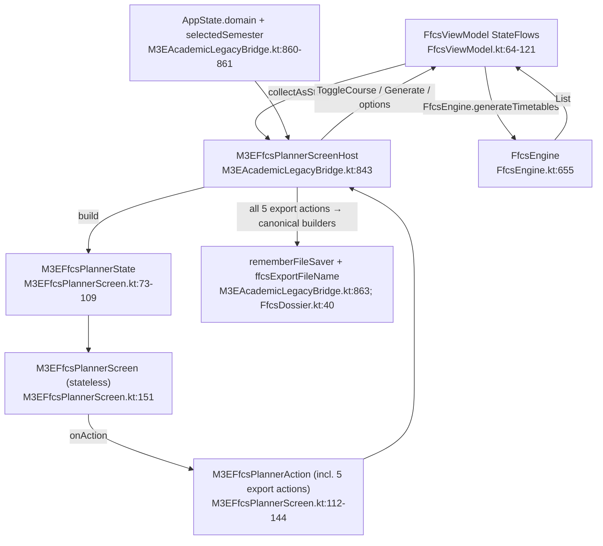
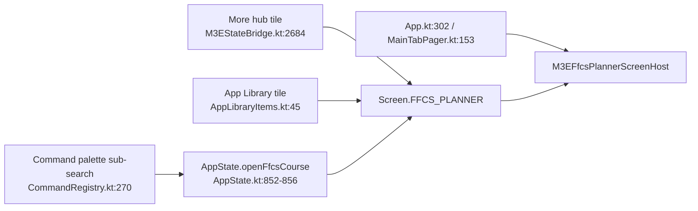

# FFCS Planner UI and state wiring

> **In one line:** the view model is the **order pad**, the host is the **waiter** who copies it onto the screen's **menu card**, taps come back as **order tickets** (actions), and the app's signposts (navigation and deep links) all point to one screen — `Screen.FFCS_PLANNER`.

## Plain English before technical

Think of a small restaurant.

- The **order pad** (`FfcsViewModel`) is the only place that remembers what the customer picked. It is a Kotlin `object`, so there is exactly one pad for the whole app.
- The **menu card** (`M3EFfcsPlannerScreen`) is deliberately blank inside: it does not remember anything. It shows whatever it is handed and prints an **order ticket** (an `M3EFfcsPlannerAction`) for every tap.
- The **waiter** (`M3EFfcsPlannerScreenHost`) shuttles between them: it reads the pad, converts values into card-friendly text, and carries tickets back to the pad or to a file saver.
- The **kitchen** (`FfcsEngine`) only starts when the waiter hands over the Generate ticket.
- The **signposts** (App navigation, App Library tiles, the More hub, the command palette) are different doors into the same dining room.

Two analogies matter for the code below: a `StateFlow` is a **conveyor belt** — you read its current value and it keeps delivering new ones; a stateless screen is a **photocopy** — change the original (state) and you get a new copy, but the copy never edits itself.

> **Warning**
> This page documents the **running** app. The older `FfcsPlannerScreen.kt` exists in the source tree but has no callers, and the ported `ffcs.planner` library types are not yet the ones the running UI uses. Both are called out honestly below.

## Vocabulary first

Read these before the code. Every term below is used with exactly this meaning on this page.

| Term | Meaning here | Real anchor |
|---|---|---|
| `StateFlow` | A readable stream holding one current value; the host reads it with `collectAsState()`. | `FfcsViewModel.kt:64-121` |
| View model | The single owner of planner state; an `object`, not a per-screen instance. | `FfcsViewModel.kt:60` |
| Action / intent | A sealed-interface value describing a user tap, sent from screen to host. | `M3EFfcsPlannerScreen.kt:112-144` |
| Stateless screen | A `@Composable` taking `state` plus `onAction`, holding no product state. | `M3EFfcsPlannerScreen.kt:150-155` |
| Host | The stateful composable that collects flows, builds state, writes exports and handles side effects. | `M3EAcademicLegacyBridge.kt:843-1183` |
| Export card | One full-width RESULTS-tab card that emits an export action; the host calls a canonical builder and saves the bytes/string. | `M3EFfcsPlannerScreen.kt:324-454`; `M3EAcademicLegacyBridge.kt:1000-1121` |
| Offering | One concrete choice for a course (faculty + slot + room), keyed by `offeringKey()`. | `FfcsModels.kt:5-16` |
| Variant | One complete clash-free timetable returned by the engine. | `FfcsViewModel.kt:79-80` |
| Lock | The student's "only these offerings" note for a course code. | `FfcsViewModel.kt:76-77,176-182` |
| Tab | One of the M3E screen's three views: `COURSES`, `TIMETABLE`, `RESULTS`. | `M3EFfcsPlannerScreen.kt:53-55` |
| Deep link | An `amazecc://…` URI parsed by `AppState` into a `DeepLinkRoute`. | `AppState.kt:1280-1286,1342-1361` |
| Adapter (planned) | Future code converting canonical `ffcs.planner` types to the legacy `ffcs` types the UI currently uses. | `FfcsPlannerModels.kt:22-26` |

## What → why → how

**What.** One singleton view model owns thirteen flows. A stateful host maps them into one immutable `M3EFfcsPlannerState` and renders one stateless screen. Every tap travels back as an `M3EFfcsPlannerAction`; the host decides whether the ticket means local UI state, a view-model call, or a file write.

**Why.** Separating state from rendering makes the card previewable (the file ships two `@Preview` functions at `M3EFfcsPlannerScreen.kt:735-745`) and keeps file/network/navigation side effects in one place. The cost is indirection: to answer "why does the screen show X?" you must look at the host's mapping, not just the screen.

**How.** Read the state board, then the ticket table, then the host, then the doors into the screen.

---

## The state board — every flow in `FfcsViewModel`

`FfcsViewModel` is an `object` (`FfcsViewModel.kt:60`) with a single `CoroutineScope(Dispatchers.Default + SupervisorJob())` (`:62`). Private flows are the pad's notes; public `asStateFlow()` views are what the waiter may read.

| Flow (private → public) | Type | Exposed? | What it carries | Source |
|---|---|---|---|---|
| `_allCourses` | `MutableStateFlow<List<ParsedCourse>>` | **No** — internal only | The processed catalog before grouping | `FfcsViewModel.kt:64` |
| `_courseOfferings` → `courseOfferings` | `List<Pair<String, List<CourseOffering>>>` | Yes | Course code → its concrete offerings | `FfcsViewModel.kt:66-67` |
| `_selectedCodes` → `selectedCodes` | `Set<String>` | Yes | Codes the student selected | `FfcsViewModel.kt:69-70` |
| `_locks` → `locks` | `List<CourseLock>` | Yes | Allowed offering keys per code | `FfcsViewModel.kt:76-77` |
| `_generatedTimetables` → `generatedTimetables` | `List<TimetableState>` | Yes | Ranked clash-free variants | `FfcsViewModel.kt:79-80` |
| `_isGenerating` → `isGenerating` | `Boolean` | Yes | Busy flag for the Generate card | `FfcsViewModel.kt:82-83` |
| `_errorMsg` → `errorMsg` | `String?` | Yes | Exception text, not a typed code | `FfcsViewModel.kt:85-86` |
| `_isLoading` → `isLoading` | `Boolean` | Yes | Catalog load spinner | `FfcsViewModel.kt:88-89` |
| `_blockedSlots` → `blockedSlots` | `Set<String>` | Yes | "day+slot" keys the student blocked | `FfcsViewModel.kt:91-92` |
| `_uniqueFaculty` | `Boolean` | **No** | Legacy modal preference | `FfcsViewModel.kt:94` |
| `_morningPreference` | `Boolean` | **No** | Legacy modal preference | `FfcsViewModel.kt:97` |
| `_maxResults` | `Int` | **No** | Result cap, coerced to `1..500` | `FfcsViewModel.kt:100,261-263` |
| `_generateOptions` → `generateOptions` | `FfcsEngine.GenerateOptions` | Yes | Close Gaps / Late Start / Early Finish | `FfcsViewModel.kt:103-104` |

The three unexposed preference flows are only written by `setUniqueFaculty` / `setMorningPreference` / `setMaxResults` (`:253-263`) and read inside `generate()` (`:412-415`). They are used by the **legacy** generator modal, not by the M3E filter chips (which go through `generateOptions`).

### The two ways in — catalog loading

```kotlin
// FfcsViewModel.kt:123-135 — the CSV fallback, annotated
fun initFromCsv() {
    scope.launch {                                        // Off the UI thread (scope at line 62).
        _isLoading.value = true                           // The card shows "Loading course catalog...".
        try {
            val csvText = FfcsReportData.CSV_DATA         // Embedded static CSV, no network.
            val parsed = FfcsCourseProcessor.parseFFCSCSV(csvText)   // Rows → ParsedCourse.
            applyProcessedCourses(FfcsCourseProcessor.processCourses(parsed)) // Group + publish.
        } catch (e: Exception) {
            _errorMsg.value = "Failed to load courses: ${e.message}" // Honest text, no fake rows.
        }
        _isLoading.value = false
    }
}
```

```kotlin
// M3EAcademicLegacyBridge.kt:874-883 — the host chooses the source
LaunchedEffect(Unit) {
    if (offerings.isEmpty()) {
        // Prefer the real domain academic snapshot (the "modern bridge" data source);
        // fall back to the static CSV only when nothing is synced yet.
        val domainCourses = domain.academics.semesters[selectedSemId]?.courses?.values
            ?.mapNotNull(::domainCourseToParsed)?.takeIf { it.isNotEmpty() }
        if (domainCourses != null) FfcsViewModel.initFromCourses(domainCourses)
        else FfcsViewModel.initFromCsv()
    }
}
```

Both paths end at `applyProcessedCourses` (`FfcsViewModel.kt:153-185`), which publishes offerings and creates **one `CourseLock` per course with `allowedOfferings = emptyList()`** (`:176-182`). An empty list means "unrestricted" — locks are opt-in.

```kotlin
// M3EAcademicLegacyBridge.kt:1189-1200 — domain course → planner catalog row
private fun domainCourseToParsed(c: com.amazecc.app.shared.domain.Course): ParsedCourse? {
    val slot = c.slots.joinToString("+").trim().takeIf { it.isNotBlank() } ?: return null
    return ParsedCourse(
        code = c.code,
        title = c.title,
        type = c.type.ifBlank { "Theory" },
        credits = c.credits ?: "3",
        room = c.venue.orEmpty(),
        slot = slot,
        faculty = c.faculty.orEmpty()
    )
}
```

A domain course with no parseable slot is **dropped** (`:1190`), and the planner works purely on `'+'`-joined slot strings.

## Tickets — every action the M3E screen can emit

The screen declares a sealed interface of intents (`M3EFfcsPlannerScreen.kt:112-144`; the D-184 ranking, faculty-priority, blocked-slot and drop-retry actions are omitted from this excerpt and live at `:130-143` in the source):

```kotlin
sealed interface M3EFfcsPlannerAction {
    data class SelectTab(val tab: M3EFfcsTab) : M3EFfcsPlannerAction
    data class SearchQueryChanged(val query: String) : M3EFfcsPlannerAction
    data class ToggleCourse(val code: String) : M3EFfcsPlannerAction
    data object Generate : M3EFfcsPlannerAction
    data class SelectResult(val id: String) : M3EFfcsPlannerAction
    data class SetCloseGaps(val enabled: Boolean) : M3EFfcsPlannerAction
    data class SetLateStart(val enabled: Boolean) : M3EFfcsPlannerAction
    data class SetEarlyFinish(val enabled: Boolean) : M3EFfcsPlannerAction
    data class SetResultsSearchQuery(val query: String) : M3EFfcsPlannerAction
    data object ExportIcs : M3EFfcsPlannerAction
    data object ExportHtmlDossier : M3EFfcsPlannerAction
    // ── D-185 ──
    data object ExportPdf : M3EFfcsPlannerAction
    data object ExportJson : M3EFfcsPlannerAction
    data object ExportClashReport : M3EFfcsPlannerAction
    data object Refresh : M3EFfcsPlannerAction
    data object Back : M3EFfcsPlannerAction
}
```

The host's `when (action)` block (`M3EAcademicLegacyBridge.kt:987-1178`) is the **routing table**. Each ticket below has exactly one destination (the D-184 capability actions are routed in the same block at `:1122-1170`):

| Ticket | Destination | Real source |
|---|---|---|
| `SelectTab` | Host-local `activeTab` | `M3EAcademicLegacyBridge.kt:988` |
| `SearchQueryChanged` | Host-local `searchQuery` | `:989` |
| `ToggleCourse` | `FfcsViewModel.toggleCourse` | `:990`, VM at `:187` |
| `Generate` | Switch to `RESULTS`, then `FfcsViewModel.generate()` | `:991-994` |
| `SelectResult` | Host-local `selectedResultId` | `:995` |
| `SetCloseGaps` / `SetLateStart` / `SetEarlyFinish` | `FfcsViewModel` option setters | `:996-998`, VM at `:265-275` |
| `SetResultsSearchQuery` | Host-local `resultsSearchQuery` | `:999` |
| `ExportIcs` | `FfcsViewModel.exportIcs()` → `saveFile` (fixed `amazecc-ffcs.ics`) | `:1000-1013`, VM at `:625-627` |
| `ExportHtmlDossier` | `buildFfcsDossierHtml` / `buildSimpleHtml` → `saveFile` | `:1014-1047` |
| `ExportPdf` | `buildFfcsPdf(generated, "FFCS Timetables")` → `saveFile` | `:1048-1065` |
| `ExportJson` | `buildFfcsJson(generated)` → `saveFile` | `:1066-1083` |
| `ExportClashReport` | `FfcsClashDeriver.derive(addedCourses)` → `buildFfcsClashReport` → `saveFile` | `:1084-1121` |
| `Refresh` | Re-run source selection | `:1171-1176` |
| `Back` | `backToHub()` | `:1177`, helper at `:90` |

`SelectTab`, `SelectResult`, the two search fields and `exportNotice` never reach the view model: they are **pure UI state** held in `remember { mutableStateOf(...) }` at `M3EAcademicLegacyBridge.kt:865-872`. That is why rotating or leaving the screen loses the active tab but keeps selected courses. The export notice is written only from a real save outcome (`M3EAcademicLegacyBridge.kt:1000-1121`), never pre-announced.

### Generation and export, precisely

```kotlin
// FfcsViewModel.kt:589-608 — snapshot before launch
fun generate() {
    val selected = _selectedCodes.value
    if (selected.isEmpty()) {
        _errorMsg.value = "Select at least one course to generate."
        return
    }
    val locksSnapshot = _locks.value
    val blockedSnapshot = _blockedSlots.value
    val maxResultsSnapshot = _maxResults.value
    val uniqueFacultySnapshot = _uniqueFaculty.value
    val morningPrefSnapshot = _morningPreference.value
    val allCoursesSnapshot = _allCourses.value

    _isGenerating.value = true
    _errorMsg.value = null
    _generatedTimetables.value = emptyList()

    scope.launch {
```

The snapshot matters: the coroutine works with a consistent view even if the user taps again. A course whose locks leave zero offerings aborts the whole run with an exception string (`FfcsViewModel.kt:423-445`); there is no drop ladder in this path.

```kotlin
// FfcsViewModel.kt:625-627 — ICS export
fun exportIcs(): String? =
    FfcsEngine.buildFfcsIcs(_generatedTimetables.value.firstOrNull()?.courses ?: emptyList())
```

```kotlin
// FfcsEngine.kt:949-1008 — abridged from the real builder
fun buildFfcsIcs(courses: List<AddedCourse>): String? {
    if (courses.isEmpty()) return null
    // ... one VEVENT per unique class period ...
    if (events.isEmpty()) return null
    return listOf("BEGIN:VCALENDAR", "VERSION:2.0", "PRODID:-//AmazeCC//FFCS Timetable//EN")
        .plus(events).plus("END:VCALENDAR").joinToString("\r\n")
}
```

> **Note**
> Export asymmetry (still true after D-185): ICS always exports the **first** generated timetable (`FfcsViewModel.kt:625-627`), while the HTML dossier prefers the **selected** variant then falls back to the first (`M3EAcademicLegacyBridge.kt:1016-1020`). Selecting result #3 and tapping "Export ICS" still exports #1. The three D-185 cards do **not** share that rule: PDF and JSON export **all** generated timetables, and the clash report derives from the student's **selected offerings**, not from any generated variant.

### The five export cards, precisely

All five cards live in the RESULTS tab (`M3EFfcsPlannerScreen.kt:324-454`) and are handled by the host (`M3EAcademicLegacyBridge.kt:1000-1121`). Every one saves through `rememberFileSaver` (`:863`) and writes `exportNotice` only from a real outcome (saved vs. could-not-save). The four dated exports name their file with `ffcsExportFileName(format, Clock.System.now().toEpochMilliseconds())` (`FfcsDossier.kt:40-51`, called at `M3EAcademicLegacyBridge.kt:1036-1039,1054-1057,1072-1075,1110-1113`); ICS keeps the fixed `amazecc-ffcs.ics` name (`:1006`).

| Card (action) | Canonical builder | Real source | What it actually exports |
|---|---|---|---|
| Export ICS (`ExportIcs`) | `FfcsEngine.buildFfcsIcs` → `String?` | `FfcsEngine.kt:953-1008`; host at `M3EAcademicLegacyBridge.kt:1000-1013` | The **first** generated timetable only; empty → "No clash-free timetable is available…" notice |
| Export HTML dossier (`ExportHtmlDossier`) | `buildFfcsDossierHtml` → `String` | `FfcsDossier.kt:16-31`; host at `:1014-1047` | The selected generated variant, else the first; with no timetable, an honest selected-course `buildSimpleHtml` fallback (`HtmlExport.kt:56`) |
| Export PDF (`ExportPdf`) | `buildFfcsPdf(generated, "FFCS Timetables")` → `ByteArray` | `FfcsExportPdf.kt:82-83`; host at `:1048-1065` | **All** generated timetables; none → "generate one" notice |
| Export JSON (`ExportJson`) | `buildFfcsJson(generated)` → `String` | `FfcsExportJson.kt:95`; host at `:1066-1083` | **All** generated timetables; none → "generate one" notice |
| Export clash report (`ExportClashReport`) | `buildFfcsClashReport(FfcsClashDeriver.derive(addedCourses))` → `String` | `FfcsClashDeriver.kt:24-80`, `FfcsExportClashReport.kt:120`; host at `:1084-1121` | Real overlaps among the user's **selected offerings** only |

`FfcsClashDeriver` is a pure deriver (`FfcsClashDeriver.kt:3-23`): it expands each `AddedCourse`'s slots through `FfcsSlotSchema.splitSlots` / `periodsForSlot` (`FfcsSlotSchema.kt:86,124`) and keeps only pairs that pass `periodsOverlap` (`:152` — same day **and** open-interval intersection, so back-to-back classes never clash). No generated timetable is needed and no clash is fabricated: with no overlaps the builder honestly prints "No clashes - all courses fit" (`FfcsClashDeriver.kt:8-10`).

## The host builds the card — state projection

```kotlin
// M3EAcademicLegacyBridge.kt:960-986 — abridged; immutable state handed to the stateless screen
M3EFfcsPlannerScreen(
    state = M3EFfcsPlannerState(
        activeTab = activeTab,
        courses = courses,
        filteredCourses = filtered,
        searchQuery = searchQuery,
        selectedCount = selectedCodes.size,
        results = results,
        selectedResultId = selectedResultId,
        isGenerating = isGenerating,
        errorMessage = error,
        isLoading = isLoading,
        closeGaps = generateOptions.closeGaps,
        lateStart = generateOptions.lateStart,
        earlyFinish = generateOptions.earlyFinish,
        resultsSearchQuery = resultsSearchQuery,
        exportNotice = exportNotice
    ),
    onAction = { action -> /* routing table above */ },
```

The three types the screen consumes are all `@Immutable` data classes: `M3EFfcsCourse` (`M3EFfcsPlannerScreen.kt:59-65`), `M3EFfcsResult` (`:69`) and `M3EFfcsPlannerState` (`:73-109`). The result summary string is built by the host, not the engine:

```kotlin
// M3EAcademicLegacyBridge.kt:902-917 — TimetableState → display card
val results = remember(generated, resultsSearchQuery) {
    generated
        .map { timetable ->
            M3EFfcsResult(
                id = timetable.id,
                name = timetable.name,
                summary = "${timetable.metrics.halfDays} half-days · ${timetable.metrics.gaps} gaps · ${timetable.courses.size} courses"
            )
        }
        // TimetableState has no summary; search the mapped variants that the UI actually shows.
        .filter {
            resultsSearchQuery.isBlank() ||
                it.name.contains(resultsSearchQuery, ignoreCase = true) ||
                it.summary.contains(resultsSearchQuery, ignoreCase = true)
        }
}
```

The whole loop in one picture:



## The three tabs

The tab enum is `M3EFfcsTab` with labels `"Courses"`, `"Timetable"`, `"Results"` (`M3EFfcsPlannerScreen.kt:53-55`), rendered as an `M3EConnectedButtonGroup` at `:183-190`.

| Tab | What the M3E screen actually renders | Real source |
|---|---|---|
| `COURSES` | Selected-count banner, always-visible search box, three filter chips, then a list of `M3ESurfaceCard` course rows; toggling a row emits `ToggleCourse`. | `M3EFfcsPlannerScreen.kt:193-277`; chips at `:504-540` |
| `TIMETABLE` | **A text hint only** — "Select courses, then generate to see ranked clash-free grids here." No grid composable is called. | `M3EFfcsPlannerScreen.kt:278-291` |
| `RESULTS` | Generate card, drop-retry controls, variant search, **five full-width export cards** (ICS, HTML dossier, PDF, JSON, clash report), optional `exportNotice`, error card, and the mapped result list. | `M3EFfcsPlannerScreen.kt:292-494`; export cards at `:324-454` |

The Courses tab's search filters **code and title only** (`M3EAcademicLegacyBridge.kt:896-901`) even though its placeholder promises "Search code, title or faculty" (`M3EFfcsPlannerScreen.kt:209`). The legacy screen's filter was also code/title only (`FfcsPlannerScreen.kt:191-197`).

### The grid that exists, but this screen never shows

`FfcsTimetableGrid` is a real, interactive week grid (`FfcsTimetableGrid.kt:51-58`): days come from `SlotMap.weekdays`, rows from the distinct slot bands (`:39-49`), each cell can be tapped to block its slots (`:150-152`), and a four-item legend is drawn at `:183-195`.

```kotlin
// FfcsTimetableGrid.kt:52-57 — note the default
fun FfcsTimetableGrid(
    courses: List<AddedCourse>,
    blockedSlots: Set<String>,
    onToggleBlockSlots: (List<String>) -> Unit,
    selectedGapDetails: List<GapDetail>? = null,   // default: no gap highlighting
    modifier: Modifier = Modifier
)
```

Gap colouring is driven by `selectedGapDetails` (`:121-124` and `:135`), but **both call sites omit it** (`FfcsPlannerScreen.kt:423-428` and `:519-524`), so `isGap` is always false in the running app. The grid is a dead surface for the M3E screen — it is only referenced by the legacy `FfcsPlannerScreen`, which itself has no callers (see below).

## Doors into the planner — navigation map

Every door leads to the same `Screen.FFCS_PLANNER` enum value (`AppState.kt:75`) and the same host composable.

| Door | Code path | What it does |
|---|---|---|
| Normal screen route | `App.kt:302` | `Screen.FFCS_PLANNER -> M3EFfcsPlannerScreenHost()` |
| Pinned bottom-bar tab | `MainTabPager.kt:153` | Same host inside the horizontal pager |
| More hub tile | `M3EStateModels.kt:1630` declares `M3ESubScreen.FFCS_PLANNER` ("Academics"); `M3EStateBridge.kt:2684` maps it to `AppState.navigateTo(Screen.FFCS_PLANNER)` | Opens the planner from the M3E hub (`M3EMoreHubScreen.kt:420` supplies the icon) |
| App Library tile | `AppLibraryItems.kt:45` — "FFCS Planner", group "Academics", `targetScreen = Screen.FFCS_PLANNER`; `executeAppLibraryItem` at `:84-90` calls `AppState.navigateTo` | Same destination from the library sheet; the list is also fed into the command palette (`CommandRegistry.kt:89-97`) |
| Command palette course search | `CommandRegistry.kt:243-277` — `SubSearchSpec("ffcs", …)` filters the static CSV and each result's `onSelect` calls `AppState.openFfcsCourse(c.code)` at `:270` | Sets a course target **and** navigates |
| Header / bottom bar | `HeaderConfigs.kt:105-106` (title "FFCS Planner"); `BottomNavigationBar.kt:107` and `M3ENavigationBar.kt:276` map FFCS to a `ViewTimeline` icon | Chrome, not navigation logic |



### Deep links and the target that nobody reads

`AppState` has a full deep-link parser (`AppState.kt:1280-1361`): `amazecc://share?code=…`, `amazecc://tab?tab=…`, `amazecc://tab?open=…`, `amazecc://open?open=…`, `amazecc://geotag` and `amazecc://auth-callback/…`. `applyDeepLink` (`:1300-1328`) resolves `open=` to a screen via `screenFromTabParam` (`:1364-1385`).

Two honest facts about FFCS specifically:

1. **`screenFromTabParam` has no FFCS entry.** Its map covers home, attendance, academics, tools, more, friend-finder, geotag and others, but returns `null` for `"ffcs"` (`AppState.kt:1384`). There is no `amazecc://tab?tab=ffcs` route into the planner today. The documented "deep-link path" is the in-app `openFfcsCourse` call, not a URI.
2. **`ffcsCourseTarget` is set but never read.** `openFfcsCourse` clears targets, writes the code and navigates (`AppState.kt:852-856`), and `clearTargets` resets it (`:817`) — but no screen or host collects `ffcsCourseTarget` (`:798-799`). A course chosen in the command palette opens the planner with a **generic course list**, not a preselected course. The `localSearchScreens` set includes `Screen.FFCS_PLANNER` (`AppState.kt:406-412`), so the header search icon bumps `localSearchTick` (`:418`), but only the **legacy** screen reads that tick (`FfcsPlannerScreen.kt:178-189`); the M3E screen has its own always-visible field and ignores it.

## Honest gotchas

| Surface | What the code really does | Source |
|---|---|---|
| Legacy `FfcsPlannerScreen()` | Declared at `FfcsPlannerScreen.kt:52` with **no callers** — the app routes to the M3E host instead. | `FfcsPlannerScreen.kt:52`; `App.kt:302`, `MainTabPager.kt:153` |
| "Save This Timetable" | The legacy screen's button **overwrites attendance** by calling `AppState.updateAttendance(AttendanceRes(...))` built from the generated courses — it does not save an FFCS plan. | `FfcsPlannerScreen.kt:528-548` |
| M3E TIMETABLE tab | A text hint, not a grid. | `M3EFfcsPlannerScreen.kt:278-291` |
| Gap highlighting | `selectedGapDetails` defaults to `null` and no caller supplies it. | `FfcsTimetableGrid.kt:56,121-124`; `FfcsPlannerScreen.kt:423,519` |
| `ffcsCourseTarget` | Set by `openFfcsCourse` and cleared by `clearTargets`, never consumed. | `AppState.kt:798-799,817,852-856` |
| `localSearchTick` for FFCS | Registered as a local-search screen, but only the dead legacy screen reads the tick. | `AppState.kt:406-412,418`; `FfcsPlannerScreen.kt:178-189` |
| Preview data | `mockFfcsState()` invents two courses and one result for `@Preview` only — never shown at runtime. | `M3EFfcsPlannerScreen.kt:722-745` |
| Legacy-only setters | `setUniqueFaculty`, `setMorningPreference`, `setMaxResults` are driven by the dead screen's `GeneratorModal`, not by the M3E chips. | `FfcsViewModel.kt:253-263`; `FfcsPlannerScreen.kt:613-731` |
| Error reporting | `_errorMsg` holds a raw exception message, not one of the ported typed failure codes. | `FfcsViewModel.kt:85-86,574-587` |

## Wave 3 — the wiring plan (PLAN, not shipped)

The drift register's note records the boundary: wave 1 (D-171…D-176) ported the canonical models, slot schema/clash, ranking, faculty priority, drop ladder and CSV/pairing as libraries marked **"PORTED – not integrated"**; "Wiring those libraries into `FfcsEngine` / `FfcsViewModel` / the M3E screen is wave 3" (`DOCS_DRIFT_REGISTER.md:5-7`). The canonical types themselves say the same thing:

```kotlin
// FfcsPlannerModels.kt:22-26 — abridged from the package-seam comment (opening /** omitted)
 * IMPORTANT — package seam: the legacy `com.amazecc.app.shared.ffcs` package
 * still owns the old lowercase ParsedCourse / AddedCourse / TimetableState /
 * CourseLock / TimetableMetrics names, and other waves still consume them.
 * These canonical types therefore live in the `.planner` sub-package so both
 * sets can coexist. Later adapter waves bridge the two; do not merge them here.
```

Today the canonical `.planner` types are imported **inside the library files** (for example `FfcsCsv.kt:3`, `FfcsStorage.kt:3-6` with aliases, `FfcsRanking.kt:3-7`, `FfcsMetrics.kt:10-11`), but `FfcsViewModel`, `FfcsEngine` and the M3E host still use the legacy lowercase `ffcs` types (`FfcsViewModel.kt:4`, `FfcsTimetableGrid.kt:1`). **No UI adapter exists yet.**

The planned placement, restated from `architecture.md:165-178`:

| Planned adapter | From (wave-1 library) | Into (running path) | Effect when shipped |
|---|---|---|---|
| Model adapter | `ffcs/planner/FfcsPlannerModels.kt:192-216` (UPPERCASE `ParsedCourse`, `offeringId()`) | `FfcsViewModel.initFromCourses` / `applyProcessedCourses` (`:141-185`) | Real campus courses carry `CLASS_ID` / `ERP_ID` identity into the host's cards |
| Clash + ranking adapter | `FfcsSlotSchema.kt`, `FfcsRanking.kt:3-7` | `FfcsEngine` (`:230-252` private slot/period check, `:941-946` comparator) | Strict interval clash and positional factor weights replace the local copies |
| Drop/failure adapter | `FfcsDropPolicy.kt`, `FfcsGenerationRun.kt` | Between `FfcsViewModel.generate()` (`:589-608`) and the host's error card | A failed course drops per policy and the screen shows a typed reason instead of an exception string |
| Preference adapter | `FfcsGeneratorSessionPrefs.kt:3-10`, `FfcsSettings.kt:3-6` | `FfcsViewModel.generateOptions` (`:103-104`) and the M3E filter chips | Eight-factor ranking choices become reachable from the UI |
| Grid/gap adapter | `ffcs/planner/GapDetail` (`FfcsPlannerModels.kt:255-266`) | `FfcsTimetableGrid.selectedGapDetails` (`:56`) via a real host call site | The TIMETABLE tab can finally show a grid with highlighted gaps |

> **Warning**
> The table above is a **plan**, not a description of shipped behaviour. Until wave 3 lands, treat the running app as the legacy path documented in the earlier sections of this page.

## Where to next

- [architecture.md](./architecture.md) — the end-to-end data flow and the wave-1-to-wave-3 boundary table this page builds on.
- [vocabulary.md](./vocabulary.md) — definitions of "variant", "lock", "offering", "ranking factor" and "drop ladder".
- [generation-engine.md](./generation-engine.md) — what `FfcsEngine.generateTimetables` does after `generate()` calls it.
- [data-model.md](./data-model.md) — the exact fields on `ParsedCourse`, `TimetableState` and both `GapDetail` types.
- [index.md](./index.md) — the overview, including the `openFfcsCourse` entry-point description that this page qualifies.
- [DOCS_DRIFT_REGISTER.md](./DOCS_DRIFT_REGISTER.md) — the authoritative DOC-ID and wave status register.
