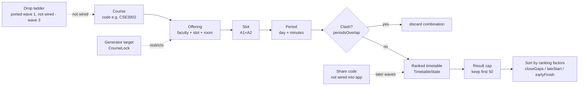

# FFCS planner words, explained once

> **In one line:** FFCS is when you choose your own courses and professors; the planner tries every timetable that doesn't double-book you, sorts the best ones to the top, and shows you a short list — this page explains every word it uses.

## Why this page exists

Open the FFCS Planner screen and you are immediately met with words like *offering*, *slot*, *clash* and *generate*. If you don't know what they mean, every later page sounds like a foreign language. Nobody memorises these words — they become obvious once you see where they come from in the code. This page defines each one the first time it appears.

## The idea, in plain words

Think of your week as a blank wall calendar and every class as a sticker with a day and a time printed on it. You cannot put two stickers on the same square — that is a **clash**. A **course** is the subject you want (one sticker shape). An **offering** is one actual sticker: this professor, this time, this room. A **slot** is the "when" printed on the sticker, and a **period** is the real block of minutes that slot turns into.

The planner's job is to lay out a complete set of stickers for all your chosen courses without any overlap, then line up the finished calendars from best to worst and give you the top few. That is the whole story. Everything below is just naming the pieces.

<Note>
Read this page top to bottom. Each definition uses only words explained earlier, so the order matters.
</Note>

## 1. FFCS

**FFCS** stands for *Fully Free Credit Semester* — the name used across the AmazeCC project for a system where a student builds their own timetable instead of being assigned one. "Free" here means you choose the course, the professor and the time block.

The Kotlin source shortens it to `Ffcs` in names; it does not spell the expansion out in code. The planner is a real destination in the app:

File: `shared/src/commonMain/kotlin/com/amazecc/app/shared/state/AppState.kt:65-82`

```kotlin
enum class Screen { SPLASH,
    LOGIN, ONBOARDING, HOME, ATTENDANCE, ACADEMICS, PAYMENTS, LIBRARIES, HOSTEL, CABSHARE, TRANSPORT, MORE, PROFILE,
    EVENTS, QBANK, SOCIAL,
    FRIEND_FINDER,
    GEOTAG_PHOTO,
    FFCS_PLANNER, FREE_CLASSROOMS, CALENDAR, GRADES, GPA_PREDICTOR,
```

| Line | What it actually does |
|---|---|
| `FFCS_PLANNER, FREE_CLASSROOMS, ...` | Registers the planner as a screen the app can navigate to (AppState.kt:72). |

The same file also lets another screen prefill a course on the planner and then open it (AppState.kt:794-796, 849-853). `Screen.FFCS_PLANNER` is listed among screens with their own local search box at AppState.kt:403-409.

## 2. Course

A **course** is the subject the student wants, identified by a code such as `CSE3002`. It is an *idea*, not a particular meeting: many different professors and times can offer the same course.

File: `shared/src/commonMain/kotlin/com/amazecc/app/shared/ffcs/FfcsModels.kt:5-16`

```kotlin
@Immutable
data class ParsedCourse(
    val code: String,
    val title: String,
    val type: String,
    val credits: String,
    val room: String,
    val slot: String,
    val faculty: String
) {
    fun offeringKey(): String = "$faculty|$slot|$room"
}
```

| Line | What it actually does |
|---|---|
| `val code: String` | The course code — the identity of the subject (FfcsModels.kt:7). |
| `val title: String` | Human-readable name (`:8`). |
| `offeringKey()` | Builds the identity of one specific instance of the course (`:15`) — explained under *offering* below. |

The catalog is grouped by course code when it loads: `processed.groupBy { it.code.uppercase() }` in `FfcsViewModel.kt:85-102`. The detail panel in the UI shows `"${course.code} · ${course.credits} cr"` (`M3EFfcsPlannerScreen.kt:205`).

**Analogy:** a course is the dish on a menu; an offering (next section) is the actual plate the kitchen can serve you.

## 3. Offering

An **offering** is one concrete instance of a course: a particular professor, time and room. The same course can have many offerings.

There are two nearly identical shapes in the code — one used while processing the catalog, one used for the picker:

File: `shared/src/commonMain/kotlin/com/amazecc/app/shared/ffcs/FfcsModels.kt:87-98`

```kotlin
@Immutable
data class CourseOffering(
    val faculty: String,
    val slot: String,
    val room: String,
    val code: String,
    val title: String,
    val type: String,
    val credits: String
) {
    fun toKey(): String = "$faculty|$slot|$room"
}
```

| Line | What it actually does |
|---|---|
| `faculty`, `slot`, `room` | The three fields that make this offering different from its siblings (FfcsModels.kt:89-91). |
| `toKey()` | Builds a text identity from faculty, slot and room (`:97`); `ParsedCourse.offeringKey()` at `:15` builds the same string. |

`FfcsViewModel.applyProcessedCourses` turns every processed row into a `CourseOffering` and groups them under their course code (`FfcsViewModel.kt:85-104`). The screen shows the count as `"${course.offeringCount} offering..."` (`M3EFfcsPlannerScreen.kt:207`).

**Analogy:** if a course is "Introduction to Web", an offering is "Prof Rao, A1+A2, room B-201".

## 4. Slot

A **slot** is a short token string that says *when* a class meets, for example `A1`, `A1+A2` or a lab token such as `L1+L2`. The `+` means "and also this other block".

File: `shared/src/commonMain/kotlin/com/amazecc/app/shared/ffcs/FfcsModels.kt:12`

```kotlin
val slot: String,
```

| Line | What it actually does |
|---|---|
| `val slot: String` | The raw slot token, kept as text (FfcsModels.kt:12). It is not parsed into a time until the engine expands it. |

The engine splits the token on `+`:

File: `shared/src/commonMain/kotlin/com/amazecc/app/shared/ffcs/FfcsEngine.kt:39-53`

```kotlin
fun getPeriodsForSlot(slotStr: String): List<Period> {
    val periods = mutableListOf<Period>()
    val slots = slotStr.split("+").map { it.trim() }.filter { it.isNotEmpty() }
    for (day in SlotMap.days) {
        val dayMap = SlotMap.map[day] ?: emptyMap()
        for (s in slots) {
            val time = dayMap[s] ?: continue
            val parts = time.split("-")
            if (parts.size == 2) {
                periods.add(Period(day, TimeMath.toMinutes(parts[0]), TimeMath.toMinutes(parts[1])))
            }
        }
    }
    return periods
}
```

| Line | What it actually does |
|---|---|
| `slotStr.split("+")` | One slot string can name several blocks (FfcsEngine.kt:41). |
| `SlotMap.map[day]` | Looks the token up per day to find its clock time (`:43-45`). |
| `TimeMath.toMinutes(...)` | Converts `"08:00-08:55"` into numbers the clash check can compare (`:48`). |

**Analogy:** a slot is the "when" label printed on a train ticket — readable shorthand, not the full itinerary.

## 5. Period

A **period** is one concrete occurrence of a slot: a named day plus a start and end time in minutes. A single slot usually becomes several periods across the week.

File: `shared/src/commonMain/kotlin/com/amazecc/app/shared/ffcs/FfcsEngine.kt:16-18`

```kotlin
object FfcsEngine {

    data class Period(val day: String, val startMin: Int, val endMin: Int)
```

| Line | What it actually does |
|---|---|
| `data class Period(...)` | The smallest unit of time the generator compares (FfcsEngine.kt:18). |
| `day`, `startMin`, `endMin` | Day name and minute-of-day bounds; `getPeriodsForSlot` fills these from `SlotMap` (`:39-53`). |

**Analogy:** the slot says "Monday 8 o'clock class"; the period is the actual 08:00–08:55 square on the calendar.

## 6. Clash

A **clash** is what happens when two offerings want the same day and overlapping minutes. A timetable with a clash is impossible to attend.

File: `shared/src/commonMain/kotlin/com/amazecc/app/shared/ffcs/FfcsEngine.kt:55-64`

```kotlin
private fun periodsOverlap(a: List<Period>, b: List<Period>): Boolean {
    for (pa in a) {
        for (pb in b) {
            if (pa.day == pb.day && max(pa.startMin, pb.startMin) < min(pa.endMin, pb.endMin)) {
                return true
            }
        }
    }
    return false
}
```

| Line | What it actually does |
|---|---|
| `pa.day == pb.day` | Two classes on different days can never clash (FfcsEngine.kt:58). |
| `max(start) < min(end)` | Overlap test on the shared minutes (`:58`). Back-to-back classes do **not** overlap. |

The generator accepts a new offering only when `!periodsOverlap(periods, currentPeriods)` (FfcsEngine.kt:139). If no clash-free combination exists at all, the engine throws (`:151-153`).

**Analogy:** two stickers fighting over the same square of the calendar.

## 7. Theory / lab pair

Some courses have two halves: a **theory** component (classroom) and a **lab** component (practical). They may arrive as separate report rows with `L`/`P` suffixed codes, or as embedded types such as `ETH` (embedded theory) and `ELA` (embedded lab). A **theory/lab pair** is the merger of those rows into one selectable offering.

File: `shared/src/commonMain/kotlin/com/amazecc/app/shared/ffcs/FfcsCourseProcessor.kt:42-128` (abridged)

```kotlin
// 1. Identify mergeable base codes (courses that have both L and P suffixes,
//    e.g. CSE1001L and CSE1001P)
...
if (theorySlots.isNotEmpty() && labSlots.isNotEmpty()) {
    // For simplicity in this port, we pair the first available theory with the first available lab
    // from the same faculty (VIT guarantees 1:1 if faculty is same)
    while (theorySlots.isNotEmpty() && labSlots.isNotEmpty()) {
        val t = theorySlots.removeAt(0)
        val l = labSlots.removeAt(0)
        val combinedType = "$tType+$lType"
        val combinedTitle = "${t.title} [Embedded Theory and Lab]"
        val combinedCredits = ((t.credits.toDoubleOrNull() ?: 0.0) + (l.credits.toDoubleOrNull() ?: 0.0)).toString()
        combined.add(
            ParsedCourse(
                code = codeKey,
                title = combinedTitle,
                type = combinedType,
                credits = combinedCredits,
                room = "${t.room} / ${l.room}",
                slot = "${t.slot}+${l.slot}",
                faculty = fac
            )
        )
    }
}
```

| Line | What it actually does |
|---|---|
| `hasL` / `hasP` intersection | Finds base codes that have both halves (FfcsCourseProcessor.kt:43-53). |
| `theorySlots` / `labSlots` | Splits rows by type or code/slot hints (`:81-89`). |
| `removeAt(0)` twice | Pairs the first theory with the first lab of the same faculty (`:91-96`). |
| `slot = "${t.slot}+${l.slot}"` | The merged offering carries both time blocks, so a clash check sees both (`:112`). |

<Warning>
The **running app** still pairs first-to-first (`FfcsCourseProcessor.kt:95-96`). Wave 1 (D-176) ported the canonical, scored pairing as a library — `processCanonicalCourses` in the same file plus `FfcsCsv.kt` — but it is not yet wired into the running app (wave 3). `docs/WEB_PARITY_DRIFT_REGISTER.md:360` records D-176 as `PORTED - not integrated`. Do not describe the runtime behaviour as finished.
</Warning>

## 8. Ranked timetable

A **ranked timetable** is one finished option the generator produced: a set of chosen offerings with no clashes, plus measured quality numbers. "Ranked" means the options come back in an order where the better ones are earlier in the list.

File: `shared/src/commonMain/kotlin/com/amazecc/app/shared/ffcs/FfcsModels.kt:54-76` (abridged)

```kotlin
@Immutable
data class TimetableMetrics(
    val halfDays: Int,
    val gaps: Int,
    ...
    val buildingDashes: Int = 0,
    ...
)

@Immutable
data class TimetableState(
    val id: String,
    val name: String,
    val courses: List<AddedCourse>,
    val metrics: TimetableMetrics = TimetableMetrics(halfDays = 0, gaps = 0),
    val firstStartMin: Int = 0,
    val lastEndMin: Int = 0
)
```

| Line | What it actually does |
|---|---|
| `TimetableMetrics.halfDays` | Number of free half-days — more is better (FfcsModels.kt:56). |
| `TimetableMetrics.gaps` | Empty stretches between classes — fewer is better (`:57`). |
| `TimetableState.courses` | The actual offerings in this option (`:70`). |
| `firstStartMin` / `lastEndMin` | Earliest start and latest end, used by the Late Start / Early Finish preferences (`:72-75`). |

The ordering happens at the end of generation with `sortedWith(...)` in `FfcsEngine.kt:182-187`; the Results tab then renders the list (`M3EFfcsPlannerScreen.kt:333-347`).

**Analogy:** a shortlist of candidate calendars, already sorted with your favourites on top.

## 9. Ranking factor

A **ranking factor** is one preference that changes which ranked timetable comes out on top. It does not change *which* combinations are legal — only their order.

In this Kotlin build there are exactly three, collected into `GenerateOptions`:

File: `shared/src/commonMain/kotlin/com/amazecc/app/shared/ffcs/FfcsEngine.kt:20-30`

```kotlin
data class GenerateOptions(
    val closeGaps: Boolean = false,
    val lateStart: Boolean = false,
    val earlyFinish: Boolean = false
)
```

| Line | What it actually does |
|---|---|
| `closeGaps` | Put timetables with zero gaps first (FfcsEngine.kt:183). |
| `lateStart` | Prefer a later `firstStartMin` (`:185`). |
| `earlyFinish` | Prefer an earlier `lastEndMin` (`:186`). |

They are exposed as three filter chips in the UI (`M3EFfcsPlannerScreen.kt:358-394`), toggled through `setCloseGaps` / `setLateStart` / `setEarlyFinish` (`FfcsViewModel.kt:170-180`), and applied in the comparator:

File: `shared/src/commonMain/kotlin/com/amazecc/app/shared/ffcs/FfcsEngine.kt:182-187`

```kotlin
timetableStates.sortedWith(
    compareByDescending<TimetableState> { if (options.closeGaps) it.metrics.gaps == 0 else false }
        .thenByDescending { (it.metrics.halfDays * 10) + ((20 - it.metrics.gaps) * 5) }
        .thenByDescending { if (options.lateStart) it.firstStartMin else 0 }
        .thenBy { if (options.earlyFinish) it.lastEndMin else Int.MAX_VALUE }
)
```

<Warning>
The web planner ships eight individually switchable factors and six named weight profiles. The **running app** still has only these three booleans with a fixed comparison order. Wave 1 (D-173) ported the full ranking math as `FfcsRanking.kt`, but it is not yet wired into the running app (wave 3); `docs/WEB_PARITY_DRIFT_REGISTER.md:357` records it as `PORTED - not integrated`. Do not call the three runtime chips "the eight factors".
</Warning>

## 10. Faculty priority

**Faculty priority** is a per-course, ordered preference for professors — "I want Prof A for this course, then Prof B". It is *different* from a ranking factor: it changes which offerings are searched first, not how finished timetables are scored.

The **running app** has no ranked faculty list. What the runtime path has is:

- `uniqueFaculty: Boolean` — a switch requiring every chosen offering to have a different professor (`FfcsEngine.kt:81`, enforced at `:123-126`).
- `CourseLock.allowedOfferings` — an exact allow-list of offering keys for a course (`FfcsModels.kt:78-85`, edited by `selectOffering` in `FfcsViewModel.kt:134-148`).

Neither runtime mechanism is a "first choice, second choice" order. Wave 1 (D-174) ported a faculty-priority library — `FfcsFacultyPriority.kt` and `FfcsFacultyRanking.kt` — but it is not yet wired into the running app (wave 3); `docs/WEB_PARITY_DRIFT_REGISTER.md:358` records it as `PORTED - not integrated`.

**Analogy:** an allow-list says "only these professors"; priority says "try this professor first, then that one".

## 11. Generator target

A **generator target** is a course the student insists must remain in the finished plan. In the web planner this is the Target Course Locker: target courses are protected from automatic removal.

The closest Kotlin mechanism is `CourseLock`:

File: `shared/src/commonMain/kotlin/com/amazecc/app/shared/ffcs/FfcsModels.kt:78-85`

```kotlin
@Immutable
data class CourseLock(
    val code: String,
    val title: String,
    val allowedOfferings: List<String> = emptyList()
) {
    val hasLock: Boolean get() = allowedOfferings.isNotEmpty()
}
```

| Line | What it actually does |
|---|---|
| `allowedOfferings` | Restricts the course to exact offering keys built from faculty, slot and room (FfcsModels.kt:82). |
| `hasLock` | True when at least one offering is pinned (`:84`). |

During generation, a locked course is filtered to those keys (`FfcsEngine.kt:97-99`). If that leaves no option for a selected course, generation fails with a named error rather than silently dropping it (`FfcsViewModel.kt:215-228`). The canonical planner model, including target locking, was ported in wave 1 (D-171) at `ffcs/planner/FfcsPlannerModels.kt`; it is not yet wired into the running app (wave 3), and `docs/WEB_PARITY_DRIFT_REGISTER.md:355` records it as `PORTED - not integrated`. The runtime path still uses `CourseLock`.

**Analogy:** pinning the one brick you refuse to build without.

## 12. Result cap

The **result cap** is the maximum number of timetables the generator will keep. It stops a wide-open search from producing thousands of options.

File: `shared/src/commonMain/kotlin/com/amazecc/app/shared/ffcs/FfcsEngine.kt:76-84, 121`

```kotlin
suspend fun generateTimetables(
    optionsPerCourse: List<List<ParsedCourse>>,
    locks: List<CourseLock> = emptyList(),
    blockedSlots: Set<String> = emptySet(),
    maxResults: Int = 50,
    ...
    if (results.size >= maxResults) return
```

| Line | What it actually does |
|---|---|
| `maxResults: Int = 50` | Default cap is fifty (FfcsEngine.kt:80). |
| `if (results.size >= maxResults) return` | The walk stops adding results once the cap is reached (`:121`). |

The view model holds the same number and clamps any caller to a sane range:

File: `shared/src/commonMain/kotlin/com/amazecc/app/shared/state/FfcsViewModel.kt:47, 166-168`

```kotlin
private val _maxResults = MutableStateFlow(50)
...
fun setMaxResults(value: Int) {
    _maxResults.value = value.coerceIn(1, 500)
}
```

**Analogy:** the "showing top 50 results" line on a search page.

## 13. Drop ladder

The **drop ladder** is a retry policy: when nothing fits, the planner removes the least-wanted courses one at a time and tries again, while never removing protected targets.

The **running app** has **no drop ladder wired in**. Instead:

- the engine throws `No conflict-free timetables found. Try removing some constraints.` (`FfcsEngine.kt:151-153`);
- the view model throws `No available offerings for: ... Deselect them or clear their locks/blocks.` (`FfcsViewModel.kt:223-228`).

Wave 1 (D-175) ported the ladder and typed failure codes as libraries — `FfcsDropPolicy.kt` and `FfcsGenerationRun.kt` — but they are not yet wired into the running app (wave 3); `docs/WEB_PARITY_DRIFT_REGISTER.md:359` records D-175 as `PORTED - not integrated`. Do not describe the runtime error messages as a ladder.

**Analogy:** taking one item out of an overfull suitcase and zipping it again, repeating until it closes.

## 14. Share code

A **share code** is a compact string that encodes a whole timetable so a friend can paste it into their planner and import it.

There is **no plan share codec wired into the running app**. The engine exports an RFC 5545 calendar file via `buildFfcsIcs` (`FfcsEngine.kt:190-249`), and the Results tab offers ICS and HTML dossier actions (`M3EFfcsPlannerScreen.kt:257-308`), but the planner does not call anything that encodes a plan into a shareable code. Share-code support is outside the wave-1 library set (D-171..D-176) and belongs to later waves, so do not claim it is shipped. (The social profile codes handled elsewhere in the app are a different feature and are out of scope for this page.)

**Analogy:** a luggage tag with the entire packing list written on it, so someone else can rebuild your bag.

## How the words fit together



## Where to next

- **[FFCS Planner — start here](./index.md)** — the same story told as a guided walk through the code.
- **[Docs drift register](./DOCS_DRIFT_REGISTER.md)** — DOC-001..DOC-007 units and the wave-1-port / wave-3-wiring trail.
